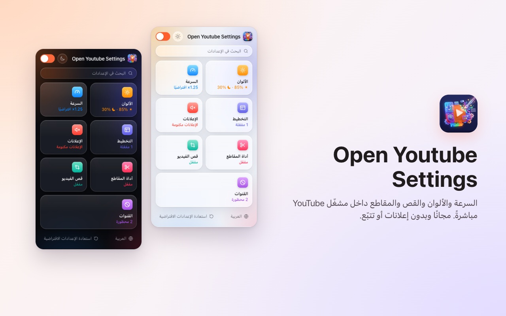
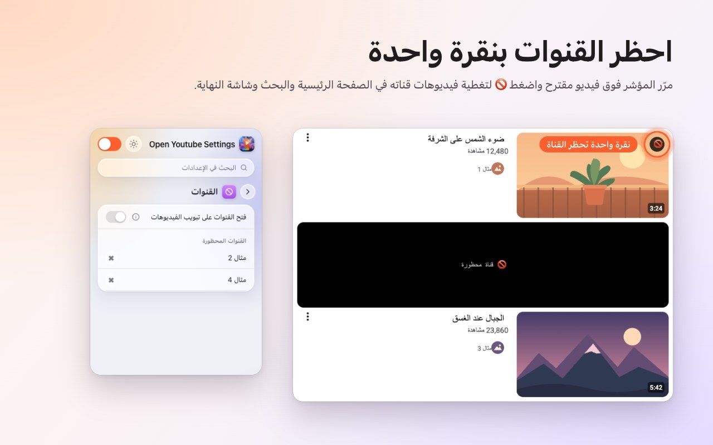
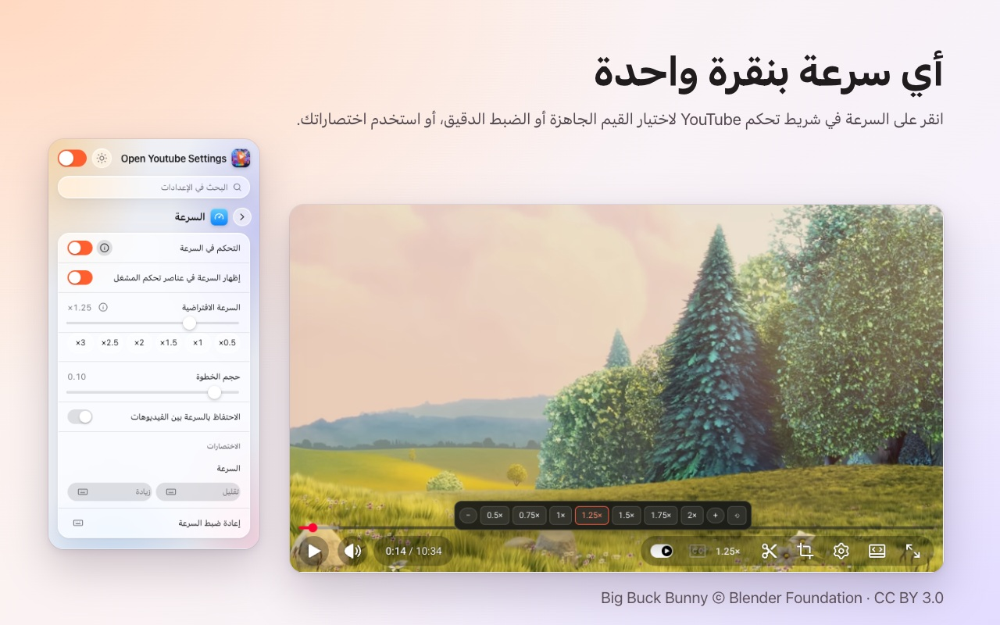
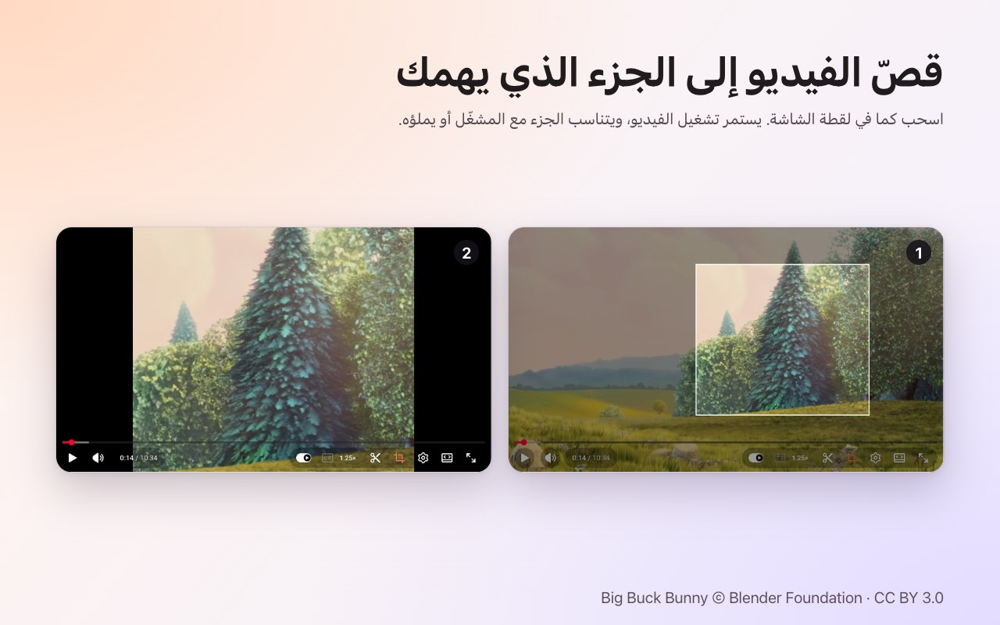
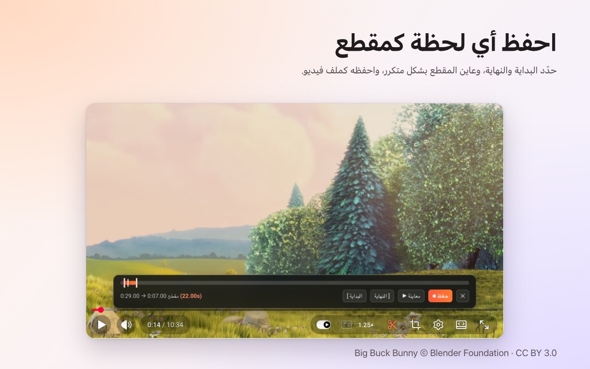

<p align="center">
  
</p>

<h1 align="center">Open Youtube Settings</h1>

<p align="center">
  احظر قنوات YouTube بنقرة واحدة، مع التحكم في السرعة والقص والمقاطع والألوان، مباشرةً في المشغّل.<br>
  إضافة مجانية لمتصفحَي <b>Chrome</b> و<b>Firefox</b>.
</p>

<p align="center">
  ✅ <b>مفتوح المصدر</b> &nbsp;·&nbsp; ✅ <b>واجهة نظيفة</b> &nbsp;·&nbsp; ✅ <b>لا تجمع أي بيانات</b>
</p>

<p align="center">
  <a href="https://chromewebstore.google.com/detail/open-youtube-settings/commphgoijegmlhbkkbgbfbnemihdjod"><b>سوق Chrome الإلكتروني</b></a> ·
  <a href="../../releases/latest">أحدث إصدار</a> ·
  <a href="https://www.youtube.com/watch?v=0iPOj1_EBRU">فيديو تعريفي</a>
</p>

<p align="center"><sub><a href="README.md">English</a> · <a href="README.tr.md">Türkçe</a> · <a href="README.de.md">Deutsch</a> · <a href="README.es.md">Español</a> · <a href="README.fr.md">Français</a> · <a href="README.it.md">Italiano</a> · <a href="README.pt-BR.md">Português (Brasil)</a> · <a href="README.nl.md">Nederlands</a> · <a href="README.pl.md">Polski</a> · <a href="README.ru.md">Русский</a> · <a href="README.uk.md">Українська</a> · <b>العربية</b> · <a href="README.hi.md">हिन्दी</a> · <a href="README.id.md">Bahasa Indonesia</a> · <a href="README.vi.md">Tiếng Việt</a> · <a href="README.th.md">ไทย</a> · <a href="README.ko.md">한국어</a> · <a href="README.ja.md">日本語</a> · <a href="README.zh-CN.md">简体中文</a> · <a href="README.zh-TW.md">繁體中文</a></sub></p>

<p align="center">
  
</p>

## لماذا Open Youtube Settings

- **مفتوح المصدر:** الشيفرة كاملة موجودة هنا على GitHub بترخيص MIT، فيستطيع أي شخص التحقق مما تفعله الإضافة بالضبط.
- **واجهة نظيفة:** نافذة صغيرة وأزرار داخل مشغّل YouTube نفسه. بلا نوافذ منبثقة ولا إعلانات ولا نسخة مدفوعة.
- **لا تجمع أي بيانات:** بلا حساب ولا تحليلات ولا خادم. إعداداتك لا تغادر متصفحك أبدًا.

## الميزات

### احظر القنوات بنقرة واحدة
مرّر المؤشر فوق فيديو مقترح واضغط 🚫. من تلك اللحظة تُغطّى كل فيديوهات تلك القناة: في الصفحة الرئيسية وفي البحث وفي شاشة النهاية. يمكنك إلغاء الحظر في أي وقت من نافذة الإضافة.



### سرعة التشغيل في المشغّل
تظهر السرعة الحالية في شريط تحكم YouTube نفسه. انقر عليها لتختار سرعات جاهزة من 0.5× إلى 2× وخطوات دقيقة، أو استخدم اختصارات لوحة المفاتيح الخاصة بك. حدّد سرعة افتراضية لكل فيديو أو احتفظ بآخر سرعة بين الفيديوهات.



### قص أي منطقة
اضغط زر القص واسحب فوق الفيديو كما لو كنت تلتقط لقطة شاشة. يستمر الفيديو في العمل **ملائمًا** للمشغّل أو **ماليًا** له. اضغط الزر مجددًا لرؤية الفيديو كاملًا. ينتهي القص بانتهاء الفيديو.



### احفظ المقاطع
افتح شريط المقطع، وحدّد البداية والنهاية، وعاين الحلقة، ثم احفظها كملف فيديو. يُسجَّل المقطع في الوقت الفعلي من تشغيلك أنت.



### الألوان والضوء الأزرق
السطوع ومرشّح الضوء الأزرق وعكس الألوان لكل فيديو، مع اختصارات لرفعها أو خفضها. اختر إن كانت المرشّحات تُطبَّق على Shorts أيضًا.


### YouTube أكثر هدوءًا
- **أوقف Shorts تمامًا:** تختفي الرفوف ونتائج البحث وعنصر القائمة وتبويب القناة، ويُفتح رابط Shorts كفيديو عادي.
- أخفِ خلاصة الصفحة الرئيسية أو الشريط الجانبي أو لوحة قائمة التشغيل.
- أخفِ شريط التحكم ورسوم التشغيل/الإيقاف المؤقت والتخطي.
- اكتم صوت الإعلانات تلقائيًا؛ يعود الصوت فور انتهاء الإعلان.
- افتح روابط القنوات مباشرةً على تبويب الفيديوهات.


### وأيضًا
- **مفتاح واحد** يوقف كل شيء؛ يعمل YouTube دون أي تغيير حتى تعيد تشغيله.
- **بحث** في جميع الإعدادات.
- **اختصار لوحة مفاتيح** لكل إعداد تقريبًا.
- مظهر فاتح أو داكن أو تلقائي.
- 20 لغة: English, Türkçe, Deutsch, Español, Français, Italiano, Português (Brasil), Nederlands, Polski, Русский, Українська, العربية, हिन्दी, Bahasa Indonesia, Tiếng Việt, ไทย, 한국어, 日本語, 简体中文, 繁體中文.

## التثبيت

**Chrome / Edge / Brave:** ثبّتها من [سوق Chrome الإلكتروني](https://chromewebstore.google.com/detail/open-youtube-settings/commphgoijegmlhbkkbgbfbnemihdjod).

**Firefox:** صفحة الإضافة على Firefox Add-ons قادمة قريبًا. حتى ذلك الحين ثبّتها من أحد الإصدارات كما هو موضّح أدناه.

**من إصدار (يدويًا):** نزّل ملف zip الخاص بمتصفحك من [Releases](../../releases/latest).

- **Chrome / Edge / Brave:** فك ضغطه، وافتح `chrome://extensions`، وفعّل *وضع مطوّر البرامج*، واختر *تحميل إضافة غير مضغوطة* ثم حدّد المجلد.
- **Firefox:** افتح `about:debugging#/runtime/this-firefox`، واختر *تحميل إضافة مؤقتة…* ثم حدّد ملف zip. تُزال الإضافات المؤقتة عند إعادة تشغيل Firefox.

## الخصوصية

لا تجمع الإضافة أي بيانات ولا ترسل أي شيء إلى أي مكان. تبقى إعداداتك في مساحة تخزين الإضافات داخل المتصفح. لا تطلب سوى إذن `storage` والوصول إلى `youtube.com`.

## التطوير

```bash
npm ci
npm run test:install   # Playwright Chromium and Firefox, once
npm test               # static, Chromium and Firefox tests against an offline YouTube fixture
npm run package        # builds dist/chrome-youtube-settings.zip and dist/firefox-youtube-settings.zip
```

يشغّل `npm run test:live` بعض الاختبارات السريعة على youtube.com الحقيقي.

### إصدار نسخة جديدة
1. ارفع قيمة `version` في `manifest.json` (و`package.json`).
2. ادفع وسمًا مطابقًا، مثل `git tag v0.9 && git push origin v0.9`. تشغّل GitHub Actions الاختبارات وتنشر إصدارًا يضم ملفَّي zip.
3. يرفع *Actions → Publish to stores → Run workflow* هذا الإصدار إلى سوق Chrome الإلكتروني وFirefox Add-ons.

## الترخيص

[MIT](LICENSE). نرحّب ببلاغات الأخطاء والأفكار في [Issues](../../issues).

---

<sub>تستخدم لقطات الشاشة <a href="https://peach.blender.org/">Big Buck Bunny</a> © 2008 Blender Foundation بترخيص <a href="https://creativecommons.org/licenses/by/3.0/">CC BY 3.0</a>. YouTube علامة تجارية لشركة Google LLC؛ هذا المشروع غير تابع لـ Google ولا تعتمده Google.</sub>
