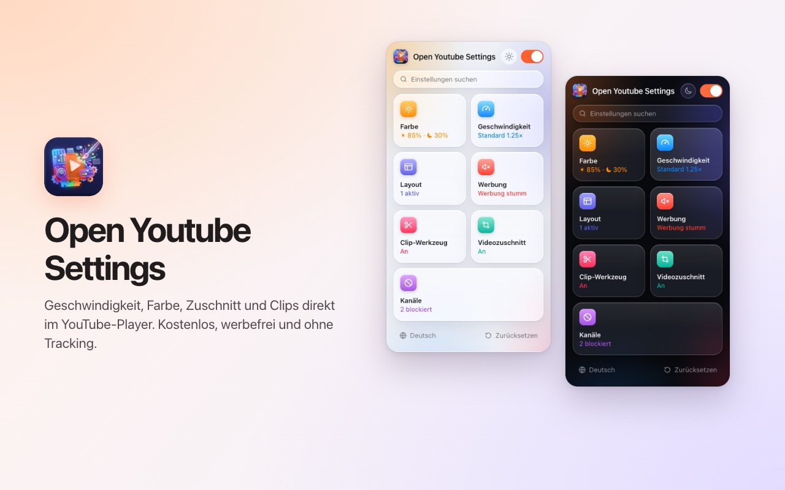
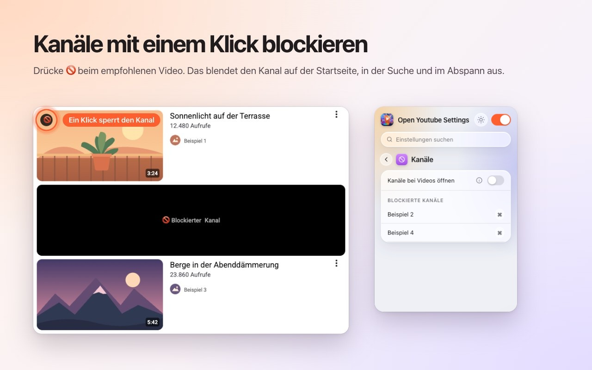
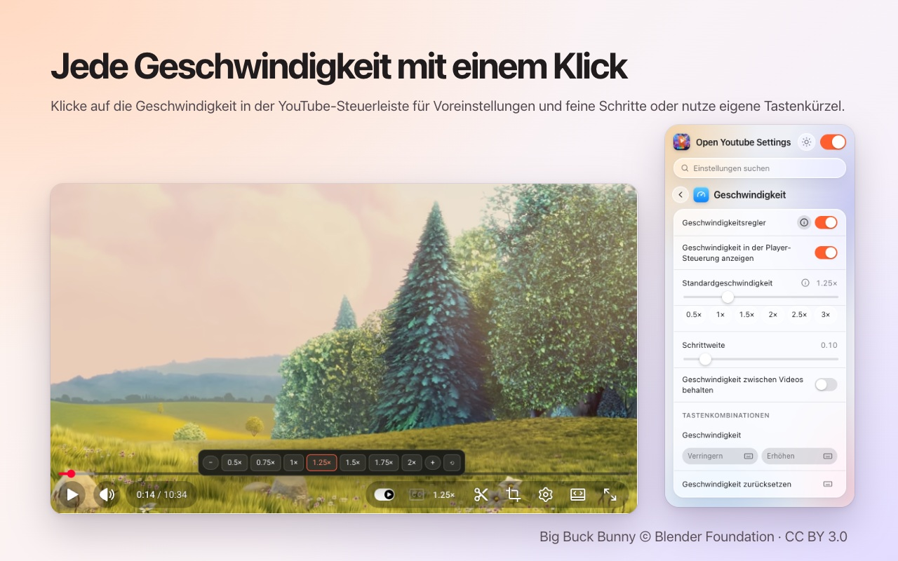
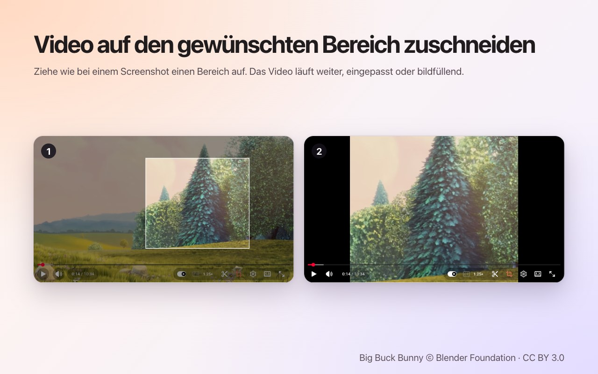
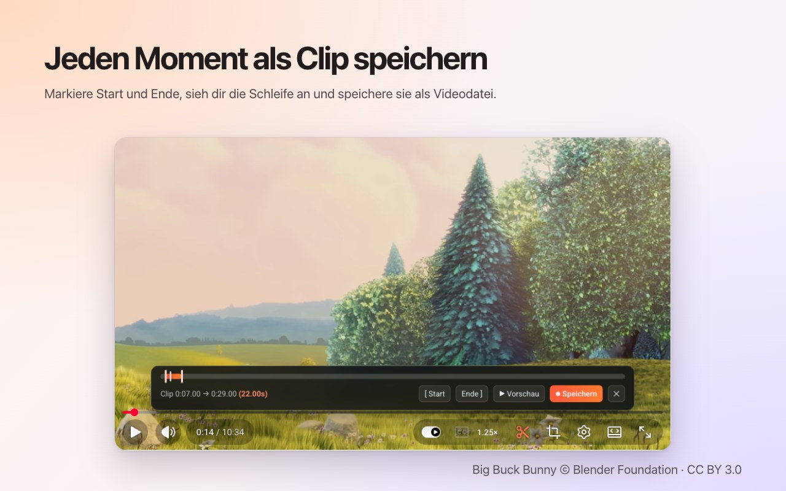
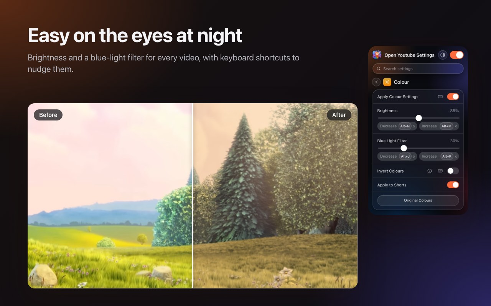
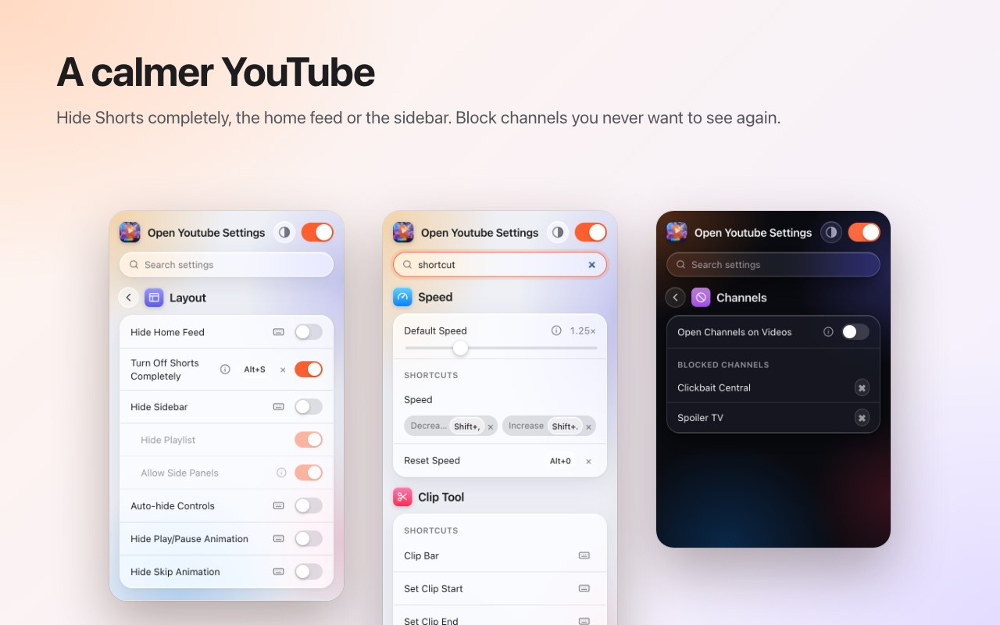

<p align="center">
  
</p>

<h1 align="center">Open Youtube Settings</h1>

<p align="center">
  YouTube-Kanäle mit einem Klick blockieren – dazu Tempo, Zuschneiden, Clips und Farbe direkt im Player.<br>
  Eine kostenlose Browser-Erweiterung für <b>Chrome</b> und <b>Firefox</b>.
</p>

<p align="center">
  ✅ <b>Open Source</b> &nbsp;·&nbsp; ✅ <b>Aufgeräumte Oberfläche</b> &nbsp;·&nbsp; ✅ <b>Sammelt keine Daten</b>
</p>

<p align="center">
  <a href="https://chromewebstore.google.com/detail/open-youtube-settings/commphgoijegmlhbkkbgbfbnemihdjod"><b>Chrome Web Store</b></a> ·
  <a href="../../releases/latest">Neueste Version</a> ·
  <a href="https://www.youtube.com/watch?v=0iPOj1_EBRU">Demo-Video</a>
</p>

<p align="center"><sub><a href="README.md">English</a> · <a href="README.tr.md">Türkçe</a> · <b>Deutsch</b> · <a href="README.es.md">Español</a> · <a href="README.fr.md">Français</a> · <a href="README.it.md">Italiano</a> · <a href="README.pt-BR.md">Português (Brasil)</a> · <a href="README.nl.md">Nederlands</a> · <a href="README.pl.md">Polski</a> · <a href="README.ru.md">Русский</a> · <a href="README.uk.md">Українська</a> · <a href="README.ar.md">العربية</a> · <a href="README.hi.md">हिन्दी</a> · <a href="README.id.md">Bahasa Indonesia</a> · <a href="README.vi.md">Tiếng Việt</a> · <a href="README.th.md">ไทย</a> · <a href="README.ko.md">한국어</a> · <a href="README.ja.md">日本語</a> · <a href="README.zh-CN.md">简体中文</a> · <a href="README.zh-TW.md">繁體中文</a></sub></p>

<p align="center">
  
</p>

## Warum Open Youtube Settings

- **Open Source:** der gesamte Code liegt hier auf GitHub unter der MIT-Lizenz. Jeder kann genau prüfen, was die Erweiterung tut.
- **Aufgeräumte Oberfläche:** ein kleines Fenster und Bedienelemente direkt im YouTube-Player. Keine Pop-ups, keine Werbung, keine Bezahlversion.
- **Sammelt keine Daten:** kein Konto, keine Analyse, kein Server. Deine Einstellungen verlassen nie deinen Browser.

## Funktionen

### Kanäle mit einem Klick blockieren
Fahre über ein empfohlenes Video und drücke 🚫. Alle Videos dieses Kanals werden ab sofort verdeckt – auf der Startseite, in der Suche und im Abspann. Im Fenster der Erweiterung kannst du die Sperre jederzeit aufheben.



### Wiedergabetempo im Player
Das aktuelle Tempo steht in YouTubes eigener Steuerleiste. Ein Klick öffnet Voreinstellungen von 0.5× bis 2× und feine Schritte; oder du nutzt eigene Tastenkürzel. Lege ein Standardtempo für jedes Video fest oder behalte das letzte Tempo zwischen Videos.



### Beliebigen Bereich zuschneiden
Drücke die Zuschneiden-Taste und ziehe wie bei einem Screenshot einen Bereich über das Video. Das Video läuft weiter und wird an den Player **angepasst** oder **füllt** ihn. Drücke die Taste erneut, um das ganze Video zu sehen. Der Zuschnitt endet mit dem Video.



### Clips speichern
Öffne die Clip-Leiste, markiere Anfang und Ende, sieh dir die Schleife an und speichere sie als Videodatei. Der Clip wird in Echtzeit aus deiner eigenen Wiedergabe aufgenommen.



### Farbe und Blaulicht
Helligkeit, Blaulichtfilter und Farbumkehr für jedes Video, mit Tastenkürzeln zum Erhöhen und Senken. Du entscheidest, ob die Filter auch für Shorts gelten.



### Ein ruhigeres YouTube
- **Shorts komplett abschalten:** Regale, Suchergebnisse, der Menüeintrag und der Kanal-Tab verschwinden; ein Shorts-Link öffnet sich als normales Video.
- Startseiten-Feed, Seitenleiste oder Playlist-Bereich ausblenden.
- Steuerleiste, Play/Pause- und Spul-Animationen ausblenden.
- Werbung automatisch stummschalten; der Ton kommt zurück, sobald die Werbung endet.
- Kanal-Links direkt im Tab „Videos“ öffnen.



### Außerdem
- **Ein Schalter** schaltet alles ab; YouTube läuft unverändert, bis du ihn wieder einschaltest.
- **Suche** über alle Einstellungen.
- Ein **Tastenkürzel** für fast jede Einstellung.
- Helles, dunkles oder automatisches Design.
- 20 Sprachen: English, Türkçe, Deutsch, Español, Français, Italiano, Português (Brasil), Nederlands, Polski, Русский, Українська, العربية, हिन्दी, Bahasa Indonesia, Tiếng Việt, ไทย, 한국어, 日本語, 简体中文, 繁體中文.

## Installation

**Chrome / Edge / Brave:** aus dem [Chrome Web Store](https://chromewebstore.google.com/detail/open-youtube-settings/commphgoijegmlhbkkbgbfbnemihdjod) installieren.

**Firefox:** die Seite bei Firefox Add-ons ist unterwegs. Bis dahin installierst du die Erweiterung aus einer Version, wie unten beschrieben.

**Aus einer Version (manuell):** lade die ZIP-Datei für deinen Browser unter [Releases](../../releases/latest) herunter.

- **Chrome / Edge / Brave:** entpacke sie, öffne `chrome://extensions`, aktiviere den *Entwicklermodus*, wähle *Entpackte Erweiterung laden* und den entpackten Ordner.
- **Firefox:** öffne `about:debugging#/runtime/this-firefox`, wähle *Temporäres Add-on laden…* und die ZIP-Datei. Temporäre Add-ons werden beim Neustart von Firefox entfernt.

## Datenschutz

Die Erweiterung sammelt keine Daten und sendet nichts. Deine Einstellungen bleiben im eigenen Erweiterungsspeicher des Browsers. Sie benötigt nur die Berechtigung `storage` und Zugriff auf `youtube.com`.

## Entwicklung

```bash
npm ci
npm run test:install   # Playwright Chromium and Firefox, once
npm test               # static, Chromium and Firefox tests against an offline YouTube fixture
npm run package        # builds dist/chrome-youtube-settings.zip and dist/firefox-youtube-settings.zip
```

`npm run test:live` führt einige Schnelltests gegen das echte youtube.com aus.

### Veröffentlichen
1. Erhöhe `version` in `manifest.json` (und `package.json`).
2. Pushe ein passendes Tag, zum Beispiel `git tag v0.9 && git push origin v0.9`. GitHub Actions führt die Tests aus und veröffentlicht eine Version mit beiden ZIP-Dateien.
3. *Actions → Publish to stores → Run workflow* lädt diese Version in den Chrome Web Store und zu Firefox Add-ons hoch.

## Lizenz

[MIT](LICENSE). Fehlerberichte und Ideen sind unter [Issues](../../issues) willkommen.

---

<sub>Die Screenshots verwenden <a href="https://peach.blender.org/">Big Buck Bunny</a> © 2008 Blender Foundation, lizenziert unter <a href="https://creativecommons.org/licenses/by/3.0/">CC BY 3.0</a>. YouTube ist eine Marke der Google LLC; dieses Projekt steht in keiner Verbindung zu Google und wird nicht von Google unterstützt.</sub>
