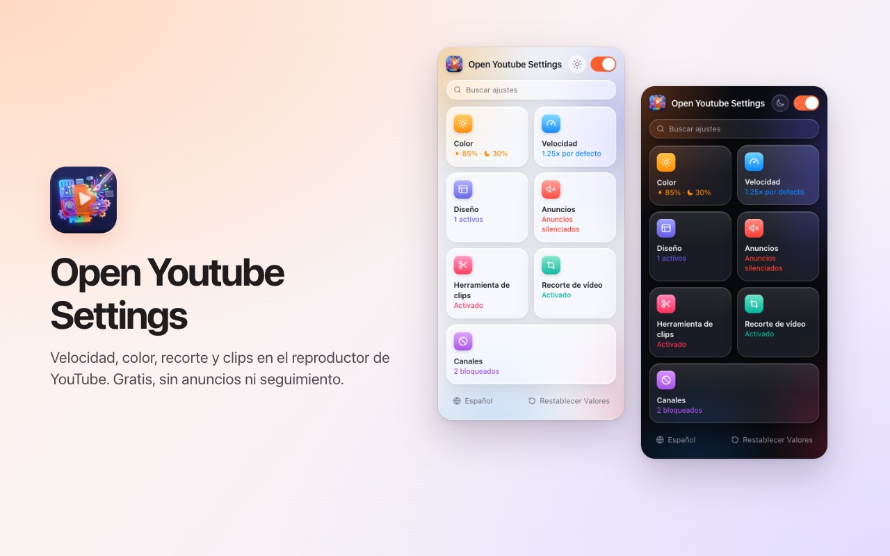
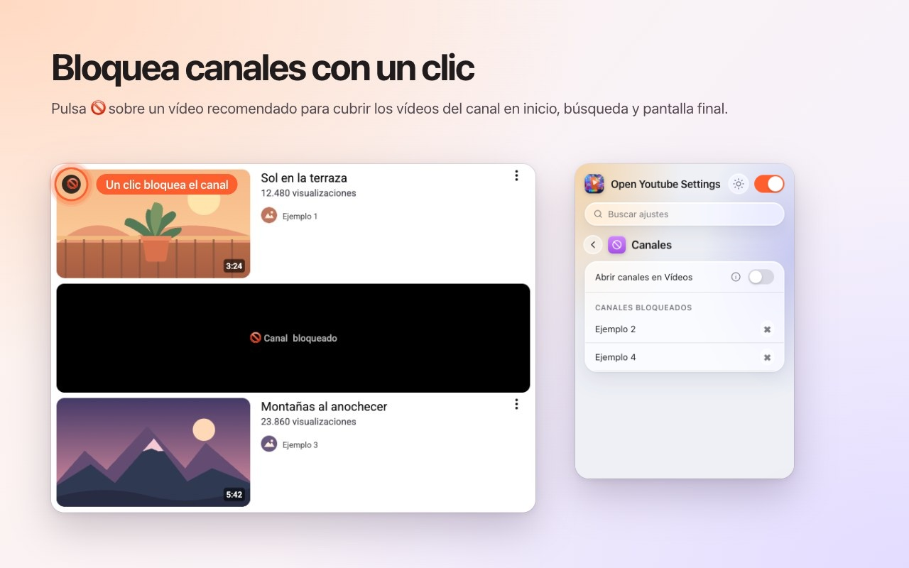
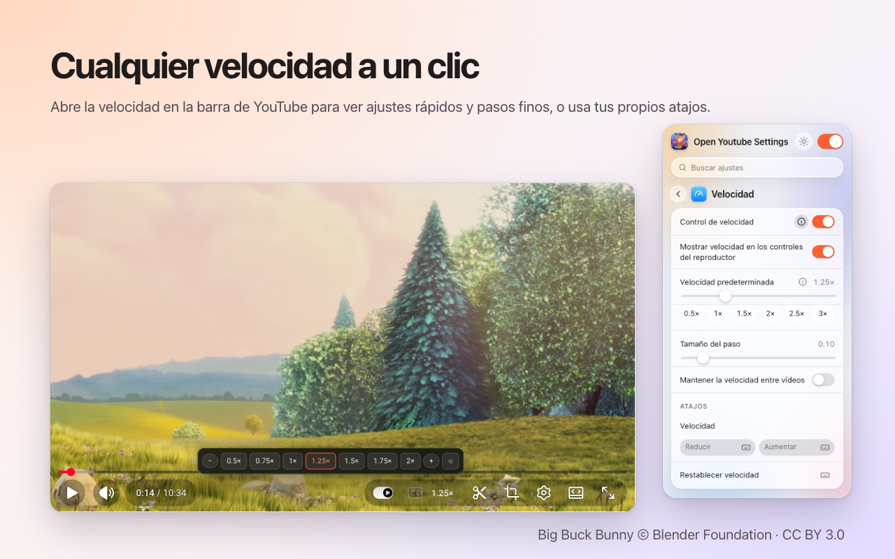
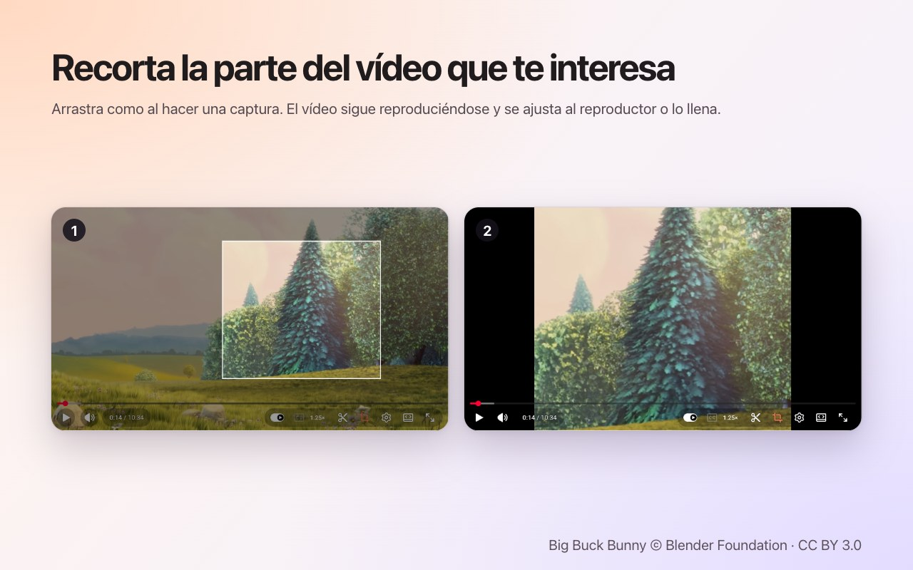
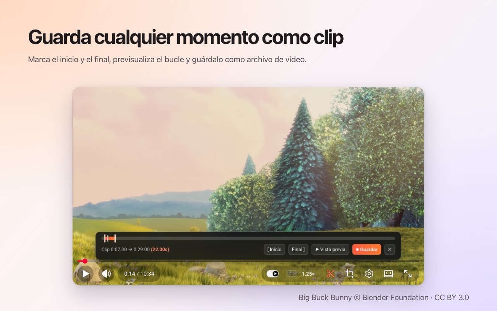

<p align="center">
  
</p>

<h1 align="center">Open Youtube Settings</h1>

<p align="center">
  Bloquea canales de YouTube con un clic, además de velocidad, recorte, clips y color, directamente en el reproductor.<br>
  Una extensión gratuita para <b>Chrome</b> y <b>Firefox</b>.
</p>

<p align="center">
  ✅ <b>Código abierto</b> &nbsp;·&nbsp; ✅ <b>Interfaz limpia</b> &nbsp;·&nbsp; ✅ <b>No recopila datos</b>
</p>

<p align="center">
  <a href="https://chromewebstore.google.com/detail/open-youtube-settings/commphgoijegmlhbkkbgbfbnemihdjod"><b>Chrome Web Store</b></a> ·
  <a href="../../releases/latest">Última versión</a> ·
  <a href="https://www.youtube.com/watch?v=0iPOj1_EBRU">Vídeo de demostración</a>
</p>

<p align="center"><sub><a href="README.md">English</a> · <a href="README.tr.md">Türkçe</a> · <a href="README.de.md">Deutsch</a> · <b>Español</b> · <a href="README.fr.md">Français</a> · <a href="README.it.md">Italiano</a> · <a href="README.pt-BR.md">Português (Brasil)</a> · <a href="README.nl.md">Nederlands</a> · <a href="README.pl.md">Polski</a> · <a href="README.ru.md">Русский</a> · <a href="README.uk.md">Українська</a> · <a href="README.ar.md">العربية</a> · <a href="README.hi.md">हिन्दी</a> · <a href="README.id.md">Bahasa Indonesia</a> · <a href="README.vi.md">Tiếng Việt</a> · <a href="README.th.md">ไทย</a> · <a href="README.ko.md">한국어</a> · <a href="README.ja.md">日本語</a> · <a href="README.zh-CN.md">简体中文</a> · <a href="README.zh-TW.md">繁體中文</a></sub></p>

<p align="center">
  
</p>

## Por qué Open Youtube Settings

- **Código abierto:** todo el código está aquí en GitHub con licencia MIT, así que cualquiera puede comprobar exactamente qué hace la extensión.
- **Interfaz limpia:** una ventana pequeña y controles dentro del propio reproductor de YouTube. Sin ventanas emergentes, sin anuncios, sin versión de pago.
- **No recopila datos:** sin cuenta, sin analíticas, sin servidor. Tus ajustes nunca salen de tu navegador.

## Funciones

### Bloquea canales con un clic
Pasa el ratón sobre un vídeo recomendado y pulsa 🚫. A partir de entonces, todos los vídeos de ese canal se cubren: en la página de inicio, en la búsqueda y en la pantalla final. Desbloquea un canal cuando quieras desde la ventana de la extensión.



### Velocidad de reproducción en el reproductor
La velocidad actual aparece en la barra de controles de YouTube. Haz clic para elegir entre valores de 0.5× a 2× y pasos finos, o usa tus propios atajos de teclado. Fija una velocidad predeterminada para cada vídeo o conserva la última entre vídeos.



### Recorta cualquier zona
Pulsa el botón de recorte y arrastra sobre el vídeo, como al hacer una captura de pantalla. El vídeo sigue reproduciéndose, **ajustado** al reproductor o **llenándolo**. Pulsa el botón otra vez para ver el vídeo completo. El recorte termina con el vídeo.



### Guarda clips
Abre la barra de clips, marca un inicio y un final, previsualiza el bucle y guárdalo como archivo de vídeo. El clip se graba en tiempo real a partir de tu propia reproducción.



### Color y luz azul
Brillo, filtro de luz azul e inversión de colores para cada vídeo, con atajos para subirlos o bajarlos. Elige si los filtros también se aplican a los Shorts.


### Un YouTube más tranquilo
- **Desactiva los Shorts por completo:** desaparecen las secciones, los resultados de búsqueda, la entrada del menú y la pestaña del canal; un enlace de Shorts se abre como vídeo normal.
- Oculta el feed de inicio, la barra lateral o el panel de la lista de reproducción.
- Oculta la barra de controles y las animaciones de reproducir/pausa y de salto.
- Silencia los anuncios automáticamente; el sonido vuelve en cuanto termina el anuncio.
- Abre los enlaces de canal directamente en la pestaña Vídeos.


### Y además
- **Un interruptor** lo desactiva todo; YouTube funciona sin cambios hasta que lo vuelvas a activar.
- **Búsqueda** en todos los ajustes.
- Un **atajo de teclado** para casi cada ajuste.
- Apariencia clara, oscura o automática.
- 20 idiomas: English, Türkçe, Deutsch, Español, Français, Italiano, Português (Brasil), Nederlands, Polski, Русский, Українська, العربية, हिन्दी, Bahasa Indonesia, Tiếng Việt, ไทย, 한국어, 日本語, 简体中文, 繁體中文.

## Instalación

**Chrome / Edge / Brave:** instálala desde la [Chrome Web Store](https://chromewebstore.google.com/detail/open-youtube-settings/commphgoijegmlhbkkbgbfbnemihdjod).

**Firefox:** la página en Firefox Add-ons está en camino. Mientras tanto, instálala desde una versión como se explica abajo.

**Desde una versión (manual):** descarga el zip para tu navegador desde [Releases](../../releases/latest).

- **Chrome / Edge / Brave:** descomprímelo, abre `chrome://extensions`, activa el *Modo de desarrollador*, elige *Cargar descomprimida* y selecciona la carpeta.
- **Firefox:** abre `about:debugging#/runtime/this-firefox`, elige *Cargar complemento temporal…* y selecciona el zip. Los complementos temporales se eliminan al reiniciar Firefox.

## Privacidad

La extensión no recopila datos ni envía nada a ninguna parte. Tus ajustes se quedan en el almacenamiento de extensiones del propio navegador. Solo pide el permiso `storage` y acceso a `youtube.com`.

## Desarrollo

```bash
npm ci
npm run test:install   # Playwright Chromium and Firefox, once
npm test               # static, Chromium and Firefox tests against an offline YouTube fixture
npm run package        # builds both store zips in dist/
```

`npm run test:live` ejecuta algunas pruebas rápidas contra el youtube.com real.

### Publicar una versión
1. Sube `version` en `manifest.json` (y `package.json`).
2. Envía una etiqueta con el mismo número, por ejemplo `git tag v0.13 && git push origin v0.13`. GitHub Actions ejecuta las pruebas y publica una versión con los dos zip.
3. *Actions → Publish to stores → Run workflow* sube esa versión a la Chrome Web Store y a Firefox Add-ons.

## Licencia

[MIT](LICENSE). Los informes de errores y las ideas son bienvenidos en [Issues](../../issues).

---

<sub>Las capturas usan <a href="https://peach.blender.org/">Big Buck Bunny</a> © 2008 Blender Foundation, con licencia <a href="https://creativecommons.org/licenses/by/3.0/">CC BY 3.0</a>. YouTube es una marca de Google LLC; este proyecto no está afiliado ni respaldado por Google.</sub>
