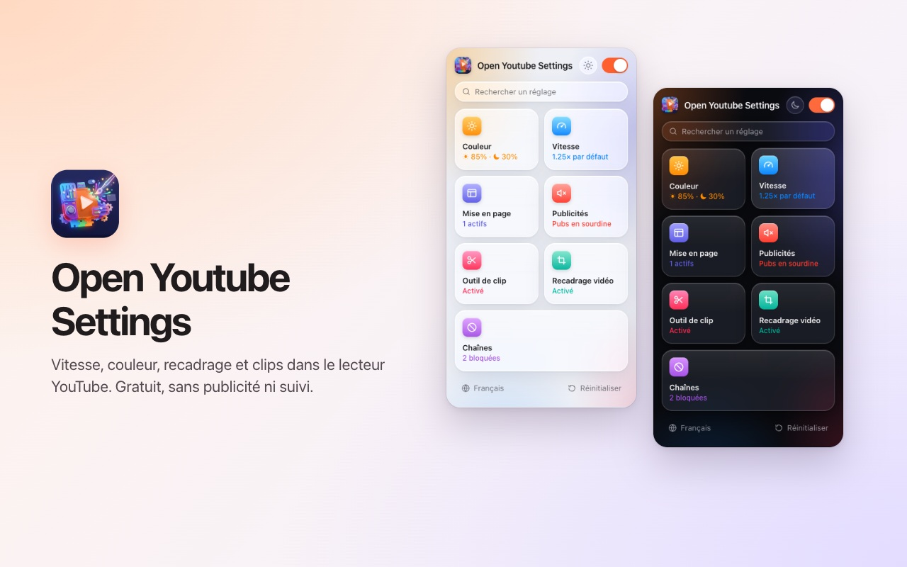
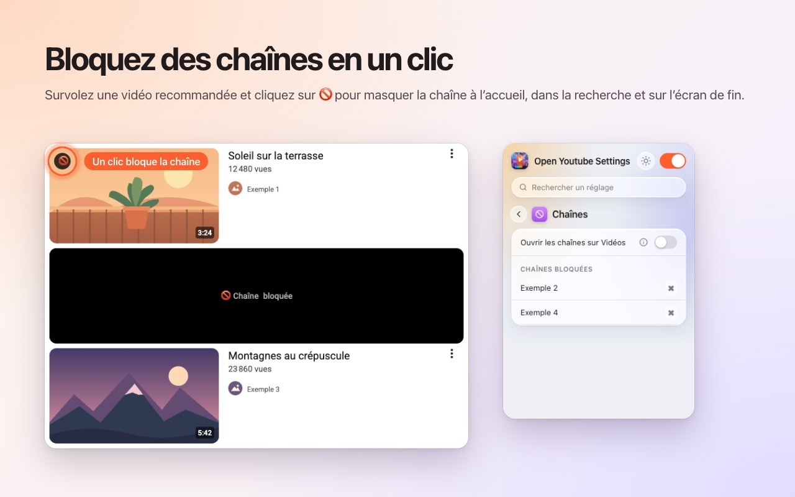
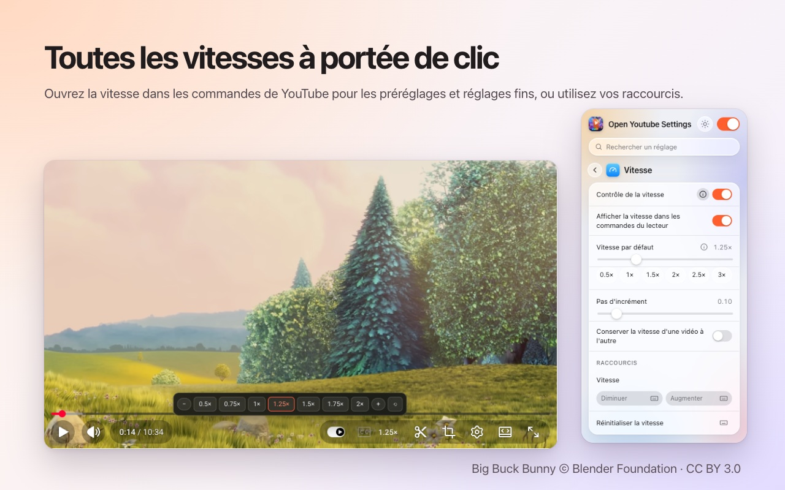
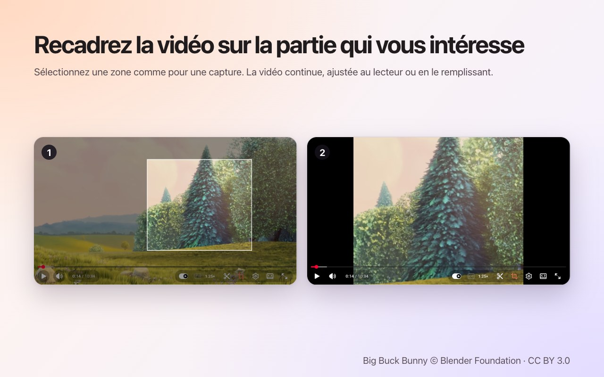
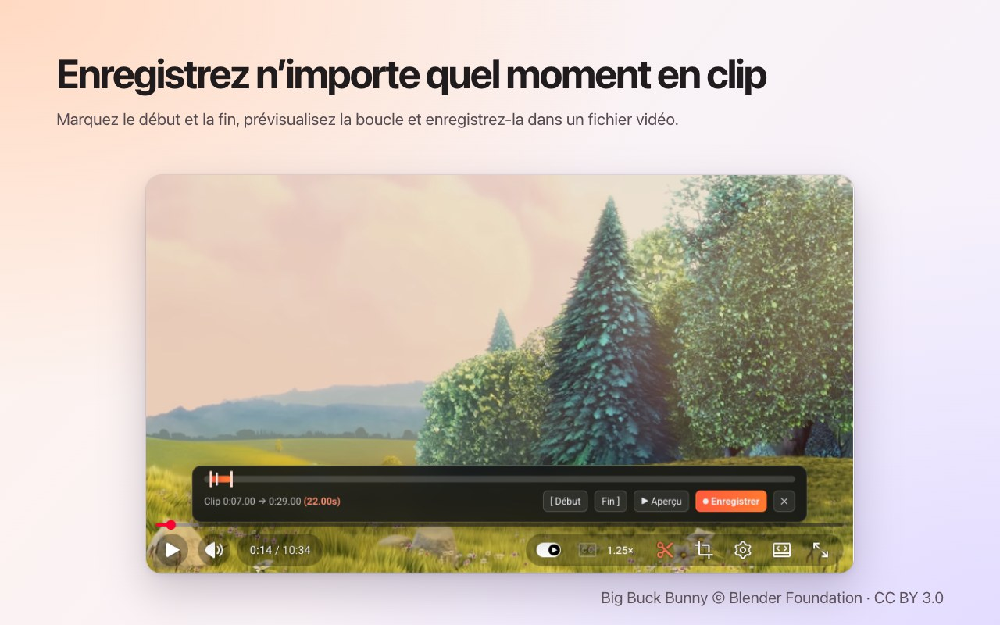

<p align="center">
  
</p>

<h1 align="center">Open Youtube Settings</h1>

<p align="center">
  Bloquez des chaînes YouTube en un clic – plus la vitesse, le recadrage, les clips et les couleurs, directement dans le lecteur.<br>
  Une extension gratuite pour <b>Chrome</b> et <b>Firefox</b>.
</p>

<p align="center">
  ✅ <b>Open source</b> &nbsp;·&nbsp; ✅ <b>Interface épurée</b> &nbsp;·&nbsp; ✅ <b>Aucune collecte de données</b>
</p>

<p align="center">
  <a href="https://chromewebstore.google.com/detail/open-youtube-settings/commphgoijegmlhbkkbgbfbnemihdjod"><b>Chrome Web Store</b></a> ·
  <a href="../../releases/latest">Dernière version</a> ·
  <a href="https://www.youtube.com/watch?v=0iPOj1_EBRU">Vidéo de démonstration</a>
</p>

<p align="center"><sub><a href="README.md">English</a> · <a href="README.tr.md">Türkçe</a> · <a href="README.de.md">Deutsch</a> · <a href="README.es.md">Español</a> · <b>Français</b> · <a href="README.it.md">Italiano</a> · <a href="README.pt-BR.md">Português (Brasil)</a> · <a href="README.nl.md">Nederlands</a> · <a href="README.pl.md">Polski</a> · <a href="README.ru.md">Русский</a> · <a href="README.uk.md">Українська</a> · <a href="README.ar.md">العربية</a> · <a href="README.hi.md">हिन्दी</a> · <a href="README.id.md">Bahasa Indonesia</a> · <a href="README.vi.md">Tiếng Việt</a> · <a href="README.th.md">ไทย</a> · <a href="README.ko.md">한국어</a> · <a href="README.ja.md">日本語</a> · <a href="README.zh-CN.md">简体中文</a> · <a href="README.zh-TW.md">繁體中文</a></sub></p>

<p align="center">
  
</p>

## Pourquoi Open Youtube Settings

- **Open source:** tout le code est ici sur GitHub sous licence MIT ; chacun peut vérifier exactement ce que fait l'extension.
- **Interface épurée:** une petite fenêtre et des commandes dans le lecteur même de YouTube. Pas de fenêtres surgissantes, pas de pub, pas de version payante.
- **Aucune collecte de données:** pas de compte, pas de statistiques, pas de serveur. Vos réglages ne quittent jamais votre navigateur.

## Fonctionnalités

### Bloquez des chaînes en un clic
Survolez une vidéo recommandée et appuyez sur 🚫. Toutes les vidéos de cette chaîne sont désormais masquées : sur l'accueil, dans la recherche et sur l'écran de fin. Débloquez une chaîne à tout moment depuis la fenêtre de l'extension.



### Vitesse de lecture dans le lecteur
La vitesse actuelle s'affiche dans la barre de commandes de YouTube. Cliquez pour choisir des préréglages de 0.5× à 2× et des pas fins, ou utilisez vos propres raccourcis clavier. Définissez une vitesse par défaut pour chaque vidéo ou conservez la dernière d'une vidéo à l'autre.



### Recadrez n'importe quelle zone
Appuyez sur le bouton de recadrage et tracez une zone sur la vidéo, comme pour une capture d'écran. La vidéo continue de jouer, **ajustée** au lecteur ou le **remplissant**. Appuyez de nouveau pour voir toute la vidéo. Le recadrage s'arrête avec la vidéo.



### Enregistrez des clips
Ouvrez la barre de clip, marquez un début et une fin, prévisualisez la boucle et enregistrez-la comme fichier vidéo. Le clip est enregistré en temps réel à partir de votre propre lecture.



### Couleurs et lumière bleue
Luminosité, filtre de lumière bleue et inversion des couleurs pour chaque vidéo, avec des raccourcis pour les augmenter ou les réduire. Choisissez si les filtres s'appliquent aussi aux Shorts.


### Un YouTube plus calme
- **Désactivez complètement les Shorts :** les étagères, les résultats de recherche, l'entrée du menu et l'onglet de chaîne disparaissent ; un lien Shorts s'ouvre comme une vidéo normale.
- Masquez le fil d'accueil, la barre latérale ou le panneau de playlist.
- Masquez la barre de commandes et les animations lecture/pause et de saut.
- Coupez le son des publicités automatiquement ; il revient dès la fin de la pub.
- Ouvrez les liens de chaîne directement sur l'onglet Vidéos.


### Et aussi
- **Un seul interrupteur** désactive tout ; YouTube reste intact jusqu'à ce que vous le réactiviez.
- **Recherche** dans tous les réglages.
- Un **raccourci clavier** pour presque chaque réglage.
- Apparence claire, sombre ou automatique.
- 20 langues : English, Türkçe, Deutsch, Español, Français, Italiano, Português (Brasil), Nederlands, Polski, Русский, Українська, العربية, हिन्दी, Bahasa Indonesia, Tiếng Việt, ไทย, 한국어, 日本語, 简体中文, 繁體中文.

## Installation

**Chrome / Edge / Brave:** installez-la depuis le [Chrome Web Store](https://chromewebstore.google.com/detail/open-youtube-settings/commphgoijegmlhbkkbgbfbnemihdjod).

**Firefox:** la page sur Firefox Add-ons arrive bientôt. En attendant, installez-la depuis une version comme expliqué ci-dessous.

**Depuis une version (manuel) :** téléchargez le zip pour votre navigateur sur [Releases](../../releases/latest).

- **Chrome / Edge / Brave:** décompressez-le, ouvrez `chrome://extensions`, activez le *Mode développeur*, choisissez *Charger l'extension non empaquetée* et sélectionnez le dossier.
- **Firefox:** ouvrez `about:debugging#/runtime/this-firefox`, choisissez *Charger un module complémentaire temporaire…* et sélectionnez le zip. Les modules temporaires sont supprimés au redémarrage de Firefox.

## Confidentialité

L'extension ne collecte aucune donnée et n'envoie rien nulle part. Vos réglages restent dans le stockage d'extensions du navigateur. Elle demande seulement l'autorisation `storage` et l'accès à `youtube.com`.

## Développement

```bash
npm ci
npm run test:install   # Playwright Chromium and Firefox, once
npm test               # static, Chromium and Firefox tests against an offline YouTube fixture
npm run package        # builds dist/chrome-youtube-settings.zip and dist/firefox-youtube-settings.zip
```

`npm run test:live` lance quelques tests rapides sur le vrai youtube.com.

### Publier une version
1. Augmentez `version` dans `manifest.json` (et `package.json`).
2. Poussez une étiquette correspondante, par exemple `git tag v0.9 && git push origin v0.9`. GitHub Actions lance les tests et publie une version avec les deux zip.
3. *Actions → Publish to stores → Run workflow* envoie cette version sur le Chrome Web Store et Firefox Add-ons.

## Licence

[MIT](LICENSE). Les rapports de bugs et les idées sont les bienvenus dans [Issues](../../issues).

---

<sub>Les captures utilisent <a href="https://peach.blender.org/">Big Buck Bunny</a> © 2008 Blender Foundation, sous licence <a href="https://creativecommons.org/licenses/by/3.0/">CC BY 3.0</a>. YouTube est une marque de Google LLC ; ce projet n'est ni affilié à Google ni approuvé par Google.</sub>
