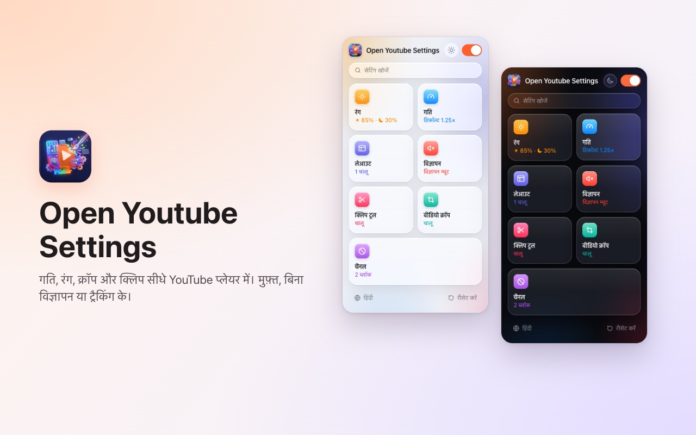
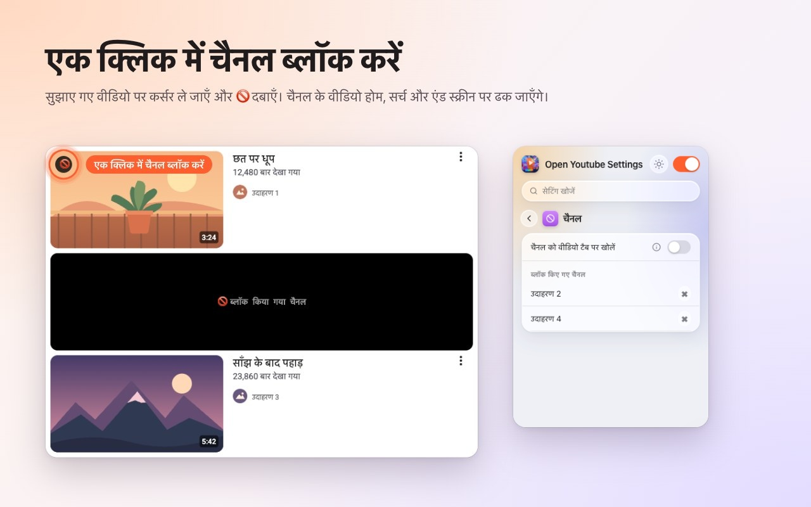
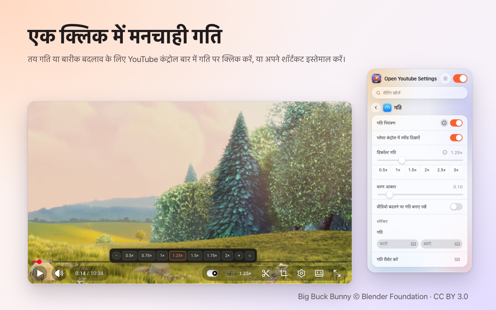
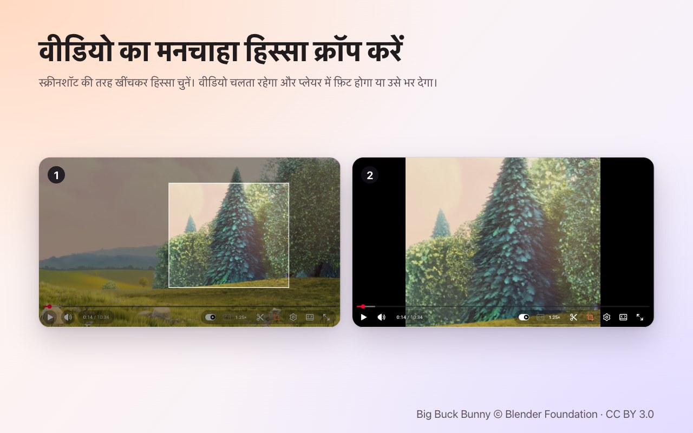
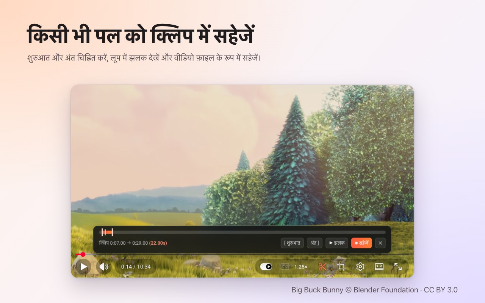

<p align="center">
  
</p>

<h1 align="center">Open Youtube Settings</h1>

<p align="center">
  एक क्लिक में YouTube चैनल ब्लॉक करें — साथ में स्पीड, क्रॉप, क्लिप और रंग, सीधे प्लेयर में।<br>
  <b>Chrome</b> और <b>Firefox</b> के लिए मुफ़्त एक्सटेंशन।
</p>

<p align="center">
  ✅ <b>ओपन सोर्स</b> &nbsp;·&nbsp; ✅ <b>साफ़-सुथरा इंटरफ़ेस</b> &nbsp;·&nbsp; ✅ <b>कोई डेटा इकट्ठा नहीं करता</b>
</p>

<p align="center">
  <a href="https://chromewebstore.google.com/detail/open-youtube-settings/commphgoijegmlhbkkbgbfbnemihdjod"><b>Chrome Web Store</b></a> ·
  <a href="../../releases/latest">नवीनतम रिलीज़</a> ·
  <a href="https://www.youtube.com/watch?v=0iPOj1_EBRU">डेमो वीडियो</a>
</p>

<p align="center"><sub><a href="README.md">English</a> · <a href="README.tr.md">Türkçe</a> · <a href="README.de.md">Deutsch</a> · <a href="README.es.md">Español</a> · <a href="README.fr.md">Français</a> · <a href="README.it.md">Italiano</a> · <a href="README.pt-BR.md">Português (Brasil)</a> · <a href="README.nl.md">Nederlands</a> · <a href="README.pl.md">Polski</a> · <a href="README.ru.md">Русский</a> · <a href="README.uk.md">Українська</a> · <a href="README.ar.md">العربية</a> · <b>हिन्दी</b> · <a href="README.id.md">Bahasa Indonesia</a> · <a href="README.vi.md">Tiếng Việt</a> · <a href="README.th.md">ไทย</a> · <a href="README.ko.md">한국어</a> · <a href="README.ja.md">日本語</a> · <a href="README.zh-CN.md">简体中文</a> · <a href="README.zh-TW.md">繁體中文</a></sub></p>

<p align="center">
  
</p>

## Open Youtube Settings क्यों

- **ओपन सोर्स:** पूरा कोड यहीं GitHub पर MIT लाइसेंस के तहत है, इसलिए कोई भी जाँच सकता है कि एक्सटेंशन ठीक-ठीक क्या करता है।
- **साफ़-सुथरा इंटरफ़ेस:** एक छोटी विंडो और YouTube के अपने प्लेयर के अंदर कंट्रोल। न पॉप-अप, न विज्ञापन, न पेड वर्ज़न।
- **कोई डेटा इकट्ठा नहीं करता:** न अकाउंट, न एनालिटिक्स, न सर्वर। आपकी सेटिंग्स कभी आपके ब्राउज़र से बाहर नहीं जातीं।

## सुविधाएँ

### एक क्लिक में चैनल ब्लॉक करें
किसी सुझाए गए वीडियो पर माउस ले जाएँ और 🚫 दबाएँ। उसके बाद उस चैनल का हर वीडियो ढक दिया जाता है — होम पेज पर, सर्च में और एंड स्क्रीन पर। एक्सटेंशन की विंडो से कभी भी चैनल अनब्लॉक करें।



### प्लेयर में प्लेबैक स्पीड
मौजूदा स्पीड YouTube के अपने कंट्रोल बार में दिखती है। क्लिक करके 0.5× से 2× तक के प्रीसेट और बारीक कदम चुनें, या अपने कीबोर्ड शॉर्टकट इस्तेमाल करें। हर वीडियो के लिए डिफ़ॉल्ट स्पीड तय करें या पिछली स्पीड अगले वीडियो में भी रखें।



### कोई भी हिस्सा क्रॉप करें
क्रॉप बटन दबाएँ और स्क्रीनशॉट लेने की तरह वीडियो पर ड्रैग करें। वीडियो चलता रहता है, प्लेयर में **फ़िट** होकर या उसे **भरकर**। पूरा वीडियो देखने के लिए बटन फिर दबाएँ। वीडियो खत्म होते ही क्रॉप हट जाता है।



### क्लिप सेव करें
क्लिप बार खोलें, शुरुआत और अंत चिह्नित करें, लूप का प्रीव्यू देखें और उसे वीडियो फ़ाइल के रूप में सेव करें। क्लिप आपके अपने प्लेबैक से रियल टाइम में रिकॉर्ड होती है।



### रंग और नीली रोशनी
हर वीडियो के लिए ब्राइटनेस, नीली रोशनी फ़िल्टर और रंग उलटना, उन्हें बढ़ाने-घटाने के शॉर्टकट के साथ। चुनें कि फ़िल्टर Shorts पर भी लागू हों या नहीं।


### ज़्यादा शांत YouTube
- **Shorts पूरी तरह बंद करें:** शेल्फ़, सर्च नतीजे, मेन्यू आइटम और चैनल टैब गायब हो जाते हैं; Shorts लिंक सामान्य वीडियो की तरह खुलता है।
- होम फ़ीड, साइडबार या प्लेलिस्ट पैनल छिपाएँ।
- कंट्रोल बार और प्ले/पॉज़ व स्किप एनिमेशन छिपाएँ।
- विज्ञापनों को अपने-आप म्यूट करें; विज्ञापन खत्म होते ही आवाज़ लौट आती है।
- चैनल लिंक सीधे वीडियो टैब पर खोलें।


### और भी
- **एक स्विच** सब कुछ बंद कर देता है; जब तक आप उसे फिर चालू न करें, YouTube बिना बदलाव के चलता है।
- सभी सेटिंग्स में **सर्च**।
- लगभग हर सेटिंग के लिए **कीबोर्ड शॉर्टकट**।
- लाइट, डार्क या ऑटोमैटिक थीम।
- 20 भाषाएँ: English, Türkçe, Deutsch, Español, Français, Italiano, Português (Brasil), Nederlands, Polski, Русский, Українська, العربية, हिन्दी, Bahasa Indonesia, Tiếng Việt, ไทย, 한국어, 日本語, 简体中文, 繁體中文.

## इंस्टॉल करें

**Chrome / Edge / Brave:** [Chrome Web Store](https://chromewebstore.google.com/detail/open-youtube-settings/commphgoijegmlhbkkbgbfbnemihdjod) से इंस्टॉल करें।

**Firefox:** Firefox Add-ons पर पेज जल्द आ रहा है। तब तक नीचे बताए तरीके से किसी रिलीज़ से इंस्टॉल करें।

**रिलीज़ से (मैन्युअल):** [Releases](../../releases/latest) से अपने ब्राउज़र की zip फ़ाइल डाउनलोड करें।

- **Chrome / Edge / Brave:** उसे अनज़िप करें, `chrome://extensions` खोलें, *डेवलपर मोड* चालू करें, *अनपैक्ड लोड करें* चुनें और फ़ोल्डर चुनें।
- **Firefox:** `about:debugging#/runtime/this-firefox` खोलें, *अस्थायी ऐड-ऑन लोड करें…* चुनें और zip फ़ाइल चुनें। Firefox रीस्टार्ट होने पर अस्थायी ऐड-ऑन हट जाते हैं।

## गोपनीयता

एक्सटेंशन कोई डेटा इकट्ठा नहीं करता और कहीं कुछ नहीं भेजता। आपकी सेटिंग्स ब्राउज़र के अपने एक्सटेंशन स्टोरेज में रहती हैं। यह सिर्फ़ `storage` अनुमति और `youtube.com` तक पहुँच माँगता है।

## डेवलपमेंट

```bash
npm ci
npm run test:install   # Playwright Chromium and Firefox, once
npm test               # static, Chromium and Firefox tests against an offline YouTube fixture
npm run package        # builds both store zips in dist/
```

`npm run test:live` असली youtube.com पर कुछ तेज़ टेस्ट चलाता है।

### रिलीज़ करना
1. `manifest.json` (और `package.json`) में `version` बढ़ाएँ।
2. मेल खाता टैग पुश करें, जैसे `git tag v0.13 && git push origin v0.13`। GitHub Actions टेस्ट चलाता है और दोनों zip के साथ रिलीज़ प्रकाशित करता है।
3. *Actions → Publish to stores → Run workflow* उस रिलीज़ को Chrome Web Store और Firefox Add-ons पर अपलोड करता है।

## लाइसेंस

[MIT](LICENSE)। बग रिपोर्ट और सुझाव [Issues](../../issues) में स्वागत योग्य हैं।

---

<sub>स्क्रीनशॉट में <a href="https://peach.blender.org/">Big Buck Bunny</a> © 2008 Blender Foundation का उपयोग किया गया है, जो <a href="https://creativecommons.org/licenses/by/3.0/">CC BY 3.0</a> के तहत लाइसेंस प्राप्त है। YouTube, Google LLC का ट्रेडमार्क है; यह प्रोजेक्ट Google से संबद्ध या उसके द्वारा समर्थित नहीं है।</sub>
