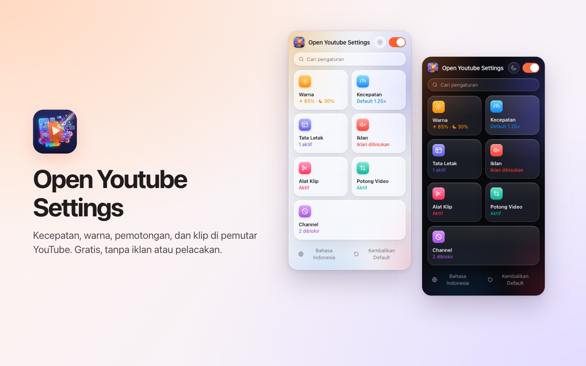
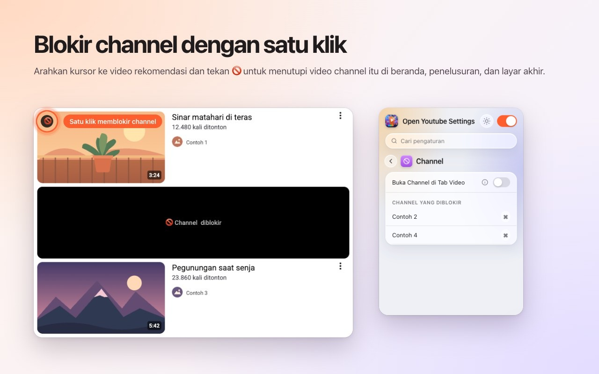
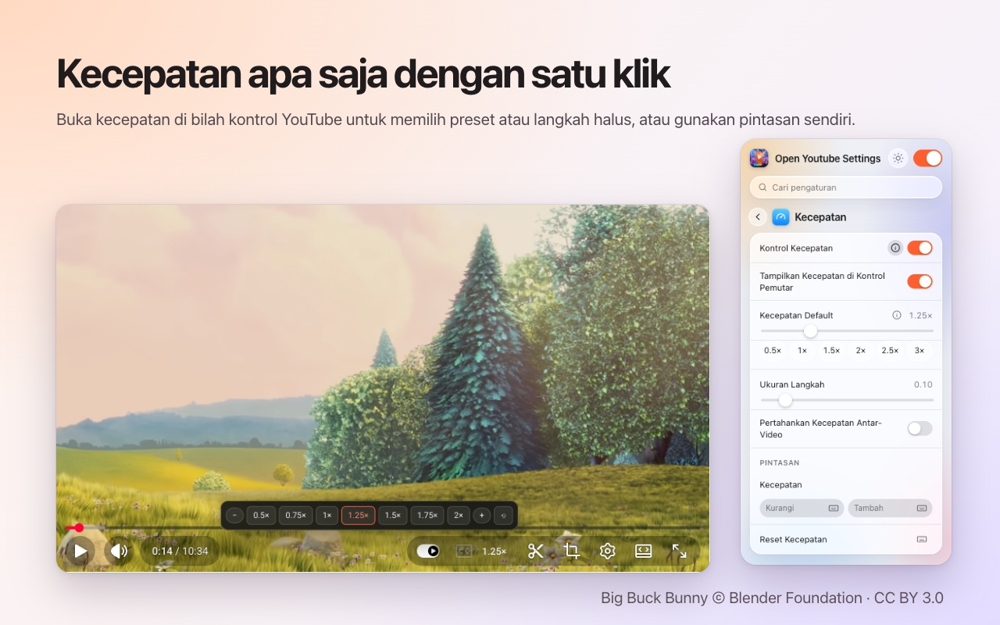
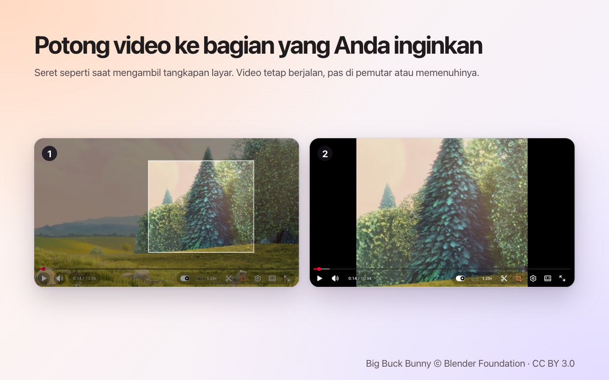
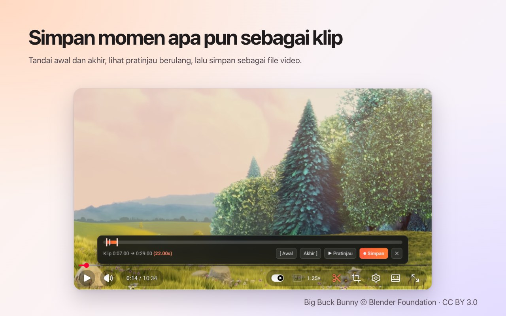

<p align="center">
  
</p>

<h1 align="center">Open Youtube Settings</h1>

<p align="center">
  Blokir channel YouTube dengan sekali klik — plus kecepatan, potong, klip, dan warna, langsung di pemutar.<br>
  Ekstensi gratis untuk <b>Chrome</b> dan <b>Firefox</b>.
</p>

<p align="center">
  ✅ <b>Sumber terbuka</b> &nbsp;·&nbsp; ✅ <b>Antarmuka bersih</b> &nbsp;·&nbsp; ✅ <b>Tidak mengumpulkan data</b>
</p>

<p align="center">
  <a href="https://chromewebstore.google.com/detail/open-youtube-settings/commphgoijegmlhbkkbgbfbnemihdjod"><b>Chrome Web Store</b></a> ·
  <a href="../../releases/latest">Rilis terbaru</a> ·
  <a href="https://www.youtube.com/watch?v=0iPOj1_EBRU">Video demo</a>
</p>

<p align="center"><sub><a href="README.md">English</a> · <a href="README.tr.md">Türkçe</a> · <a href="README.de.md">Deutsch</a> · <a href="README.es.md">Español</a> · <a href="README.fr.md">Français</a> · <a href="README.it.md">Italiano</a> · <a href="README.pt-BR.md">Português (Brasil)</a> · <a href="README.nl.md">Nederlands</a> · <a href="README.pl.md">Polski</a> · <a href="README.ru.md">Русский</a> · <a href="README.uk.md">Українська</a> · <a href="README.ar.md">العربية</a> · <a href="README.hi.md">हिन्दी</a> · <b>Bahasa Indonesia</b> · <a href="README.vi.md">Tiếng Việt</a> · <a href="README.th.md">ไทย</a> · <a href="README.ko.md">한국어</a> · <a href="README.ja.md">日本語</a> · <a href="README.zh-CN.md">简体中文</a> · <a href="README.zh-TW.md">繁體中文</a></sub></p>

<p align="center">
  
</p>

## Mengapa Open Youtube Settings

- **Sumber terbuka:** seluruh kodenya ada di sini, di GitHub, dengan lisensi MIT, jadi siapa pun bisa memeriksa persis apa yang dilakukan ekstensi ini.
- **Antarmuka bersih:** satu jendela kecil dan kontrol di dalam pemutar YouTube sendiri. Tanpa pop-up, tanpa iklan, tanpa versi berbayar.
- **Tidak mengumpulkan data:** tanpa akun, tanpa analitik, tanpa server. Pengaturanmu tidak pernah keluar dari browser.

## Fitur

### Blokir channel dengan sekali klik
Arahkan kursor ke video yang direkomendasikan dan tekan 🚫. Sejak itu, setiap video dari channel tersebut ditutup — di beranda, di pencarian, dan di layar akhir. Buka blokir channel kapan saja dari jendela ekstensi.



### Kecepatan putar di pemutar
Kecepatan saat ini ada di bilah kontrol YouTube sendiri. Klik untuk memilih preset dari 0.5× sampai 2× dan langkah halus, atau gunakan pintasan keyboard sendiri. Tetapkan kecepatan default untuk setiap video, atau pertahankan kecepatan terakhir antarvideo.



### Potong area mana pun
Tekan tombol potong dan seret di atas video, seperti mengambil tangkapan layar. Video terus diputar, **pas** di pemutar atau **memenuhinya**. Tekan tombol lagi untuk melihat seluruh video. Potongan berakhir bersama videonya.



### Simpan klip
Buka bilah klip, tandai awal dan akhir, pratinjau putaran, lalu simpan sebagai file video. Klip direkam secara real time dari pemutaranmu sendiri.



### Warna dan cahaya biru
Kecerahan, filter cahaya biru, dan pembalikan warna untuk setiap video, dengan pintasan untuk menaikkan atau menurunkannya. Pilih apakah filter juga berlaku untuk Shorts.


### YouTube yang lebih tenang
- **Matikan Shorts sepenuhnya:** rak, hasil pencarian, entri menu, dan tab channel menghilang; tautan Shorts terbuka sebagai video biasa.
- Sembunyikan feed beranda, bilah samping, atau panel playlist.
- Sembunyikan bilah kontrol serta animasi putar/jeda dan lompat.
- Bisukan iklan secara otomatis; suara kembali begitu iklan selesai.
- Buka tautan channel langsung di tab Video.


### Dan juga
- **Satu sakelar** mematikan semuanya; YouTube berjalan apa adanya sampai kamu menyalakannya lagi.
- **Pencarian** di semua pengaturan.
- **Pintasan keyboard** untuk hampir setiap pengaturan.
- Tampilan terang, gelap, atau otomatis.
- 20 bahasa: English, Türkçe, Deutsch, Español, Français, Italiano, Português (Brasil), Nederlands, Polski, Русский, Українська, العربية, हिन्दी, Bahasa Indonesia, Tiếng Việt, ไทย, 한국어, 日本語, 简体中文, 繁體中文.

## Pemasangan

**Chrome / Edge / Brave:** pasang dari [Chrome Web Store](https://chromewebstore.google.com/detail/open-youtube-settings/commphgoijegmlhbkkbgbfbnemihdjod).

**Firefox:** halaman di Firefox Add-ons segera hadir. Sementara itu, pasang dari rilis seperti dijelaskan di bawah.

**Dari rilis (manual):** unduh file zip untuk browsermu dari [Releases](../../releases/latest).

- **Chrome / Edge / Brave:** ekstrak, buka `chrome://extensions`, aktifkan *Mode developer*, pilih *Muat yang belum dibuka* lalu pilih foldernya.
- **Firefox:** buka `about:debugging#/runtime/this-firefox`, pilih *Muat Pengaya Sementara…* lalu pilih file zip. Pengaya sementara dihapus saat Firefox dimulai ulang.

## Privasi

Ekstensi ini tidak mengumpulkan data dan tidak mengirim apa pun ke mana pun. Pengaturanmu tetap di penyimpanan ekstensi browser sendiri. Ekstensi hanya meminta izin `storage` dan akses ke `youtube.com`.

## Pengembangan

```bash
npm ci
npm run test:install   # Playwright Chromium and Firefox, once
npm test               # static, Chromium and Firefox tests against an offline YouTube fixture
npm run package        # builds dist/chrome-youtube-settings.zip and dist/firefox-youtube-settings.zip
```

`npm run test:live` menjalankan beberapa tes cepat di youtube.com yang asli.

### Merilis versi
1. Naikkan `version` di `manifest.json` (dan `package.json`).
2. Push tag yang sesuai, misalnya `git tag v0.9 && git push origin v0.9`. GitHub Actions menjalankan tes dan menerbitkan rilis dengan kedua file zip.
3. *Actions → Publish to stores → Run workflow* mengunggah rilis itu ke Chrome Web Store dan Firefox Add-ons.

## Lisensi

[MIT](LICENSE). Laporan bug dan ide sangat diterima di [Issues](../../issues).

---

<sub>Tangkapan layar menggunakan <a href="https://peach.blender.org/">Big Buck Bunny</a> © 2008 Blender Foundation, berlisensi <a href="https://creativecommons.org/licenses/by/3.0/">CC BY 3.0</a>. YouTube adalah merek dagang Google LLC; proyek ini tidak berafiliasi dengan atau didukung oleh Google.</sub>
