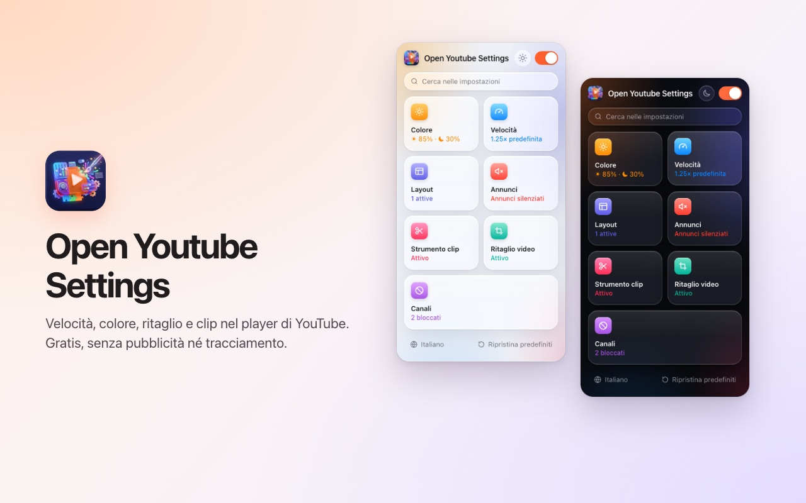
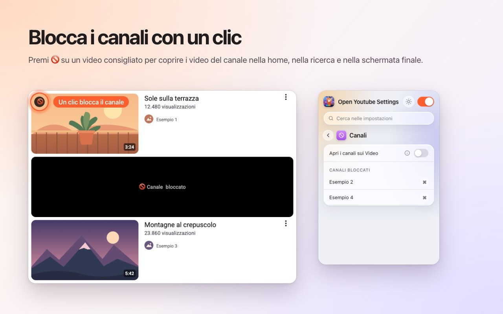
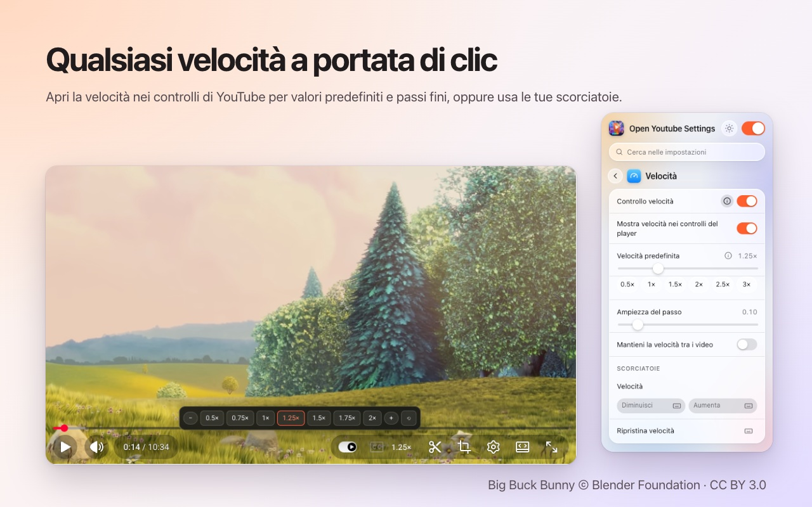
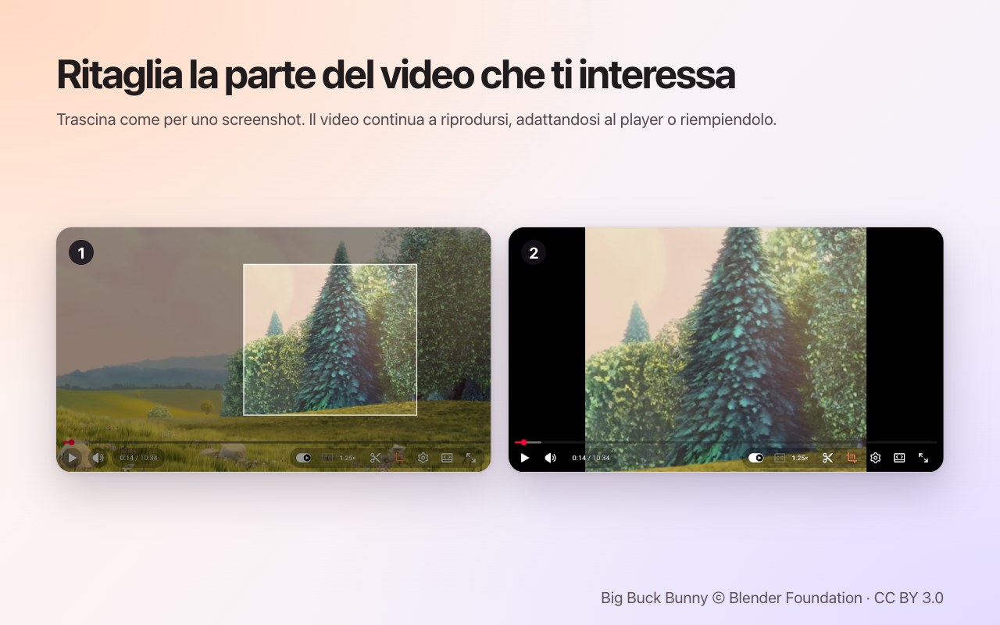
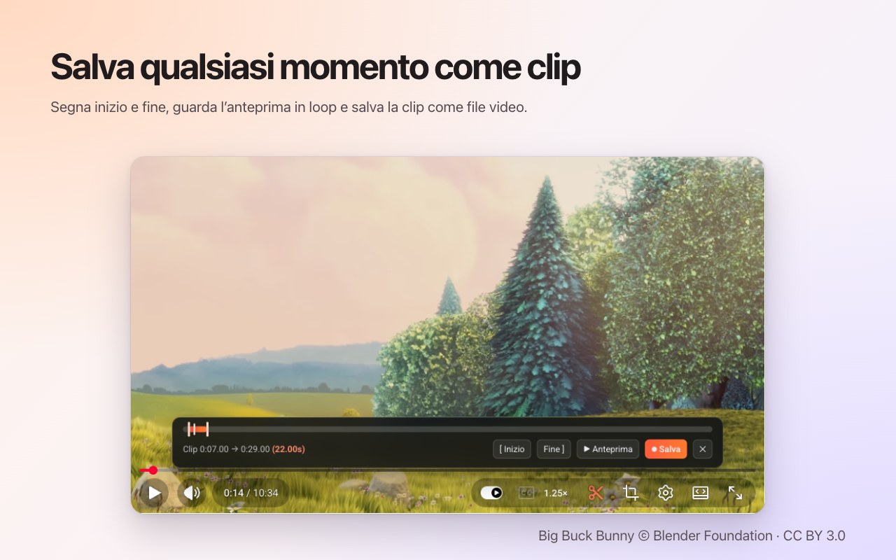

<p align="center">
  
</p>

<h1 align="center">Open Youtube Settings</h1>

<p align="center">
  Blocca i canali YouTube con un clic, più velocità, ritaglio, clip e colori, direttamente nel player.<br>
  Un'estensione gratuita per <b>Chrome</b> e <b>Firefox</b>.
</p>

<p align="center">
  ✅ <b>Open source</b> &nbsp;·&nbsp; ✅ <b>Interfaccia pulita</b> &nbsp;·&nbsp; ✅ <b>Nessuna raccolta di dati</b>
</p>

<p align="center">
  <a href="https://chromewebstore.google.com/detail/open-youtube-settings/commphgoijegmlhbkkbgbfbnemihdjod"><b>Chrome Web Store</b></a> ·
  <a href="../../releases/latest">Ultima versione</a> ·
  <a href="https://www.youtube.com/watch?v=0iPOj1_EBRU">Video dimostrativo</a>
</p>

<p align="center"><sub><a href="README.md">English</a> · <a href="README.tr.md">Türkçe</a> · <a href="README.de.md">Deutsch</a> · <a href="README.es.md">Español</a> · <a href="README.fr.md">Français</a> · <b>Italiano</b> · <a href="README.pt-BR.md">Português (Brasil)</a> · <a href="README.nl.md">Nederlands</a> · <a href="README.pl.md">Polski</a> · <a href="README.ru.md">Русский</a> · <a href="README.uk.md">Українська</a> · <a href="README.ar.md">العربية</a> · <a href="README.hi.md">हिन्दी</a> · <a href="README.id.md">Bahasa Indonesia</a> · <a href="README.vi.md">Tiếng Việt</a> · <a href="README.th.md">ไทย</a> · <a href="README.ko.md">한국어</a> · <a href="README.ja.md">日本語</a> · <a href="README.zh-CN.md">简体中文</a> · <a href="README.zh-TW.md">繁體中文</a></sub></p>

<p align="center">
  
</p>

## Perché Open Youtube Settings

- **Open source:** tutto il codice è qui su GitHub con licenza MIT, così chiunque può verificare esattamente cosa fa l'estensione.
- **Interfaccia pulita:** una piccola finestra e controlli dentro il player stesso di YouTube. Niente popup, niente pubblicità, niente versione a pagamento.
- **Nessuna raccolta di dati:** nessun account, nessuna statistica, nessun server. Le tue impostazioni non lasciano mai il browser.

## Funzioni

### Blocca i canali con un clic
Passa sopra un video consigliato e premi 🚫. Da quel momento tutti i video di quel canale vengono coperti: nella home, nella ricerca e nella schermata finale. Sblocca un canale quando vuoi dalla finestra dell'estensione.



### Velocità di riproduzione nel player
La velocità attuale è nella barra dei controlli di YouTube. Fai clic per scegliere valori da 0.5× a 2× e passi fini, oppure usa le tue scorciatoie da tastiera. Imposta una velocità predefinita per ogni video o mantieni l'ultima tra un video e l'altro.



### Ritaglia qualsiasi area
Premi il pulsante di ritaglio e trascina sul video, come per uno screenshot. Il video continua a scorrere, **adattato** al player o **riempiendolo**. Premi di nuovo il pulsante per vedere tutto il video. Il ritaglio termina con il video.



### Salva clip
Apri la barra delle clip, segna inizio e fine, guarda l'anteprima in loop e salvala come file video. La clip viene registrata in tempo reale dalla tua riproduzione.



### Colori e luce blu
Luminosità, filtro luce blu e inversione dei colori per ogni video, con scorciatoie per aumentarli o ridurli. Scegli se i filtri valgono anche per gli Shorts.


### Uno YouTube più tranquillo
- **Disattiva completamente gli Shorts:** spariscono i ripiani, i risultati di ricerca, la voce del menu e la scheda del canale; un link Shorts si apre come video normale.
- Nascondi il feed della home, la barra laterale o il pannello della playlist.
- Nascondi la barra dei controlli e le animazioni di play/pausa e di salto.
- Disattiva automaticamente l'audio degli annunci; torna appena l'annuncio finisce.
- Apri i link dei canali direttamente nella scheda Video.


### E inoltre
- **Un solo interruttore** spegne tutto; YouTube resta intatto finché non lo riattivi.
- **Ricerca** in tutte le impostazioni.
- Una **scorciatoia da tastiera** per quasi ogni impostazione.
- Aspetto chiaro, scuro o automatico.
- 20 lingue: English, Türkçe, Deutsch, Español, Français, Italiano, Português (Brasil), Nederlands, Polski, Русский, Українська, العربية, हिन्दी, Bahasa Indonesia, Tiếng Việt, ไทย, 한국어, 日本語, 简体中文, 繁體中文.

## Installazione

**Chrome / Edge / Brave:** installala dal [Chrome Web Store](https://chromewebstore.google.com/detail/open-youtube-settings/commphgoijegmlhbkkbgbfbnemihdjod).

**Firefox:** la pagina su Firefox Add-ons è in arrivo. Nel frattempo installala da una versione come spiegato sotto.

**Da una versione (manuale):** scarica lo zip per il tuo browser da [Releases](../../releases/latest).

- **Chrome / Edge / Brave:** estrailo, apri `chrome://extensions`, attiva la *Modalità sviluppatore*, scegli *Carica estensione non pacchettizzata* e seleziona la cartella.
- **Firefox:** apri `about:debugging#/runtime/this-firefox`, scegli *Carica componente aggiuntivo temporaneo…* e seleziona lo zip. I componenti temporanei vengono rimossi al riavvio di Firefox.

## Privacy

L'estensione non raccoglie dati e non invia nulla. Le tue impostazioni restano nella memoria delle estensioni del browser. Chiede solo il permesso `storage` e l'accesso a `youtube.com`.

## Sviluppo

```bash
npm ci
npm run test:install   # Playwright Chromium and Firefox, once
npm test               # static, Chromium and Firefox tests against an offline YouTube fixture
npm run package        # builds dist/chrome-youtube-settings.zip and dist/firefox-youtube-settings.zip
```

`npm run test:live` esegue alcuni test rapidi sul vero youtube.com.

### Pubblicare una versione
1. Aumenta `version` in `manifest.json` (e `package.json`).
2. Invia un tag corrispondente, per esempio `git tag v0.9 && git push origin v0.9`. GitHub Actions esegue i test e pubblica una versione con entrambi gli zip.
3. *Actions → Publish to stores → Run workflow* carica quella versione sul Chrome Web Store e su Firefox Add-ons.

## Licenza

[MIT](LICENSE). Segnalazioni di bug e idee sono benvenute in [Issues](../../issues).

---

<sub>Gli screenshot usano <a href="https://peach.blender.org/">Big Buck Bunny</a> © 2008 Blender Foundation, con licenza <a href="https://creativecommons.org/licenses/by/3.0/">CC BY 3.0</a>. YouTube è un marchio di Google LLC; questo progetto non è affiliato né approvato da Google.</sub>
