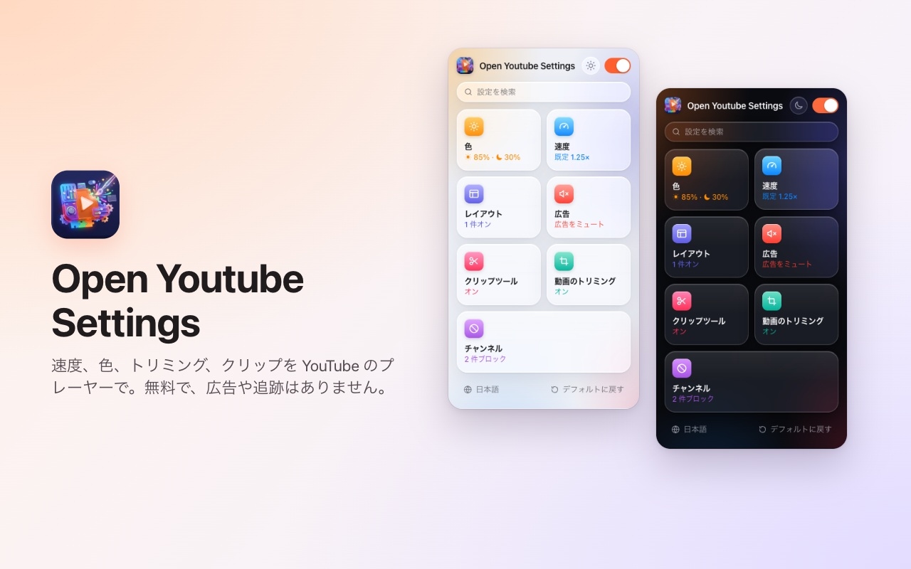
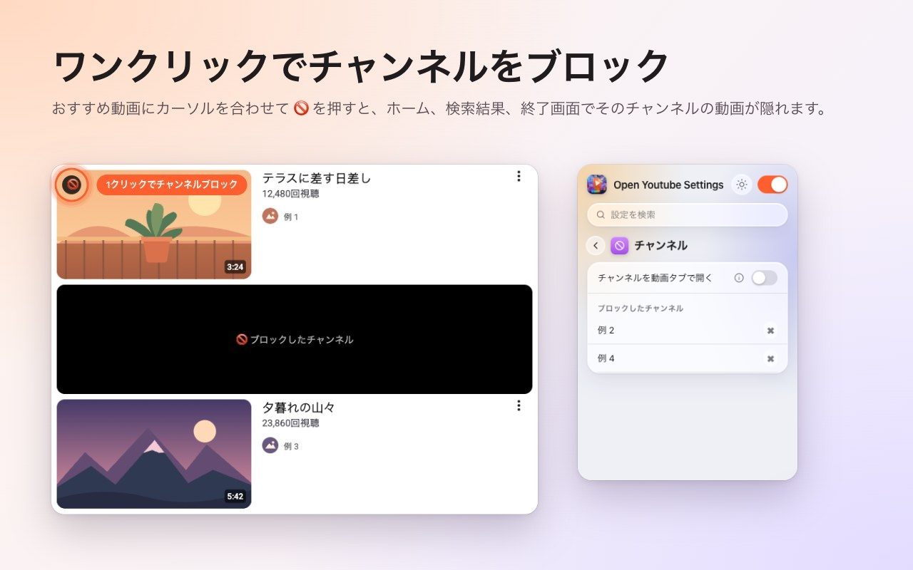
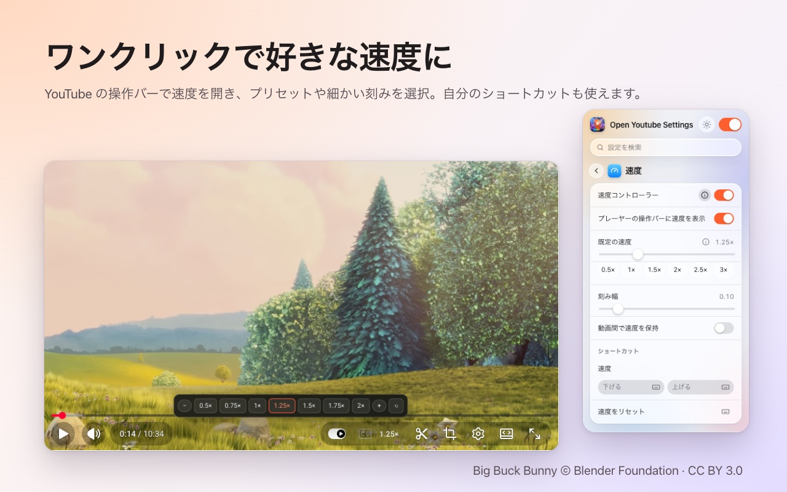
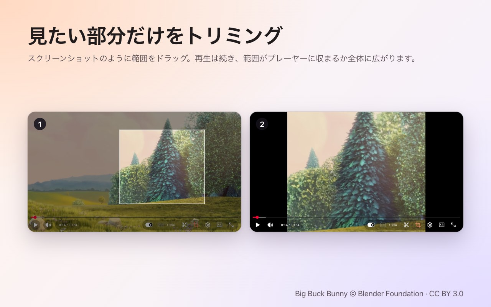
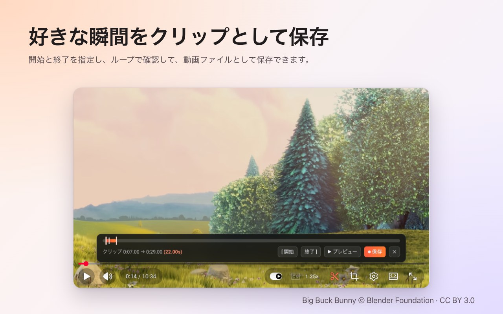

<p align="center">
  
</p>

<h1 align="center">Open Youtube Settings</h1>

<p align="center">
  ワンクリックで YouTube のチャンネルをブロック。速度、トリミング、クリップ、色の調整もプレーヤー上で。<br>
  <b>Chrome</b> と <b>Firefox</b> 向けの無料拡張機能。
</p>

<p align="center">
  ✅ <b>オープンソース</b> &nbsp;·&nbsp; ✅ <b>すっきりした画面</b> &nbsp;·&nbsp; ✅ <b>データを収集しない</b>
</p>

<p align="center">
  <a href="https://chromewebstore.google.com/detail/open-youtube-settings/commphgoijegmlhbkkbgbfbnemihdjod"><b>Chrome ウェブストア</b></a> ·
  <a href="../../releases/latest">最新リリース</a> ·
  <a href="https://www.youtube.com/watch?v=0iPOj1_EBRU">デモ動画</a>
</p>

<p align="center"><sub><a href="README.md">English</a> · <a href="README.tr.md">Türkçe</a> · <a href="README.de.md">Deutsch</a> · <a href="README.es.md">Español</a> · <a href="README.fr.md">Français</a> · <a href="README.it.md">Italiano</a> · <a href="README.pt-BR.md">Português (Brasil)</a> · <a href="README.nl.md">Nederlands</a> · <a href="README.pl.md">Polski</a> · <a href="README.ru.md">Русский</a> · <a href="README.uk.md">Українська</a> · <a href="README.ar.md">العربية</a> · <a href="README.hi.md">हिन्दी</a> · <a href="README.id.md">Bahasa Indonesia</a> · <a href="README.vi.md">Tiếng Việt</a> · <a href="README.th.md">ไทย</a> · <a href="README.ko.md">한국어</a> · <b>日本語</b> · <a href="README.zh-CN.md">简体中文</a> · <a href="README.zh-TW.md">繁體中文</a></sub></p>

<p align="center">
  
</p>

## Open Youtube Settings を選ぶ理由

- **オープンソース:** すべてのコードが MIT ライセンスでこの GitHub にあり、拡張機能が何をしているかを誰でも確認できます。
- **すっきりした画面:** 小さなウィンドウひとつと、YouTube のプレーヤー内のボタンだけ。ポップアップも広告も有料版もありません。
- **データを収集しない:** アカウントも分析もサーバーもありません。設定がブラウザの外に出ることはありません。

## 機能

### ワンクリックでチャンネルをブロック
おすすめ動画にマウスを重ねて 🚫 を押すだけ。以後、そのチャンネルのすべての動画がホーム、検索、終了画面で隠されます。ブロックは拡張機能のウィンドウからいつでも解除できます。



### プレーヤーで再生速度を変更
現在の速度は YouTube のコントロールバーに表示されます。クリックすると 0.5× から 2× までのプリセットと細かい刻みを選べ、独自のキーボードショートカットも使えます。すべての動画の既定速度を決めることも、直前の速度を次の動画に引き継ぐこともできます。



### 好きな範囲をトリミング
トリミングボタンを押し、スクリーンショットを撮るように動画上をドラッグします。動画は再生を続け、プレーヤーに**合わせる**か**全体に広げる**かを選べます。もう一度押すと動画全体に戻ります。トリミングは動画の終了とともに解除されます。



### クリップを保存
クリップバーを開いて開始点と終了点を指定し、ループでプレビューしてから動画ファイルとして保存します。クリップは自分の再生からリアルタイムで録画されます。



### 色とブルーライト
動画ごとに明るさ、ブルーライトフィルター、色の反転を調整でき、ショートカットで上げ下げできます。フィルターを Shorts にも適用するかを選べます。


### もっと落ち着いた YouTube
- **Shorts を完全にオフ:** 棚、検索結果、メニュー項目、チャンネルのタブが消え、Shorts のリンクは通常の動画として開きます。
- ホームのフィード、サイドバー、再生リストのパネルを非表示にできます。
- コントロールバーと再生/一時停止・スキップのアニメーションを非表示にできます。
- 広告を自動でミュートし、広告が終わるとすぐに音が戻ります。
- チャンネルのリンクを最初から動画タブで開きます。


### そのほか
- **スイッチひとつ**ですべてオフ。再びオンにするまで YouTube はそのまま動きます。
- すべての設定を**検索**。
- ほぼすべての設定に**キーボードショートカット**。
- ライト、ダーク、自動のテーマ。
- 20 言語: English, Türkçe, Deutsch, Español, Français, Italiano, Português (Brasil), Nederlands, Polski, Русский, Українська, العربية, हिन्दी, Bahasa Indonesia, Tiếng Việt, ไทย, 한국어, 日本語, 简体中文, 繁體中文.

## インストール

**Chrome / Edge / Brave:** [Chrome ウェブストア](https://chromewebstore.google.com/detail/open-youtube-settings/commphgoijegmlhbkkbgbfbnemihdjod)からインストールできます。

**Firefox:** Firefox Add-ons のページは近日公開予定です。それまでは下記の手順でリリースからインストールしてください。

**リリースから(手動):** [Releases](../../releases/latest) からブラウザ用の zip をダウンロードします。

- **Chrome / Edge / Brave:** 展開して `chrome://extensions` を開き、*デベロッパー モード* をオンにして *パッケージ化されていない拡張機能を読み込む* からフォルダを選びます。
- **Firefox:** `about:debugging#/runtime/this-firefox` を開き、*一時的なアドオンを読み込む…* から zip を選びます。一時的なアドオンは Firefox を再起動すると削除されます。

## プライバシー

この拡張機能はデータを一切収集せず、どこにも送信しません。設定はブラウザ自身の拡張機能ストレージに保存されます。求める権限は `storage` と `youtube.com` へのアクセスだけです。

## 開発

```bash
npm ci
npm run test:install   # Playwright Chromium and Firefox, once
npm test               # static, Chromium and Firefox tests against an offline YouTube fixture
npm run package        # builds dist/chrome-youtube-settings.zip and dist/firefox-youtube-settings.zip
```

`npm run test:live` は実際の youtube.com でいくつかの簡単なテストを実行します。

### リリース手順
1. `manifest.json`(と `package.json`)の `version` を上げます。
2. 同じ番号のタグをプッシュします。例: `git tag v0.9 && git push origin v0.9`。GitHub Actions がテストを実行し、2 つの zip を含むリリースを公開します。
3. *Actions → Publish to stores → Run workflow* でそのリリースを Chrome ウェブストアと Firefox Add-ons にアップロードします。

## ライセンス

[MIT](LICENSE)。不具合の報告やアイデアは [Issues](../../issues) へどうぞ。

---

<sub>スクリーンショットには <a href="https://peach.blender.org/">Big Buck Bunny</a> © 2008 Blender Foundation(<a href="https://creativecommons.org/licenses/by/3.0/">CC BY 3.0</a>)を使用しています。YouTube は Google LLC の商標です。このプロジェクトは Google と提携しておらず、Google の承認も受けていません。</sub>
