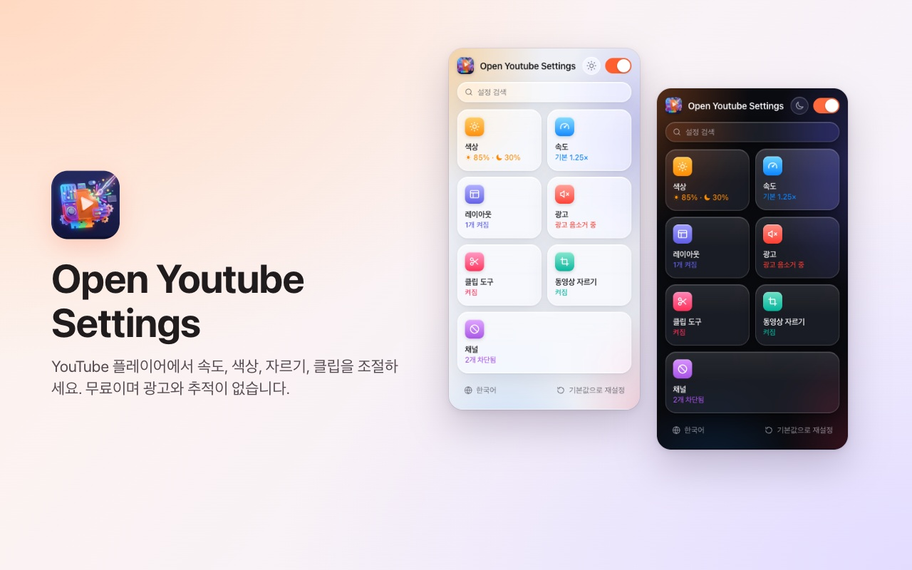
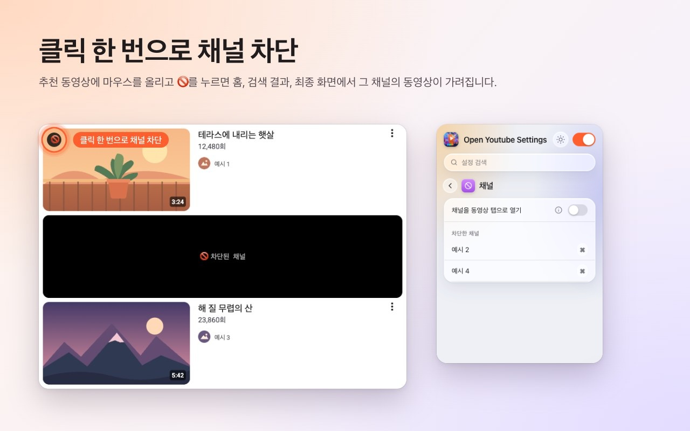
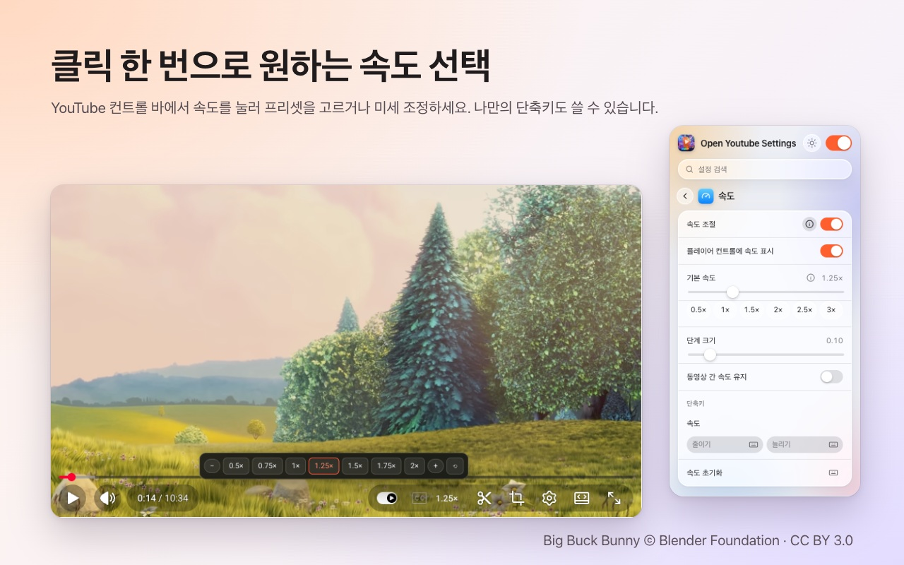
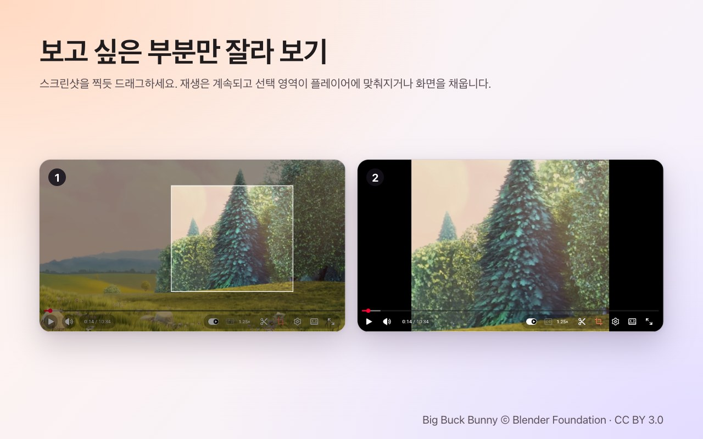
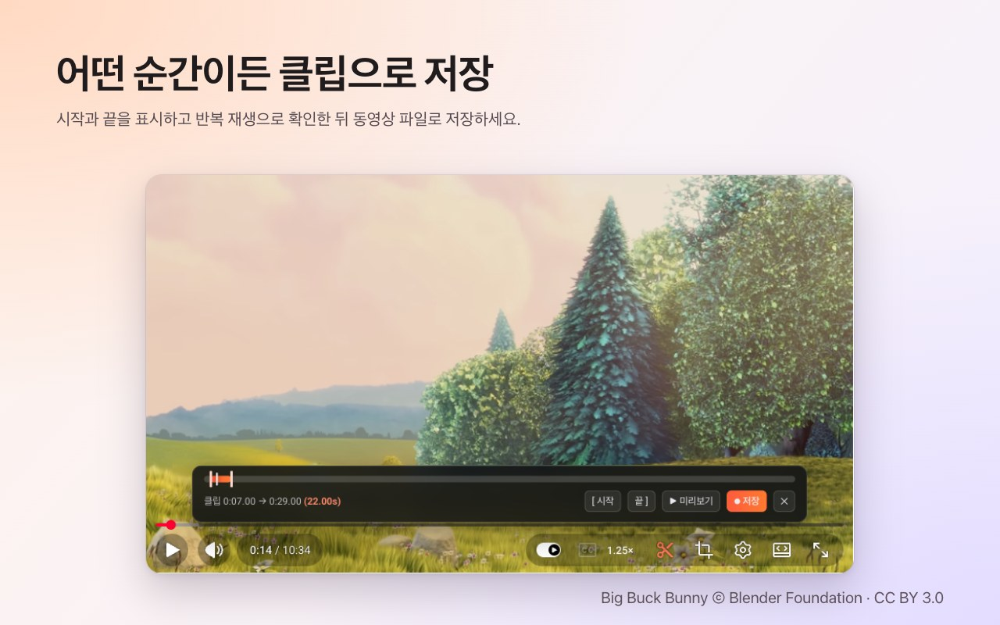

<p align="center">
  
</p>

<h1 align="center">Open Youtube Settings</h1>

<p align="center">
  클릭 한 번으로 YouTube 채널 차단 — 속도, 자르기, 클립, 색상도 플레이어에서 바로.<br>
  <b>Chrome</b>과 <b>Firefox</b>용 무료 확장 프로그램.
</p>

<p align="center">
  ✅ <b>오픈 소스</b> &nbsp;·&nbsp; ✅ <b>깔끔한 인터페이스</b> &nbsp;·&nbsp; ✅ <b>데이터 수집 없음</b>
</p>

<p align="center">
  <a href="https://chromewebstore.google.com/detail/open-youtube-settings/commphgoijegmlhbkkbgbfbnemihdjod"><b>Chrome 웹 스토어</b></a> ·
  <a href="../../releases/latest">최신 릴리스</a> ·
  <a href="https://www.youtube.com/watch?v=0iPOj1_EBRU">데모 영상</a>
</p>

<p align="center"><sub><a href="README.md">English</a> · <a href="README.tr.md">Türkçe</a> · <a href="README.de.md">Deutsch</a> · <a href="README.es.md">Español</a> · <a href="README.fr.md">Français</a> · <a href="README.it.md">Italiano</a> · <a href="README.pt-BR.md">Português (Brasil)</a> · <a href="README.nl.md">Nederlands</a> · <a href="README.pl.md">Polski</a> · <a href="README.ru.md">Русский</a> · <a href="README.uk.md">Українська</a> · <a href="README.ar.md">العربية</a> · <a href="README.hi.md">हिन्दी</a> · <a href="README.id.md">Bahasa Indonesia</a> · <a href="README.vi.md">Tiếng Việt</a> · <a href="README.th.md">ไทย</a> · <b>한국어</b> · <a href="README.ja.md">日本語</a> · <a href="README.zh-CN.md">简体中文</a> · <a href="README.zh-TW.md">繁體中文</a></sub></p>

<p align="center">
  
</p>

## 왜 Open Youtube Settings인가

- **오픈 소스:** 모든 코드가 MIT 라이선스로 이곳 GitHub에 있어 누구나 확장 프로그램이 정확히 무엇을 하는지 확인할 수 있습니다.
- **깔끔한 인터페이스:** 작은 창 하나와 YouTube 플레이어 안의 컨트롤. 팝업도, 광고도, 유료 버전도 없습니다.
- **데이터 수집 없음:** 계정도, 분석도, 서버도 없습니다. 설정은 브라우저 밖으로 나가지 않습니다.

## 기능

### 클릭 한 번으로 채널 차단
추천 동영상 위에 마우스를 올리고 🚫를 누르세요. 그때부터 그 채널의 모든 동영상이 홈, 검색, 종료 화면에서 가려집니다. 확장 프로그램 창에서 언제든 차단을 해제할 수 있습니다.



### 플레이어 안의 재생 속도
현재 속도가 YouTube 컨트롤 바에 표시됩니다. 클릭하면 0.5×부터 2×까지의 프리셋과 세밀한 단계를 고를 수 있고, 직접 정한 단축키도 쓸 수 있습니다. 모든 동영상의 기본 속도를 정하거나 마지막 속도를 다음 동영상에도 유지하세요.



### 원하는 영역 자르기
자르기 버튼을 누르고 스크린샷을 찍듯 동영상 위를 드래그하세요. 동영상은 계속 재생되며 플레이어에 **맞추거나** 플레이어를 **채웁니다**. 버튼을 다시 누르면 전체 동영상이 보입니다. 자르기는 동영상이 끝나면 해제됩니다.



### 클립 저장
클립 바를 열고 시작과 끝을 표시한 뒤 반복 재생으로 미리 보고 동영상 파일로 저장하세요. 클립은 내 재생 화면에서 실시간으로 녹화됩니다.



### 색상과 블루라이트
모든 동영상에 밝기, 블루라이트 필터, 색상 반전을 적용하고 단축키로 높이거나 낮출 수 있습니다. 필터를 Shorts에도 적용할지 선택하세요.


### 더 차분한 YouTube
- **Shorts 완전히 끄기:** 선반, 검색 결과, 메뉴 항목, 채널 탭이 사라지고 Shorts 링크는 일반 동영상으로 열립니다.
- 홈 피드, 사이드바, 재생목록 패널을 숨기세요.
- 컨트롤 바와 재생/일시정지, 건너뛰기 애니메이션을 숨기세요.
- 광고를 자동으로 음소거하고, 광고가 끝나면 소리가 바로 돌아옵니다.
- 채널 링크를 바로 동영상 탭으로 엽니다.


### 그리고
- **스위치 하나**로 모든 기능을 끕니다. 다시 켤 때까지 YouTube는 그대로 동작합니다.
- 모든 설정에서 **검색**.
- 거의 모든 설정에 **단축키**.
- 라이트, 다크 또는 자동 테마.
- 20개 언어: English, Türkçe, Deutsch, Español, Français, Italiano, Português (Brasil), Nederlands, Polski, Русский, Українська, العربية, हिन्दी, Bahasa Indonesia, Tiếng Việt, ไทย, 한국어, 日本語, 简体中文, 繁體中文.

## 설치

**Chrome / Edge / Brave:** [Chrome 웹 스토어](https://chromewebstore.google.com/detail/open-youtube-settings/commphgoijegmlhbkkbgbfbnemihdjod)에서 설치하세요.

**Firefox:** Firefox Add-ons 페이지는 곧 공개됩니다. 그때까지는 아래 설명대로 릴리스에서 설치하세요.

**릴리스에서 (수동):** [Releases](../../releases/latest)에서 브라우저에 맞는 zip 파일을 받으세요.

- **Chrome / Edge / Brave:** 압축을 풀고 `chrome://extensions`를 연 뒤 *개발자 모드*를 켜고 *압축해제된 확장 프로그램을 로드합니다*를 눌러 폴더를 선택하세요.
- **Firefox:** `about:debugging#/runtime/this-firefox`를 열고 *임시 부가 기능 로드…*를 눌러 zip 파일을 선택하세요. 임시 부가 기능은 Firefox를 다시 시작하면 삭제됩니다.

## 개인정보 보호

이 확장 프로그램은 어떤 데이터도 수집하지 않고 아무것도 전송하지 않습니다. 설정은 브라우저 자체의 확장 프로그램 저장소에 남습니다. `storage` 권한과 `youtube.com` 접근 권한만 요청합니다.

## 개발

```bash
npm ci
npm run test:install   # Playwright Chromium and Firefox, once
npm test               # static, Chromium and Firefox tests against an offline YouTube fixture
npm run package        # builds both store zips in dist/
```

`npm run test:live`는 실제 youtube.com에서 몇 가지 빠른 테스트를 실행합니다.

### 릴리스하기
1. `manifest.json`(과 `package.json`)의 `version`을 올리세요.
2. 같은 번호의 태그를 푸시하세요. 예: `git tag v0.13 && git push origin v0.13`. GitHub Actions가 테스트를 실행하고 두 zip 파일로 릴리스를 게시합니다.
3. *Actions → Publish to stores → Run workflow*가 그 릴리스를 Chrome 웹 스토어와 Firefox Add-ons에 업로드합니다.

## 라이선스

[MIT](LICENSE). 버그 신고와 아이디어는 [Issues](../../issues)에 남겨 주세요.

---

<sub>스크린샷에는 <a href="https://peach.blender.org/">Big Buck Bunny</a> © 2008 Blender Foundation(<a href="https://creativecommons.org/licenses/by/3.0/">CC BY 3.0</a> 라이선스)이 사용되었습니다. YouTube는 Google LLC의 상표이며, 이 프로젝트는 Google과 제휴하거나 Google의 보증을 받지 않았습니다.</sub>
