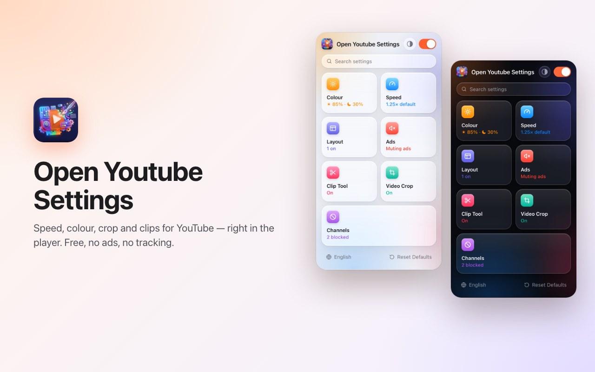
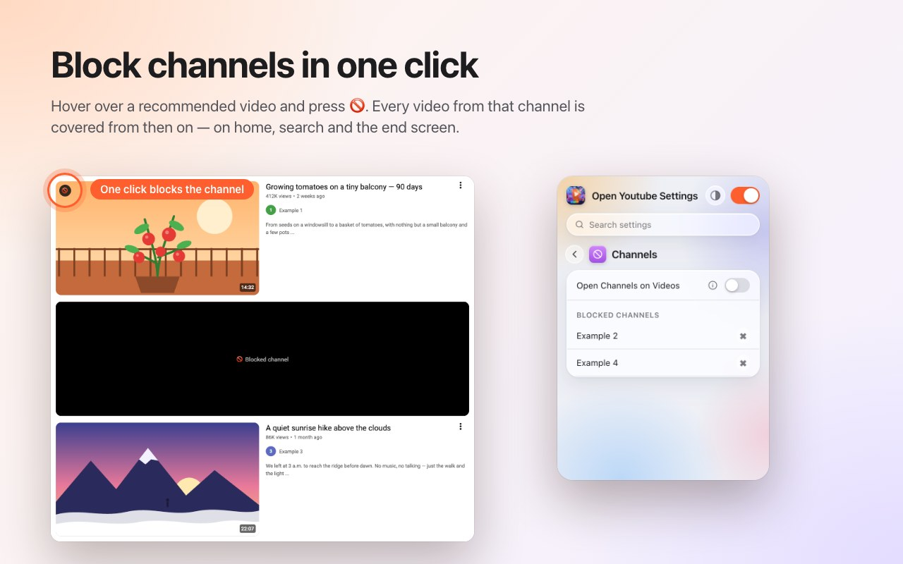
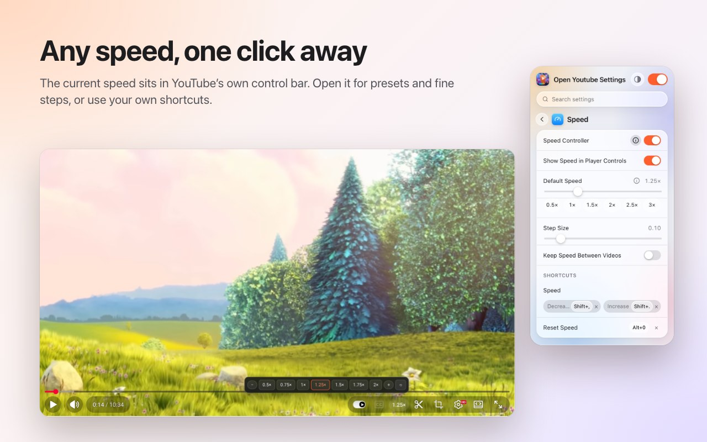
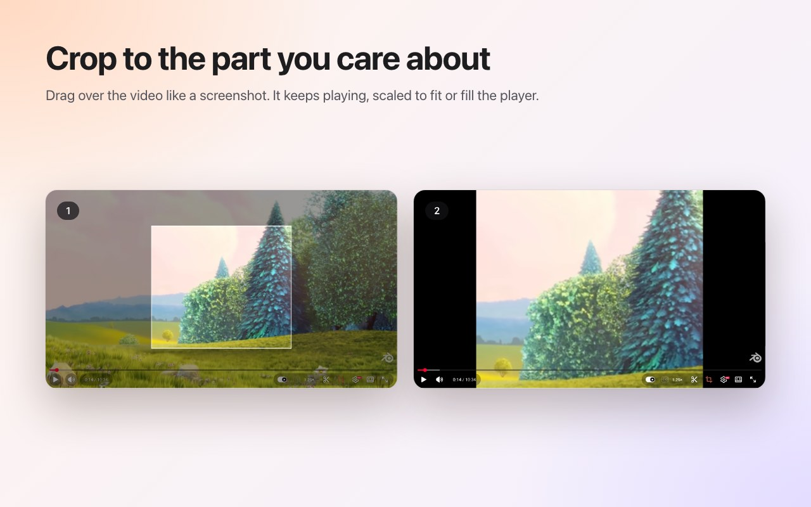
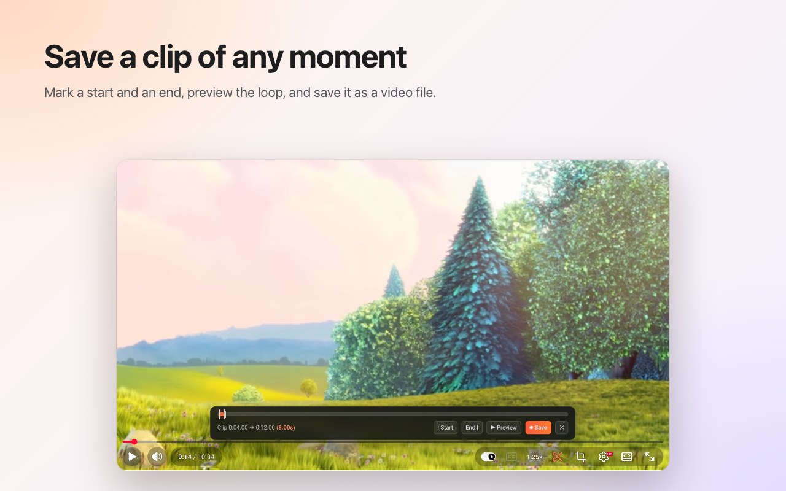

<p align="center">
  
</p>

<h1 align="center">Open Youtube Settings</h1>

<p align="center">
  Speed, colour, crop and clips for YouTube — right in the player.<br>
  A browser extension for <b>Chrome</b> and <b>Firefox</b>. Free, no ads, no tracking.
</p>

<p align="center">
  <a href="../../releases/latest"><b>Download the latest release</b></a> ·
  <a href="README.tr.md">Türkçe</a>
</p>

<p align="center">
  
</p>

## Features

### Block channels in one click
Hover over a recommended video and press 🚫. Every video from that channel is covered from then on — on the home page, in search and on the end screen. Unblock a channel any time from the popup.



### Playback speed in the player
The current speed sits in YouTube's own control bar. Click it for presets from 0.5× to 2× and fine steps, or use your own keyboard shortcuts. Set a default speed for every video, or keep the last one between videos.



### Crop to any area
Press the crop button and drag over the video, like taking a screenshot. The video keeps playing, scaled to **fit** the player or **fill** it. Press the button again to see the whole video. The crop ends with the video.



### Save clips
Open the clip bar, mark a start and an end, preview the loop and save it as a video file. The clip is recorded in real time from your own playback.



### Colour and blue light
Brightness, a blue-light filter and colour inversion for every video, with shortcuts to raise or lower them. Choose whether the filters also apply to Shorts.


### A calmer YouTube
- **Turn off Shorts completely:** shelves, search results, the menu entry and the channel tab disappear; a Shorts link opens as a normal video.
- Hide the home feed, the sidebar or the playlist panel.
- Hide the control bar, the play/pause and the skip animations.
- **Block channels:** hover over a recommended video and press 🚫. That channel's videos are covered from then on.
- Mute ads automatically; the sound comes back as soon as the ad ends.
- Open channel links straight on the Videos tab.


### And also
- **One switch** turns everything off; YouTube runs untouched until you turn it back on.
- **Search** across every setting.
- A **keyboard shortcut** for almost every setting.
- Light, dark or automatic appearance.
- 20 languages: English, Türkçe, Deutsch, Español, Français, Italiano, Português (Brasil), Nederlands, Polski, Русский, Українська, العربية, हिन्दी, Bahasa Indonesia, Tiếng Việt, ไทย, 한국어, 日本語, 简体中文, 繁體中文.

## Install

**From the stores:** Chrome Web Store and Firefox Add-ons links will be added here once the listings are approved.

**From a release (manual):** download the zip for your browser from [Releases](../../releases/latest).

- **Chrome / Edge / Brave:** unzip it, open `chrome://extensions`, turn on *Developer mode*, choose *Load unpacked* and select the unzipped folder.
- **Firefox:** open `about:debugging#/runtime/this-firefox`, choose *Load Temporary Add-on…* and select the zip. Temporary add-ons are removed when Firefox restarts; use the Firefox Add-ons version for a permanent install.

## Privacy

The extension collects no data and sends nothing anywhere. Your settings stay in the browser's own extension storage. It only asks for the `storage` permission and access to `youtube.com`.

## Development

```bash
npm ci
npm run test:install   # Playwright Chromium and Firefox, once
npm test               # static, Chromium and Firefox tests against an offline YouTube fixture
npm run package        # builds dist/chrome-youtube-settings.zip and dist/firefox-youtube-settings.zip
```

`npm run test:live` runs a few smoke tests against the real youtube.com.

### Releasing
1. Raise `version` in `manifest.json` (and `package.json`).
2. Push a matching tag, for example `git tag v0.9 && git push origin v0.9`. GitHub Actions runs the tests and publishes a release with both zips.
3. *Actions → Publish to stores → Run workflow* uploads that release to the Chrome Web Store and Firefox Add-ons.

---

<sub>Screenshots use <a href="https://peach.blender.org/">Big Buck Bunny</a> © 2008 Blender Foundation, licensed under <a href="https://creativecommons.org/licenses/by/3.0/">CC BY 3.0</a>. YouTube is a trademark of Google LLC; this project is not affiliated with or endorsed by Google.</sub>
