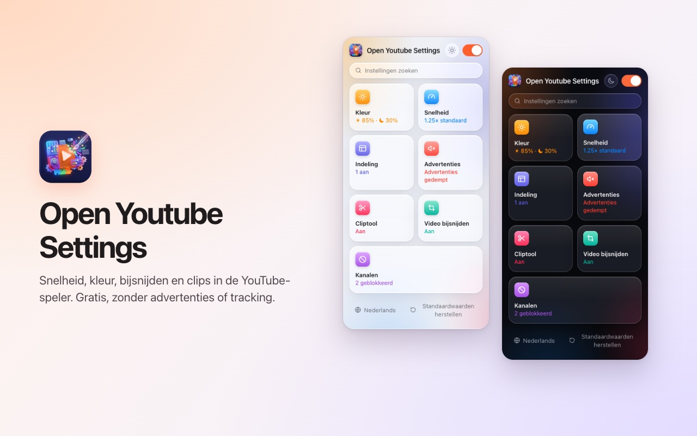
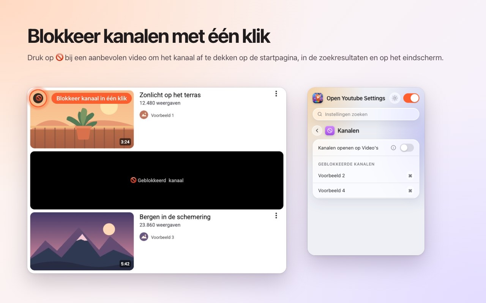
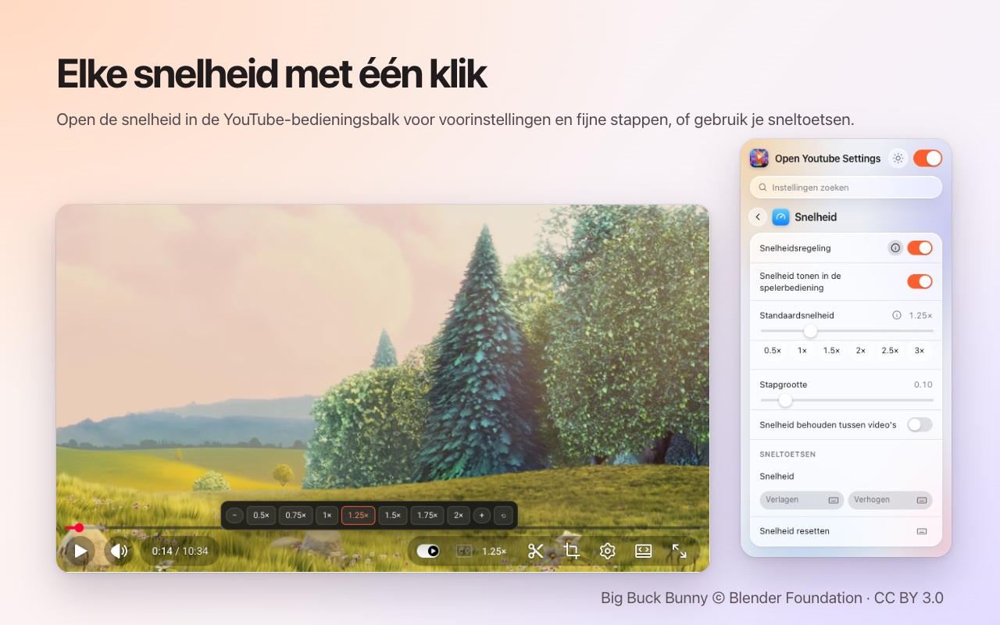
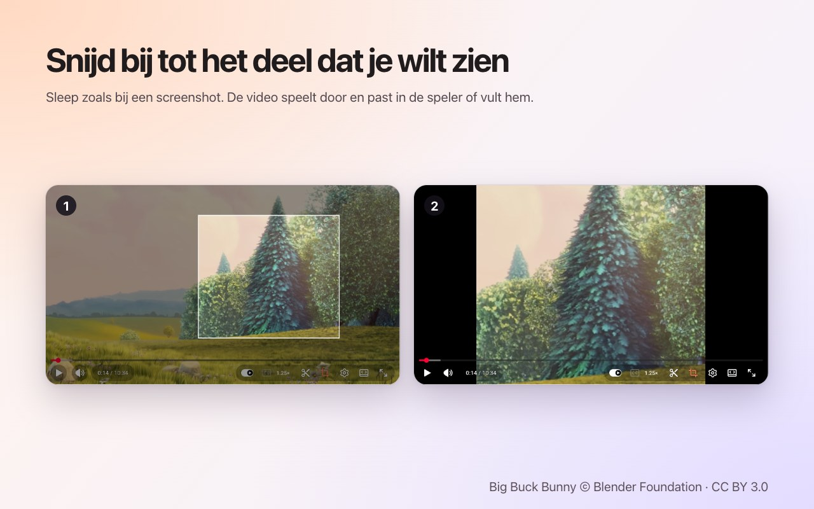
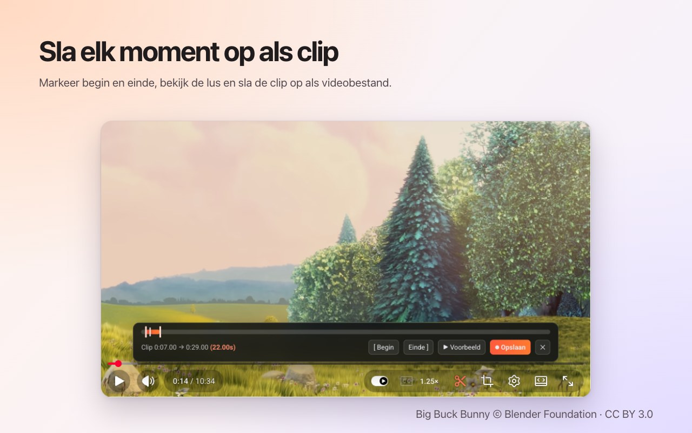

<p align="center">
  
</p>

<h1 align="center">Open Youtube Settings</h1>

<p align="center">
  Blokkeer YouTube-kanalen met één klik – plus snelheid, bijsnijden, clips en kleur, direct in de speler.<br>
  Een gratis browserextensie voor <b>Chrome</b> en <b>Firefox</b>.
</p>

<p align="center">
  ✅ <b>Open source</b> &nbsp;·&nbsp; ✅ <b>Overzichtelijke interface</b> &nbsp;·&nbsp; ✅ <b>Verzamelt geen gegevens</b>
</p>

<p align="center">
  <a href="https://chromewebstore.google.com/detail/open-youtube-settings/commphgoijegmlhbkkbgbfbnemihdjod"><b>Chrome Web Store</b></a> ·
  <a href="../../releases/latest">Nieuwste versie</a> ·
  <a href="https://www.youtube.com/watch?v=0iPOj1_EBRU">Demovideo</a>
</p>

<p align="center"><sub><a href="README.md">English</a> · <a href="README.tr.md">Türkçe</a> · <a href="README.de.md">Deutsch</a> · <a href="README.es.md">Español</a> · <a href="README.fr.md">Français</a> · <a href="README.it.md">Italiano</a> · <a href="README.pt-BR.md">Português (Brasil)</a> · <b>Nederlands</b> · <a href="README.pl.md">Polski</a> · <a href="README.ru.md">Русский</a> · <a href="README.uk.md">Українська</a> · <a href="README.ar.md">العربية</a> · <a href="README.hi.md">हिन्दी</a> · <a href="README.id.md">Bahasa Indonesia</a> · <a href="README.vi.md">Tiếng Việt</a> · <a href="README.th.md">ไทย</a> · <a href="README.ko.md">한국어</a> · <a href="README.ja.md">日本語</a> · <a href="README.zh-CN.md">简体中文</a> · <a href="README.zh-TW.md">繁體中文</a></sub></p>

<p align="center">
  
</p>

## Waarom Open Youtube Settings

- **Open source:** alle code staat hier op GitHub onder de MIT-licentie, zodat iedereen precies kan nagaan wat de extensie doet.
- **Overzichtelijke interface:** één klein venster en bediening in de eigen speler van YouTube. Geen pop-ups, geen advertenties, geen betaalde versie.
- **Verzamelt geen gegevens:** geen account, geen statistieken, geen server. Je instellingen verlaten nooit je browser.

## Functies

### Kanalen blokkeren met één klik
Beweeg over een aanbevolen video en druk op 🚫. Vanaf dan wordt elke video van dat kanaal afgedekt – op de startpagina, in de zoekresultaten en op het eindscherm. Deblokkeer een kanaal wanneer je wilt via het venster van de extensie.



### Afspeelsnelheid in de speler
De huidige snelheid staat in de eigen bedieningsbalk van YouTube. Klik erop voor voorinstellingen van 0.5× tot 2× en fijne stappen, of gebruik je eigen sneltoetsen. Stel een standaardsnelheid in voor elke video of houd de laatste vast tussen video's.



### Elk gebied bijsnijden
Druk op de bijsnijknop en sleep over de video, zoals bij een schermafbeelding. De video blijft spelen, **passend** in de speler of **vullend**. Druk nogmaals op de knop om de hele video te zien. Het bijsnijden stopt met de video.



### Clips opslaan
Open de clipbalk, markeer een begin en een einde, bekijk de lus en sla hem op als videobestand. De clip wordt in realtime opgenomen uit je eigen weergave.



### Kleur en blauw licht
Helderheid, een blauwlichtfilter en kleurinversie voor elke video, met sneltoetsen om ze hoger of lager te zetten. Kies of de filters ook voor Shorts gelden.


### Een rustiger YouTube
- **Shorts volledig uitzetten:** planken, zoekresultaten, het menu-item en het kanaaltabblad verdwijnen; een Shorts-link opent als gewone video.
- Verberg de startfeed, de zijbalk of het afspeellijstpaneel.
- Verberg de bedieningsbalk en de animaties voor afspelen/pauzeren en overslaan.
- Demp advertenties automatisch; het geluid komt terug zodra de advertentie voorbij is.
- Open kanaallinks direct op het tabblad Video's.


### En verder
- **Eén schakelaar** zet alles uit; YouTube blijft onaangeroerd tot je hem weer aanzet.
- **Zoeken** in alle instellingen.
- Een **sneltoets** voor bijna elke instelling.
- Lichte, donkere of automatische weergave.
- 20 talen: English, Türkçe, Deutsch, Español, Français, Italiano, Português (Brasil), Nederlands, Polski, Русский, Українська, العربية, हिन्दी, Bahasa Indonesia, Tiếng Việt, ไทย, 한국어, 日本語, 简体中文, 繁體中文.

## Installeren

**Chrome / Edge / Brave:** installeer via de [Chrome Web Store](https://chromewebstore.google.com/detail/open-youtube-settings/commphgoijegmlhbkkbgbfbnemihdjod).

**Firefox:** de pagina op Firefox Add-ons komt eraan. Installeer tot die tijd vanuit een versie, zoals hieronder beschreven.

**Vanuit een versie (handmatig):** download de zip voor je browser via [Releases](../../releases/latest).

- **Chrome / Edge / Brave:** pak hem uit, open `chrome://extensions`, zet de *Ontwikkelaarsmodus* aan, kies *Uitgepakte extensie laden* en selecteer de map.
- **Firefox:** open `about:debugging#/runtime/this-firefox`, kies *Tijdelijke add-on laden…* en selecteer de zip. Tijdelijke add-ons worden verwijderd als Firefox opnieuw start.

## Privacy

De extensie verzamelt geen gegevens en verstuurt niets. Je instellingen blijven in de extensieopslag van de browser zelf. Ze vraagt alleen de machtiging `storage` en toegang tot `youtube.com`.

## Ontwikkeling

```bash
npm ci
npm run test:install   # Playwright Chromium and Firefox, once
npm test               # static, Chromium and Firefox tests against an offline YouTube fixture
npm run package        # builds dist/chrome-youtube-settings.zip and dist/firefox-youtube-settings.zip
```

`npm run test:live` voert een paar snelle tests uit op het echte youtube.com.

### Een versie uitbrengen
1. Verhoog `version` in `manifest.json` (en `package.json`).
2. Push een bijbehorende tag, bijvoorbeeld `git tag v0.9 && git push origin v0.9`. GitHub Actions voert de tests uit en publiceert een versie met beide zips.
3. *Actions → Publish to stores → Run workflow* uploadt die versie naar de Chrome Web Store en Firefox Add-ons.

## Licentie

[MIT](LICENSE). Foutmeldingen en ideeën zijn welkom bij [Issues](../../issues).

---

<sub>De schermafbeeldingen gebruiken <a href="https://peach.blender.org/">Big Buck Bunny</a> © 2008 Blender Foundation, gelicentieerd onder <a href="https://creativecommons.org/licenses/by/3.0/">CC BY 3.0</a>. YouTube is een handelsmerk van Google LLC; dit project is niet verbonden aan of goedgekeurd door Google.</sub>
