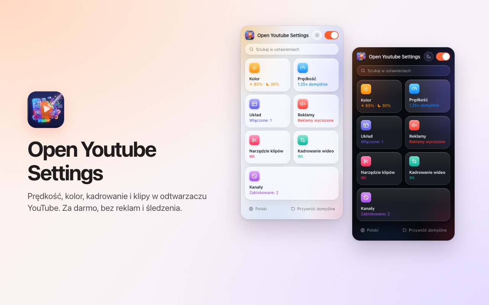
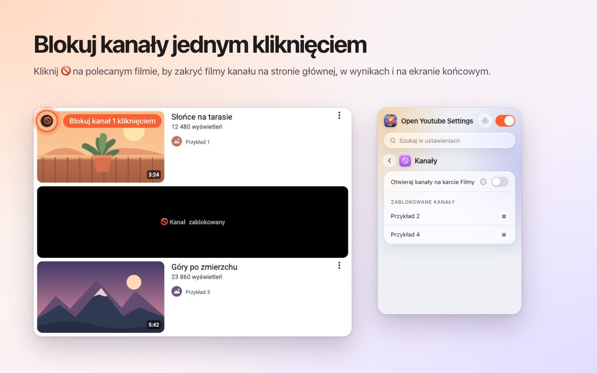
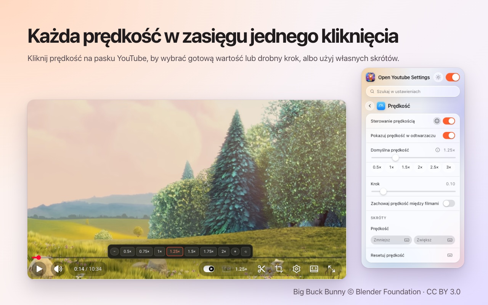
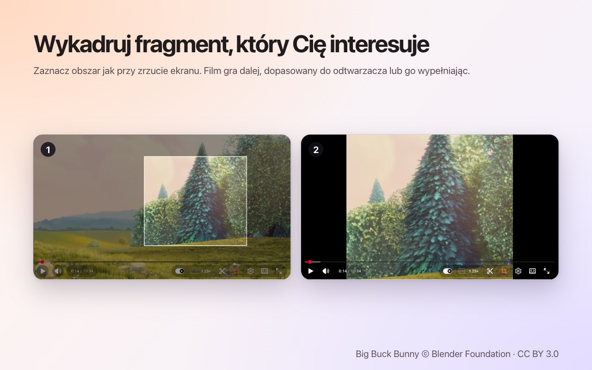
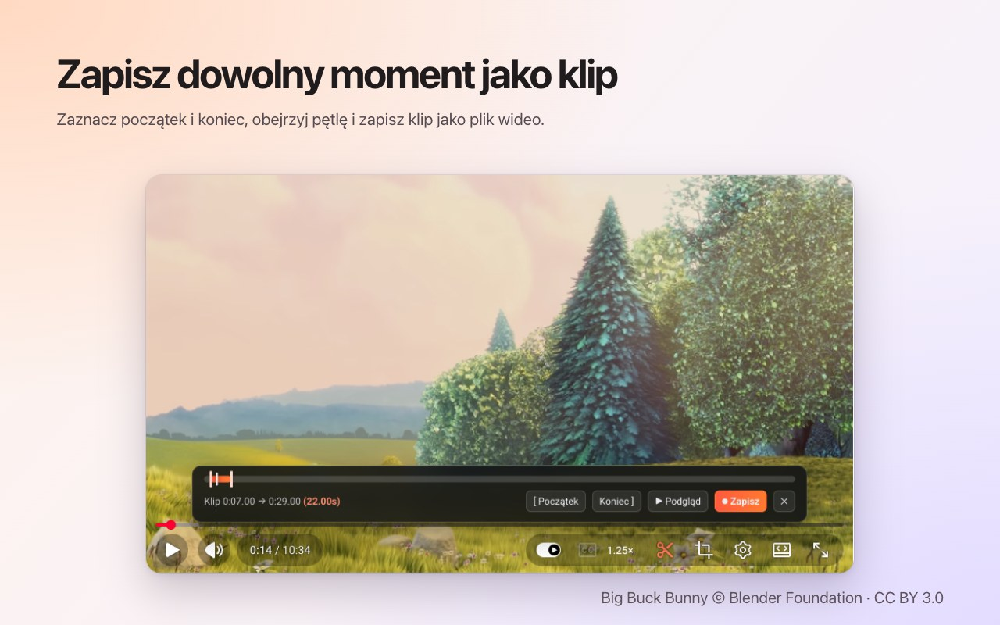

<p align="center">
  
</p>

<h1 align="center">Open Youtube Settings</h1>

<p align="center">
  Blokuj kanały YouTube jednym kliknięciem – a do tego prędkość, kadrowanie, klipy i kolory, prosto w odtwarzaczu.<br>
  Darmowe rozszerzenie dla <b>Chrome</b> i <b>Firefox</b>.
</p>

<p align="center">
  ✅ <b>Open source</b> &nbsp;·&nbsp; ✅ <b>Przejrzysty interfejs</b> &nbsp;·&nbsp; ✅ <b>Nie zbiera danych</b>
</p>

<p align="center">
  <a href="https://chromewebstore.google.com/detail/open-youtube-settings/commphgoijegmlhbkkbgbfbnemihdjod"><b>Chrome Web Store</b></a> ·
  <a href="../../releases/latest">Najnowsza wersja</a> ·
  <a href="https://www.youtube.com/watch?v=0iPOj1_EBRU">Film demonstracyjny</a>
</p>

<p align="center"><sub><a href="README.md">English</a> · <a href="README.tr.md">Türkçe</a> · <a href="README.de.md">Deutsch</a> · <a href="README.es.md">Español</a> · <a href="README.fr.md">Français</a> · <a href="README.it.md">Italiano</a> · <a href="README.pt-BR.md">Português (Brasil)</a> · <a href="README.nl.md">Nederlands</a> · <b>Polski</b> · <a href="README.ru.md">Русский</a> · <a href="README.uk.md">Українська</a> · <a href="README.ar.md">العربية</a> · <a href="README.hi.md">हिन्दी</a> · <a href="README.id.md">Bahasa Indonesia</a> · <a href="README.vi.md">Tiếng Việt</a> · <a href="README.th.md">ไทย</a> · <a href="README.ko.md">한국어</a> · <a href="README.ja.md">日本語</a> · <a href="README.zh-CN.md">简体中文</a> · <a href="README.zh-TW.md">繁體中文</a></sub></p>

<p align="center">
  
</p>

## Dlaczego Open Youtube Settings

- **Open source:** cały kod jest tutaj, na GitHubie, na licencji MIT, więc każdy może sprawdzić, co dokładnie robi rozszerzenie.
- **Przejrzysty interfejs:** jedno małe okno i przyciski w samym odtwarzaczu YouTube. Bez wyskakujących okien, reklam i płatnej wersji.
- **Nie zbiera danych:** bez konta, bez analityki, bez serwera. Twoje ustawienia nigdy nie opuszczają przeglądarki.

## Funkcje

### Blokuj kanały jednym kliknięciem
Najedź na polecany film i naciśnij 🚫. Od tej chwili każdy film z tego kanału jest zakryty – na stronie głównej, w wyszukiwaniu i na ekranie końcowym. Odblokuj kanał w dowolnej chwili w oknie rozszerzenia.



### Prędkość odtwarzania w odtwarzaczu
Bieżąca prędkość jest na pasku sterowania YouTube. Kliknij, aby wybrać ustawienia od 0.5× do 2× i drobne kroki, albo użyj własnych skrótów klawiszowych. Ustaw domyślną prędkość dla każdego filmu lub zachowuj ostatnią między filmami.



### Kadruj dowolny obszar
Naciśnij przycisk kadrowania i przeciągnij po filmie, jak przy zrzucie ekranu. Film gra dalej, **dopasowany** do odtwarzacza albo go **wypełniając**. Naciśnij przycisk ponownie, aby zobaczyć cały film. Kadrowanie kończy się wraz z filmem.



### Zapisuj klipy
Otwórz pasek klipu, zaznacz początek i koniec, obejrzyj pętlę i zapisz ją jako plik wideo. Klip jest nagrywany w czasie rzeczywistym z Twojego odtwarzania.



### Kolory i światło niebieskie
Jasność, filtr światła niebieskiego i odwrócenie kolorów dla każdego filmu, ze skrótami do zwiększania i zmniejszania. Wybierz, czy filtry działają też w Shorts.


### Spokojniejszy YouTube
- **Całkowicie wyłącz Shorts:** znikają półki, wyniki wyszukiwania, pozycja w menu i karta kanału; link do Shorts otwiera się jako zwykły film.
- Ukryj kanał strony głównej, pasek boczny lub panel playlisty.
- Ukryj pasek sterowania oraz animacje odtwarzania/pauzy i przewijania.
- Automatycznie wyciszaj reklamy; dźwięk wraca, gdy reklama się skończy.
- Otwieraj linki do kanałów od razu na karcie Filmy.


### A także
- **Jeden przełącznik** wyłącza wszystko; YouTube działa bez zmian, dopóki go nie włączysz.
- **Wyszukiwanie** we wszystkich ustawieniach.
- **Skrót klawiszowy** dla prawie każdego ustawienia.
- Wygląd jasny, ciemny lub automatyczny.
- 20 języków: English, Türkçe, Deutsch, Español, Français, Italiano, Português (Brasil), Nederlands, Polski, Русский, Українська, العربية, हिन्दी, Bahasa Indonesia, Tiếng Việt, ไทย, 한국어, 日本語, 简体中文, 繁體中文.

## Instalacja

**Chrome / Edge / Brave:** zainstaluj z [Chrome Web Store](https://chromewebstore.google.com/detail/open-youtube-settings/commphgoijegmlhbkkbgbfbnemihdjod).

**Firefox:** strona w Firefox Add-ons jest w drodze. Do tego czasu zainstaluj rozszerzenie z wydania, jak opisano niżej.

**Z wydania (ręcznie):** pobierz plik zip dla swojej przeglądarki z [Releases](../../releases/latest).

- **Chrome / Edge / Brave:** rozpakuj go, otwórz `chrome://extensions`, włącz *Tryb dewelopera*, wybierz *Załaduj rozpakowane* i wskaż folder.
- **Firefox:** otwórz `about:debugging#/runtime/this-firefox`, wybierz *Wczytaj tymczasowy dodatek…* i wskaż plik zip. Tymczasowe dodatki znikają po ponownym uruchomieniu Firefoksa.

## Prywatność

Rozszerzenie nie zbiera danych i niczego nigdzie nie wysyła. Twoje ustawienia zostają w pamięci rozszerzeń przeglądarki. Prosi tylko o uprawnienie `storage` i dostęp do `youtube.com`.

## Rozwój

```bash
npm ci
npm run test:install   # Playwright Chromium and Firefox, once
npm test               # static, Chromium and Firefox tests against an offline YouTube fixture
npm run package        # builds dist/chrome-youtube-settings.zip and dist/firefox-youtube-settings.zip
```

`npm run test:live` uruchamia kilka szybkich testów na prawdziwym youtube.com.

### Wydawanie wersji
1. Zwiększ `version` w `manifest.json` (i `package.json`).
2. Wypchnij pasujący tag, na przykład `git tag v0.9 && git push origin v0.9`. GitHub Actions uruchamia testy i publikuje wydanie z oboma plikami zip.
3. *Actions → Publish to stores → Run workflow* wysyła to wydanie do Chrome Web Store i Firefox Add-ons.

## Licencja

[MIT](LICENSE). Zgłoszenia błędów i pomysły są mile widziane w [Issues](../../issues).

---

<sub>Zrzuty ekranu wykorzystują <a href="https://peach.blender.org/">Big Buck Bunny</a> © 2008 Blender Foundation na licencji <a href="https://creativecommons.org/licenses/by/3.0/">CC BY 3.0</a>. YouTube jest znakiem towarowym Google LLC; ten projekt nie jest powiązany z Google ani przez nie popierany.</sub>
