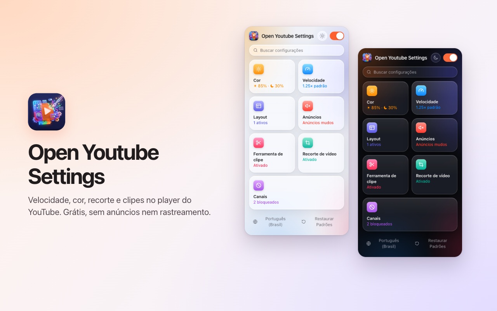
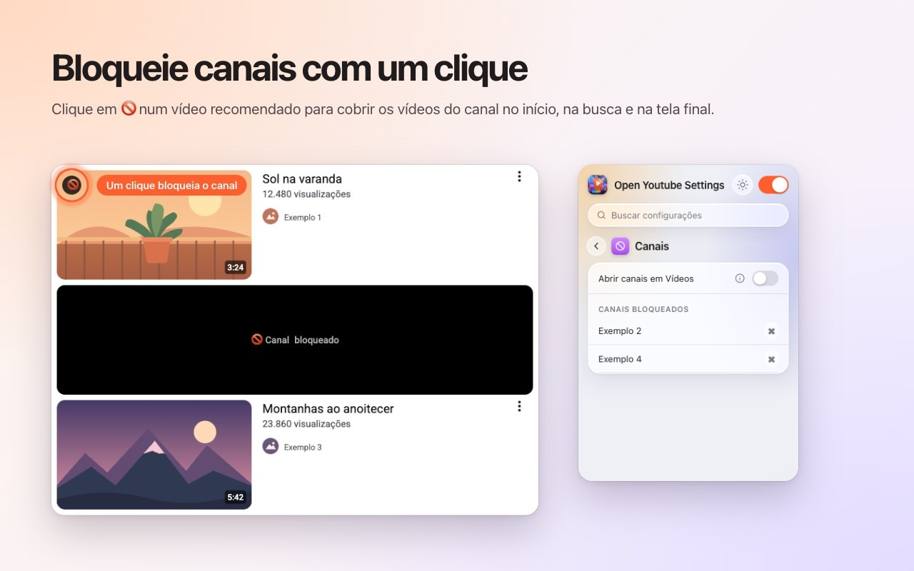
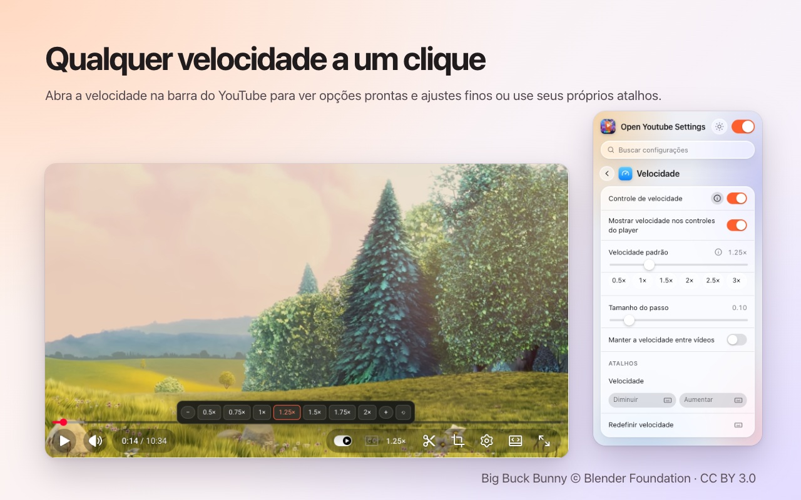
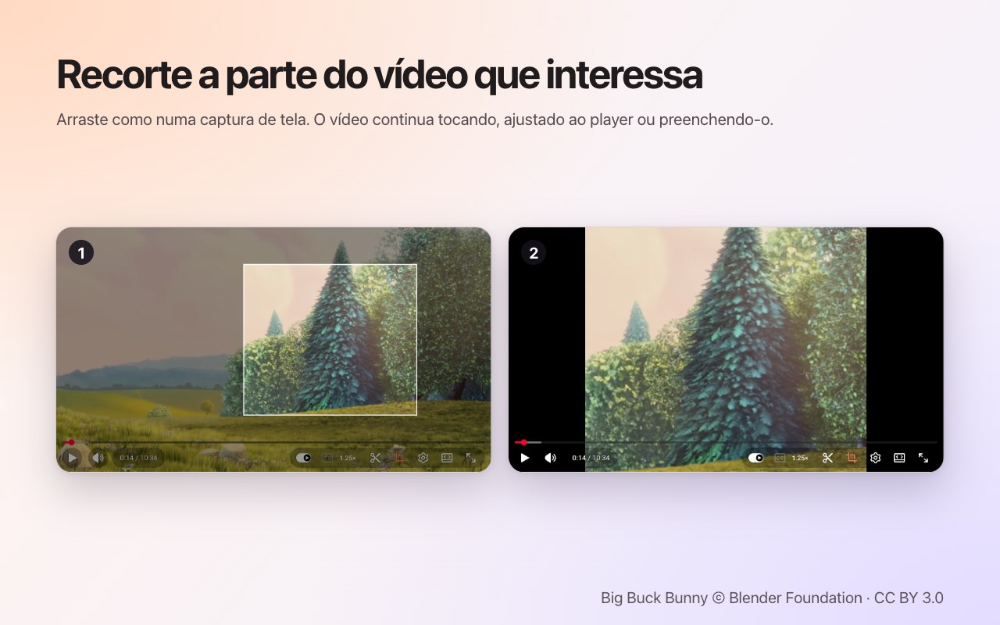
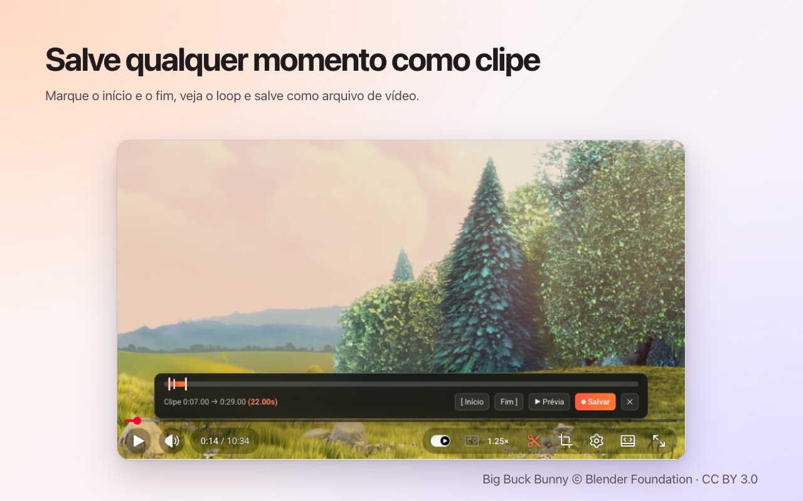

<p align="center">
  
</p>

<h1 align="center">Open Youtube Settings</h1>

<p align="center">
  Bloqueie canais do YouTube com um clique — além de velocidade, corte, clipes e cor, direto no player.<br>
  Uma extensão gratuita para <b>Chrome</b> e <b>Firefox</b>.
</p>

<p align="center">
  ✅ <b>Código aberto</b> &nbsp;·&nbsp; ✅ <b>Interface limpa</b> &nbsp;·&nbsp; ✅ <b>Não coleta dados</b>
</p>

<p align="center">
  <a href="https://chromewebstore.google.com/detail/open-youtube-settings/commphgoijegmlhbkkbgbfbnemihdjod"><b>Chrome Web Store</b></a> ·
  <a href="../../releases/latest">Versão mais recente</a> ·
  <a href="https://www.youtube.com/watch?v=0iPOj1_EBRU">Vídeo de demonstração</a>
</p>

<p align="center"><sub><a href="README.md">English</a> · <a href="README.tr.md">Türkçe</a> · <a href="README.de.md">Deutsch</a> · <a href="README.es.md">Español</a> · <a href="README.fr.md">Français</a> · <a href="README.it.md">Italiano</a> · <b>Português (Brasil)</b> · <a href="README.nl.md">Nederlands</a> · <a href="README.pl.md">Polski</a> · <a href="README.ru.md">Русский</a> · <a href="README.uk.md">Українська</a> · <a href="README.ar.md">العربية</a> · <a href="README.hi.md">हिन्दी</a> · <a href="README.id.md">Bahasa Indonesia</a> · <a href="README.vi.md">Tiếng Việt</a> · <a href="README.th.md">ไทย</a> · <a href="README.ko.md">한국어</a> · <a href="README.ja.md">日本語</a> · <a href="README.zh-CN.md">简体中文</a> · <a href="README.zh-TW.md">繁體中文</a></sub></p>

<p align="center">
  
</p>

## Por que Open Youtube Settings

- **Código aberto:** todo o código está aqui no GitHub sob a licença MIT, então qualquer pessoa pode conferir exatamente o que a extensão faz.
- **Interface limpa:** uma janela pequena e controles dentro do próprio player do YouTube. Sem pop-ups, sem anúncios, sem versão paga.
- **Não coleta dados:** sem conta, sem análises, sem servidor. Suas configurações nunca saem do navegador.

## Recursos

### Bloqueie canais com um clique
Passe o mouse sobre um vídeo recomendado e pressione 🚫. A partir daí, todos os vídeos desse canal ficam cobertos — na página inicial, na busca e na tela final. Desbloqueie um canal quando quiser pela janela da extensão.



### Velocidade de reprodução no player
A velocidade atual fica na própria barra de controles do YouTube. Clique para escolher predefinições de 0.5× a 2× e passos finos, ou use seus atalhos de teclado. Defina uma velocidade padrão para cada vídeo ou mantenha a última entre vídeos.



### Corte qualquer área
Pressione o botão de corte e arraste sobre o vídeo, como numa captura de tela. O vídeo continua tocando, **ajustado** ao player ou **preenchendo** o player. Pressione o botão de novo para ver o vídeo inteiro. O corte termina com o vídeo.



### Salve clipes
Abra a barra de clipes, marque início e fim, veja o loop e salve como arquivo de vídeo. O clipe é gravado em tempo real a partir da sua própria reprodução.



### Cor e luz azul
Brilho, filtro de luz azul e inversão de cores para cada vídeo, com atalhos para aumentar ou diminuir. Escolha se os filtros também valem para os Shorts.


### Um YouTube mais tranquilo
- **Desative os Shorts por completo:** prateleiras, resultados de busca, o item do menu e a aba do canal somem; um link de Shorts abre como vídeo normal.
- Oculte o feed inicial, a barra lateral ou o painel da playlist.
- Oculte a barra de controles e as animações de reproduzir/pausar e de pular.
- Silencie anúncios automaticamente; o som volta assim que o anúncio termina.
- Abra links de canais direto na aba Vídeos.


### E também
- **Um único botão** desliga tudo; o YouTube fica intacto até você ligar de novo.
- **Busca** em todas as configurações.
- Um **atalho de teclado** para quase todas as configurações.
- Aparência clara, escura ou automática.
- 20 idiomas: English, Türkçe, Deutsch, Español, Français, Italiano, Português (Brasil), Nederlands, Polski, Русский, Українська, العربية, हिन्दी, Bahasa Indonesia, Tiếng Việt, ไทย, 한국어, 日本語, 简体中文, 繁體中文.

## Instalação

**Chrome / Edge / Brave:** instale pela [Chrome Web Store](https://chromewebstore.google.com/detail/open-youtube-settings/commphgoijegmlhbkkbgbfbnemihdjod).

**Firefox:** a página no Firefox Add-ons está a caminho. Até lá, instale a partir de uma versão, como explicado abaixo.

**A partir de uma versão (manual):** baixe o zip do seu navegador em [Releases](../../releases/latest).

- **Chrome / Edge / Brave:** descompacte, abra `chrome://extensions`, ative o *Modo do desenvolvedor*, escolha *Carregar sem compactação* e selecione a pasta.
- **Firefox:** abra `about:debugging#/runtime/this-firefox`, escolha *Carregar extensão temporária…* e selecione o zip. Extensões temporárias são removidas quando o Firefox reinicia.

## Privacidade

A extensão não coleta dados e não envia nada a lugar nenhum. Suas configurações ficam no armazenamento de extensões do próprio navegador. Ela só pede a permissão `storage` e acesso a `youtube.com`.

## Desenvolvimento

```bash
npm ci
npm run test:install   # Playwright Chromium and Firefox, once
npm test               # static, Chromium and Firefox tests against an offline YouTube fixture
npm run package        # builds dist/chrome-youtube-settings.zip and dist/firefox-youtube-settings.zip
```

`npm run test:live` executa alguns testes rápidos no youtube.com real.

### Publicar uma versão
1. Aumente `version` em `manifest.json` (e `package.json`).
2. Envie uma tag correspondente, por exemplo `git tag v0.9 && git push origin v0.9`. O GitHub Actions roda os testes e publica uma versão com os dois zips.
3. *Actions → Publish to stores → Run workflow* envia essa versão para a Chrome Web Store e o Firefox Add-ons.

## Licença

[MIT](LICENSE). Relatos de bugs e ideias são bem-vindos em [Issues](../../issues).

---

<sub>As capturas usam <a href="https://peach.blender.org/">Big Buck Bunny</a> © 2008 Blender Foundation, sob a licença <a href="https://creativecommons.org/licenses/by/3.0/">CC BY 3.0</a>. YouTube é uma marca da Google LLC; este projeto não é afiliado nem endossado pelo Google.</sub>
