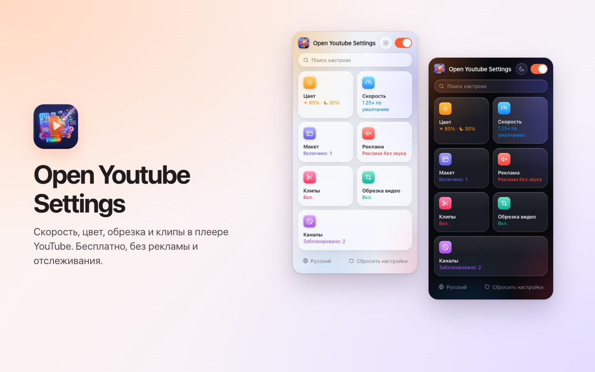
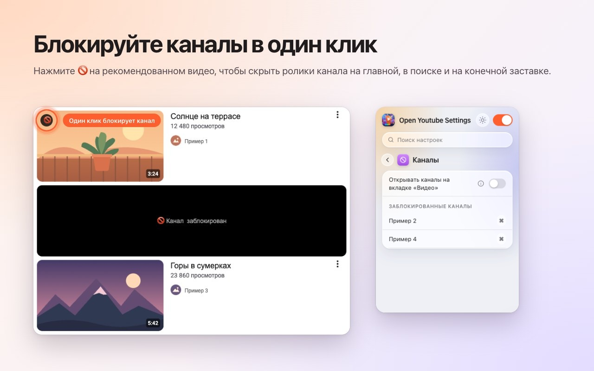
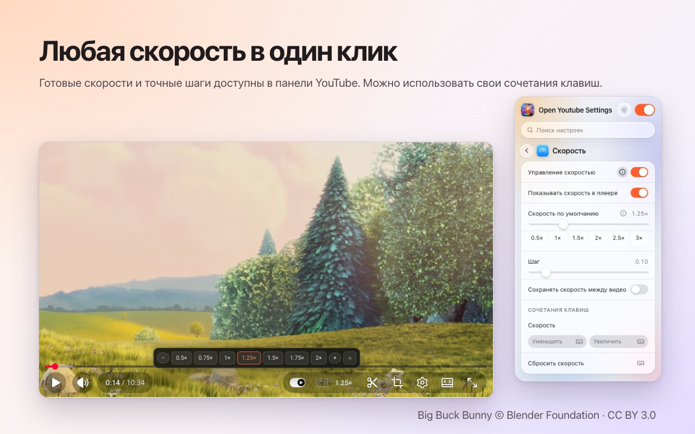
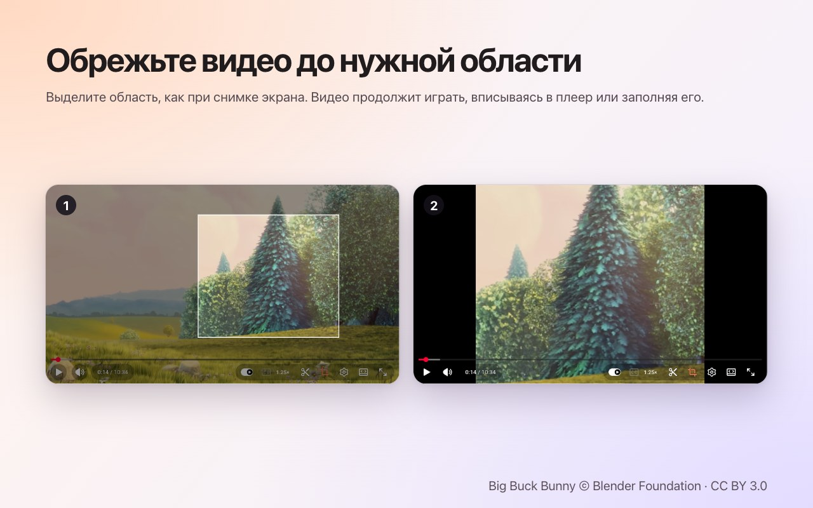
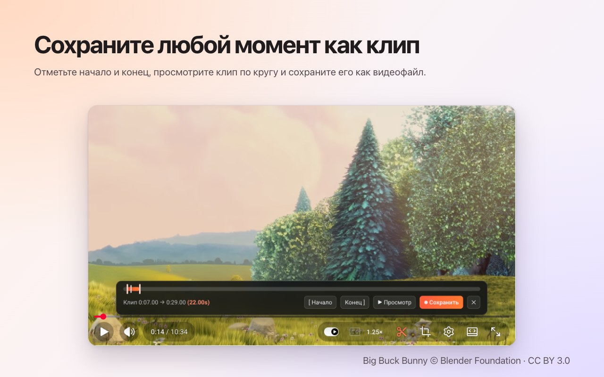

<p align="center">
  
</p>

<h1 align="center">Open Youtube Settings</h1>

<p align="center">
  Блокируйте каналы YouTube одним кликом — а также скорость, кадрирование, клипы и цвет прямо в плеере.<br>
  Бесплатное расширение для <b>Chrome</b> и <b>Firefox</b>.
</p>

<p align="center">
  ✅ <b>Открытый исходный код</b> &nbsp;·&nbsp; ✅ <b>Чистый интерфейс</b> &nbsp;·&nbsp; ✅ <b>Не собирает данные</b>
</p>

<p align="center">
  <a href="https://chromewebstore.google.com/detail/open-youtube-settings/commphgoijegmlhbkkbgbfbnemihdjod"><b>Chrome Web Store</b></a> ·
  <a href="../../releases/latest">Последняя версия</a> ·
  <a href="https://www.youtube.com/watch?v=0iPOj1_EBRU">Демо-видео</a>
</p>

<p align="center"><sub><a href="README.md">English</a> · <a href="README.tr.md">Türkçe</a> · <a href="README.de.md">Deutsch</a> · <a href="README.es.md">Español</a> · <a href="README.fr.md">Français</a> · <a href="README.it.md">Italiano</a> · <a href="README.pt-BR.md">Português (Brasil)</a> · <a href="README.nl.md">Nederlands</a> · <a href="README.pl.md">Polski</a> · <b>Русский</b> · <a href="README.uk.md">Українська</a> · <a href="README.ar.md">العربية</a> · <a href="README.hi.md">हिन्दी</a> · <a href="README.id.md">Bahasa Indonesia</a> · <a href="README.vi.md">Tiếng Việt</a> · <a href="README.th.md">ไทย</a> · <a href="README.ko.md">한국어</a> · <a href="README.ja.md">日本語</a> · <a href="README.zh-CN.md">简体中文</a> · <a href="README.zh-TW.md">繁體中文</a></sub></p>

<p align="center">
  
</p>

## Почему Open Youtube Settings

- **Открытый исходный код:** весь код лежит здесь, на GitHub, под лицензией MIT — каждый может проверить, что именно делает расширение.
- **Чистый интерфейс:** одно небольшое окно и кнопки прямо в плеере YouTube. Без всплывающих окон, рекламы и платной версии.
- **Не собирает данные:** без аккаунта, без аналитики, без сервера. Ваши настройки никогда не покидают браузер.

## Возможности

### Блокировка каналов одним кликом
Наведите курсор на рекомендованное видео и нажмите 🚫. С этого момента все видео этого канала закрываются — на главной, в поиске и на конечной заставке. Снять блокировку можно в любой момент в окне расширения.



### Скорость воспроизведения в плеере
Текущая скорость показана на панели управления YouTube. Нажмите, чтобы выбрать значения от 0.5× до 2× и мелкие шаги, или используйте свои сочетания клавиш. Задайте скорость по умолчанию для каждого видео или сохраняйте последнюю между видео.



### Кадрирование любой области
Нажмите кнопку кадрирования и выделите область на видео, как при снимке экрана. Видео продолжает играть, **вписываясь** в плеер или **заполняя** его. Нажмите кнопку ещё раз, чтобы увидеть видео целиком. Кадрирование заканчивается вместе с видео.



### Сохранение клипов
Откройте панель клипа, отметьте начало и конец, просмотрите петлю и сохраните её как видеофайл. Клип записывается в реальном времени из вашего собственного воспроизведения.



### Цвет и синий свет
Яркость, фильтр синего света и инверсия цветов для каждого видео, с сочетаниями клавиш для увеличения и уменьшения. Выберите, применять ли фильтры и к Shorts.


### Более спокойный YouTube
- **Полностью отключите Shorts:** исчезают полки, результаты поиска, пункт меню и вкладка канала; ссылка на Shorts открывается как обычное видео.
- Скройте ленту главной страницы, боковую панель или панель плейлиста.
- Скройте панель управления и анимации воспроизведения/паузы и перемотки.
- Автоматически выключайте звук рекламы; он возвращается, как только реклама заканчивается.
- Открывайте ссылки на каналы сразу на вкладке «Видео».


### А также
- **Один переключатель** выключает всё; YouTube работает без изменений, пока вы не включите его снова.
- **Поиск** по всем настройкам.
- **Сочетание клавиш** почти для каждой настройки.
- Светлая, тёмная или автоматическая тема.
- 20 языков: English, Türkçe, Deutsch, Español, Français, Italiano, Português (Brasil), Nederlands, Polski, Русский, Українська, العربية, हिन्दी, Bahasa Indonesia, Tiếng Việt, ไทย, 한국어, 日本語, 简体中文, 繁體中文.

## Установка

**Chrome / Edge / Brave:** установите из [Chrome Web Store](https://chromewebstore.google.com/detail/open-youtube-settings/commphgoijegmlhbkkbgbfbnemihdjod).

**Firefox:** страница в Firefox Add-ons скоро появится. До тех пор установите расширение из выпуска, как описано ниже.

**Из выпуска (вручную):** скачайте zip-файл для своего браузера на странице [Releases](../../releases/latest).

- **Chrome / Edge / Brave:** распакуйте его, откройте `chrome://extensions`, включите *Режим разработчика*, выберите *Загрузить распакованное расширение* и укажите папку.
- **Firefox:** откройте `about:debugging#/runtime/this-firefox`, выберите *Загрузить временное дополнение…* и укажите zip-файл. Временные дополнения удаляются после перезапуска Firefox.

## Конфиденциальность

Расширение не собирает данные и ничего никуда не отправляет. Ваши настройки остаются в хранилище расширений самого браузера. Оно запрашивает только разрешение `storage` и доступ к `youtube.com`.

## Разработка

```bash
npm ci
npm run test:install   # Playwright Chromium and Firefox, once
npm test               # static, Chromium and Firefox tests against an offline YouTube fixture
npm run package        # builds both store zips in dist/
```

`npm run test:live` запускает несколько быстрых тестов на настоящем youtube.com.

### Выпуск версии
1. Увеличьте `version` в `manifest.json` (и `package.json`).
2. Отправьте соответствующий тег, например `git tag v0.13 && git push origin v0.13`. GitHub Actions запускает тесты и публикует выпуск с обоими zip-файлами.
3. *Actions → Publish to stores → Run workflow* загружает этот выпуск в Chrome Web Store и Firefox Add-ons.

## Лицензия

[MIT](LICENSE). Сообщения об ошибках и идеи приветствуются в [Issues](../../issues).

---

<sub>На снимках экрана используется <a href="https://peach.blender.org/">Big Buck Bunny</a> © 2008 Blender Foundation по лицензии <a href="https://creativecommons.org/licenses/by/3.0/">CC BY 3.0</a>. YouTube — товарный знак Google LLC; этот проект не связан с Google и не одобрен Google.</sub>
