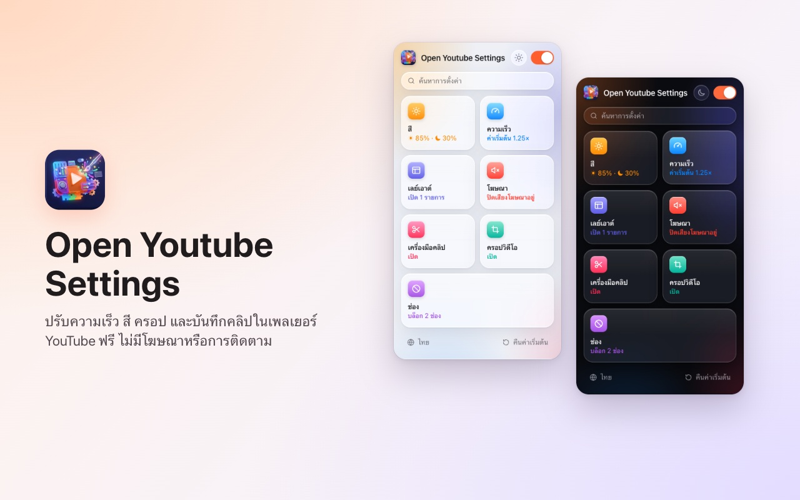
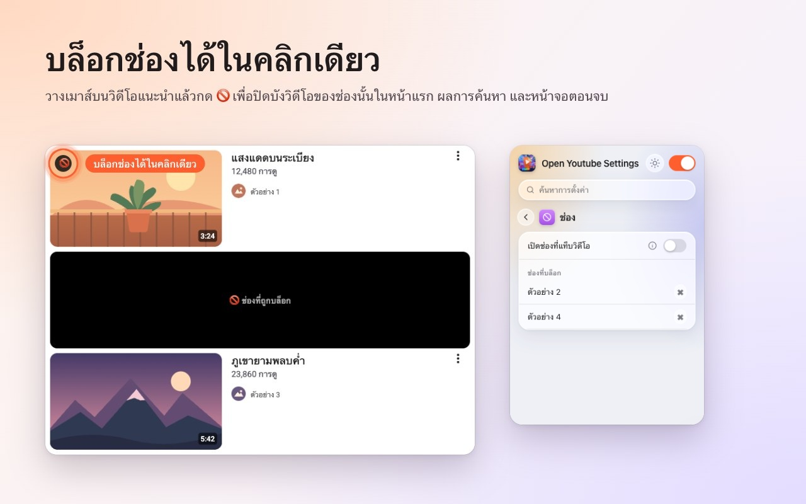
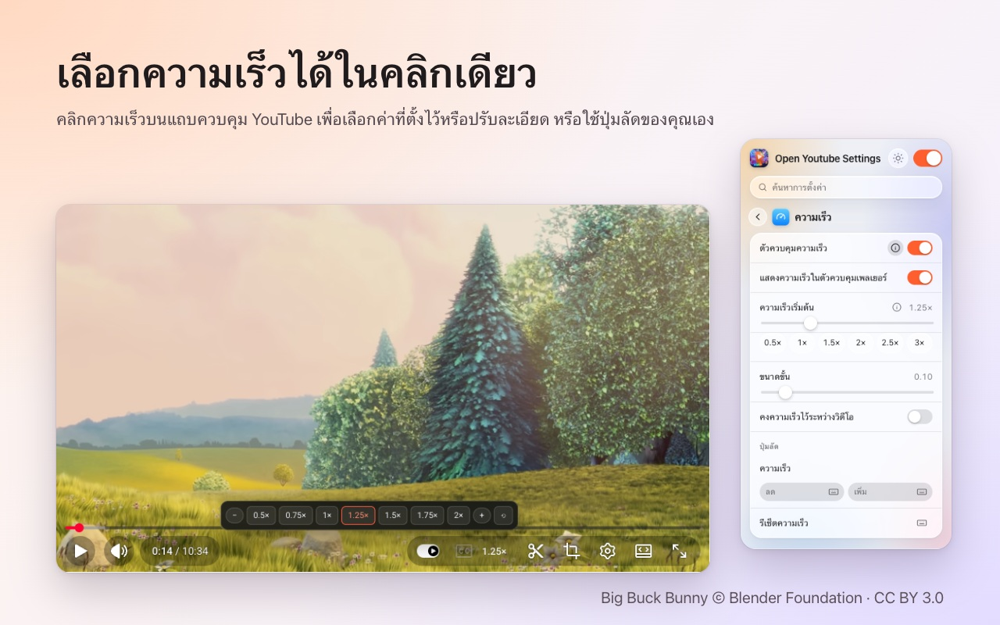
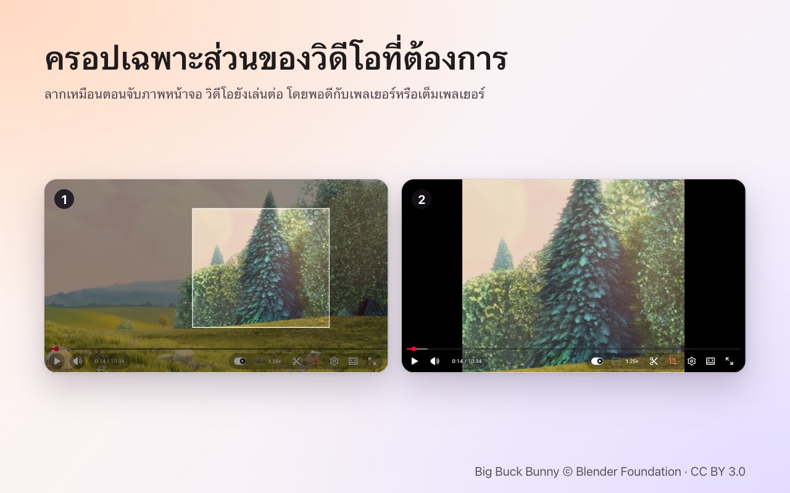
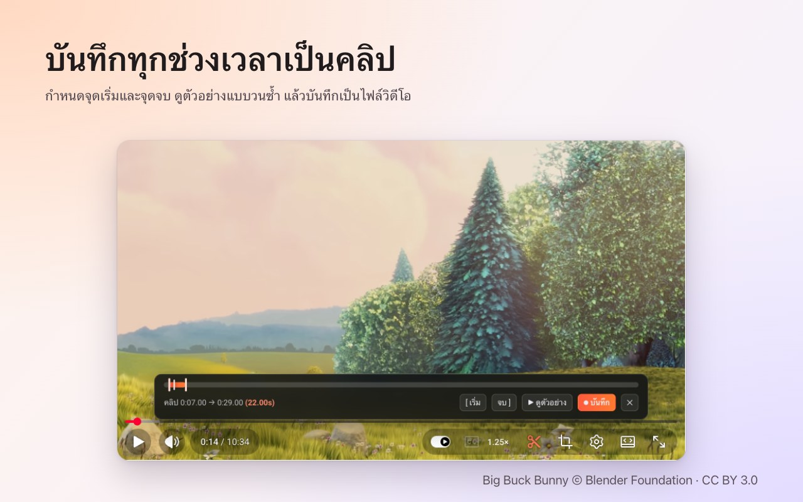

<p align="center">
  
</p>

<h1 align="center">Open Youtube Settings</h1>

<p align="center">
  บล็อกช่อง YouTube ได้ในคลิกเดียว พร้อมปรับความเร็ว ครอปภาพ ตัดคลิป และสี ได้ในเครื่องเล่นโดยตรง<br>
  ส่วนขยายฟรีสำหรับ <b>Chrome</b> และ <b>Firefox</b>
</p>

<p align="center">
  ✅ <b>โอเพนซอร์ส</b> &nbsp;·&nbsp; ✅ <b>หน้าตาเรียบง่าย</b> &nbsp;·&nbsp; ✅ <b>ไม่เก็บข้อมูล</b>
</p>

<p align="center">
  <a href="https://chromewebstore.google.com/detail/open-youtube-settings/commphgoijegmlhbkkbgbfbnemihdjod"><b>Chrome เว็บสโตร์</b></a> ·
  <a href="../../releases/latest">รุ่นล่าสุด</a> ·
  <a href="https://www.youtube.com/watch?v=0iPOj1_EBRU">วิดีโอสาธิต</a>
</p>

<p align="center"><sub><a href="README.md">English</a> · <a href="README.tr.md">Türkçe</a> · <a href="README.de.md">Deutsch</a> · <a href="README.es.md">Español</a> · <a href="README.fr.md">Français</a> · <a href="README.it.md">Italiano</a> · <a href="README.pt-BR.md">Português (Brasil)</a> · <a href="README.nl.md">Nederlands</a> · <a href="README.pl.md">Polski</a> · <a href="README.ru.md">Русский</a> · <a href="README.uk.md">Українська</a> · <a href="README.ar.md">العربية</a> · <a href="README.hi.md">हिन्दी</a> · <a href="README.id.md">Bahasa Indonesia</a> · <a href="README.vi.md">Tiếng Việt</a> · <b>ไทย</b> · <a href="README.ko.md">한국어</a> · <a href="README.ja.md">日本語</a> · <a href="README.zh-CN.md">简体中文</a> · <a href="README.zh-TW.md">繁體中文</a></sub></p>

<p align="center">
  
</p>

## ทำไมต้อง Open Youtube Settings

- **โอเพนซอร์ส:** โค้ดทั้งหมดอยู่ที่นี่บน GitHub ภายใต้สัญญาอนุญาต MIT ใครก็ตรวจสอบได้ว่าส่วนขยายทำอะไรบ้าง
- **หน้าตาเรียบง่าย:** หน้าต่างเล็ก ๆ หนึ่งหน้าต่างและปุ่มควบคุมในเครื่องเล่นของ YouTube เอง ไม่มีป๊อปอัป ไม่มีโฆษณา ไม่มีรุ่นเสียเงิน
- **ไม่เก็บข้อมูล:** ไม่มีบัญชี ไม่มีการวิเคราะห์ ไม่มีเซิร์ฟเวอร์ การตั้งค่าของคุณไม่เคยออกจากเบราว์เซอร์

## ฟีเจอร์

### บล็อกช่องได้ในคลิกเดียว
เลื่อนเมาส์ไปที่วิดีโอแนะนำแล้วกด 🚫 หลังจากนั้นทุกวิดีโอของช่องนั้นจะถูกปิดไว้ ทั้งในหน้าแรก ในการค้นหา และในหน้าจอตอนจบ ยกเลิกการบล็อกได้ทุกเมื่อจากหน้าต่างของส่วนขยาย



### ความเร็วการเล่นในเครื่องเล่น
ความเร็วปัจจุบันอยู่บนแถบควบคุมของ YouTube เอง คลิกเพื่อเลือกค่าตั้งแต่ 0.5× ถึง 2× และขั้นละเอียด หรือใช้แป้นลัดของคุณเอง ตั้งความเร็วเริ่มต้นให้ทุกวิดีโอ หรือคงความเร็วล่าสุดไว้ระหว่างวิดีโอ



### ครอปพื้นที่ใดก็ได้
กดปุ่มครอปแล้วลากบนวิดีโอเหมือนจับภาพหน้าจอ วิดีโอยังเล่นต่อ โดย**พอดี**กับเครื่องเล่นหรือ**เต็ม**เครื่องเล่น กดปุ่มอีกครั้งเพื่อดูวิดีโอทั้งหมด การครอปจะสิ้นสุดพร้อมวิดีโอ



### บันทึกคลิป
เปิดแถบคลิป ทำเครื่องหมายจุดเริ่มและจุดจบ ดูตัวอย่างแบบวนซ้ำ แล้วบันทึกเป็นไฟล์วิดีโอ คลิปจะถูกบันทึกแบบเรียลไทม์จากการเล่นของคุณเอง



### สีและแสงสีฟ้า
ความสว่าง ฟิลเตอร์แสงสีฟ้า และการกลับสีสำหรับทุกวิดีโอ พร้อมแป้นลัดเพื่อเพิ่มหรือลด เลือกได้ว่าจะใช้ฟิลเตอร์กับ Shorts ด้วยหรือไม่


### YouTube ที่สงบขึ้น
- **ปิด Shorts ทั้งหมด:** ชั้นวาง ผลการค้นหา รายการในเมนู และแท็บช่องจะหายไป ลิงก์ Shorts จะเปิดเป็นวิดีโอปกติ
- ซ่อนฟีดหน้าแรก แถบข้าง หรือแผงเพลย์ลิสต์
- ซ่อนแถบควบคุม และแอนิเมชันเล่น/หยุดชั่วคราวและการข้าม
- ปิดเสียงโฆษณาอัตโนมัติ เสียงจะกลับมาทันทีที่โฆษณาจบ
- เปิดลิงก์ช่องไปที่แท็บวิดีโอโดยตรง


### และยังมี
- **สวิตช์เดียว** ปิดทุกอย่าง YouTube จะทำงานตามปกติจนกว่าคุณจะเปิดอีกครั้ง
- **ค้นหา** ในการตั้งค่าทั้งหมด
- **แป้นลัด** สำหรับเกือบทุกการตั้งค่า
- ธีมสว่าง มืด หรืออัตโนมัติ
- 20 ภาษา: English, Türkçe, Deutsch, Español, Français, Italiano, Português (Brasil), Nederlands, Polski, Русский, Українська, العربية, हिन्दी, Bahasa Indonesia, Tiếng Việt, ไทย, 한국어, 日本語, 简体中文, 繁體中文.

## การติดตั้ง

**Chrome / Edge / Brave:** ติดตั้งจาก [Chrome เว็บสโตร์](https://chromewebstore.google.com/detail/open-youtube-settings/commphgoijegmlhbkkbgbfbnemihdjod)

**Firefox:** หน้าใน Firefox Add-ons กำลังจะมา ระหว่างนี้ติดตั้งจากรุ่นเผยแพร่ตามวิธีด้านล่าง

**จากรุ่นเผยแพร่ (ด้วยตนเอง):** ดาวน์โหลดไฟล์ zip สำหรับเบราว์เซอร์ของคุณจาก [Releases](../../releases/latest)

- **Chrome / Edge / Brave:** แตกไฟล์ เปิด `chrome://extensions` เปิด *โหมดนักพัฒนาซอฟต์แวร์* เลือก *โหลดส่วนขยายที่คลายการบีบอัด* แล้วเลือกโฟลเดอร์
- **Firefox:** เปิด `about:debugging#/runtime/this-firefox` เลือก *โหลดส่วนเสริมชั่วคราว…* แล้วเลือกไฟล์ zip ส่วนเสริมชั่วคราวจะถูกลบเมื่อรีสตาร์ต Firefox

## ความเป็นส่วนตัว

ส่วนขยายไม่เก็บข้อมูลใด ๆ และไม่ส่งอะไรออกไปไหน การตั้งค่าของคุณอยู่ในพื้นที่เก็บข้อมูลส่วนขยายของเบราว์เซอร์เอง ขอเพียงสิทธิ์ `storage` และการเข้าถึง `youtube.com`

## การพัฒนา

```bash
npm ci
npm run test:install   # Playwright Chromium and Firefox, once
npm test               # static, Chromium and Firefox tests against an offline YouTube fixture
npm run package        # builds both store zips in dist/
```

`npm run test:live` รันการทดสอบสั้น ๆ บน youtube.com จริง

### การออกรุ่นใหม่
1. เพิ่ม `version` ใน `manifest.json` (และ `package.json`)
2. พุชแท็กที่ตรงกัน เช่น `git tag v0.13 && git push origin v0.13` แล้ว GitHub Actions จะรันการทดสอบและเผยแพร่รุ่นพร้อมไฟล์ zip ทั้งสอง
3. *Actions → Publish to stores → Run workflow* อัปโหลดรุ่นนั้นไปยัง Chrome เว็บสโตร์ และ Firefox Add-ons

## สัญญาอนุญาต

[MIT](LICENSE) ยินดีรับรายงานข้อผิดพลาดและไอเดียที่ [Issues](../../issues)

---

<sub>ภาพหน้าจอใช้ <a href="https://peach.blender.org/">Big Buck Bunny</a> © 2008 Blender Foundation ภายใต้สัญญาอนุญาต <a href="https://creativecommons.org/licenses/by/3.0/">CC BY 3.0</a> YouTube เป็นเครื่องหมายการค้าของ Google LLC โครงการนี้ไม่มีส่วนเกี่ยวข้องหรือได้รับการรับรองจาก Google</sub>
