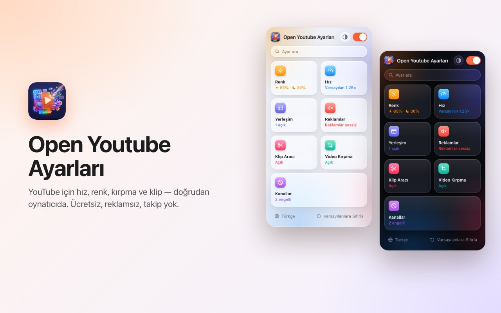
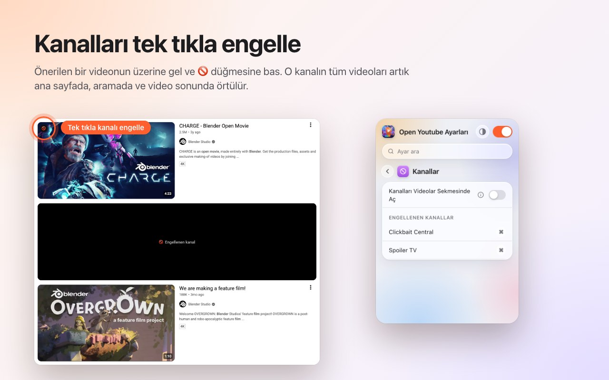
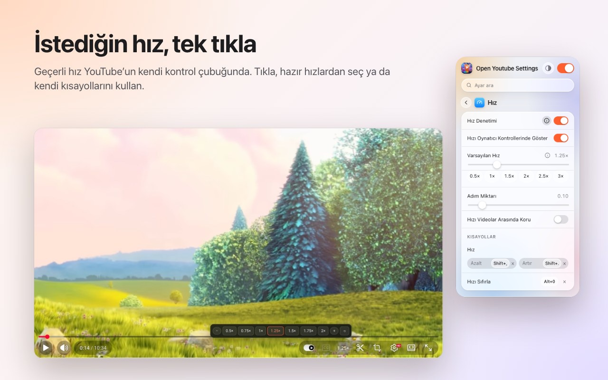
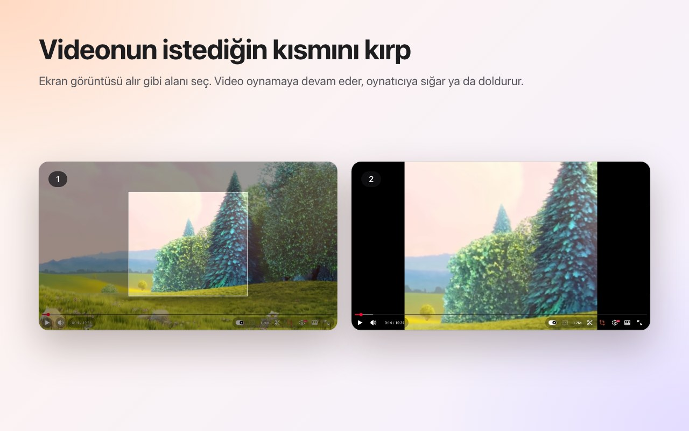
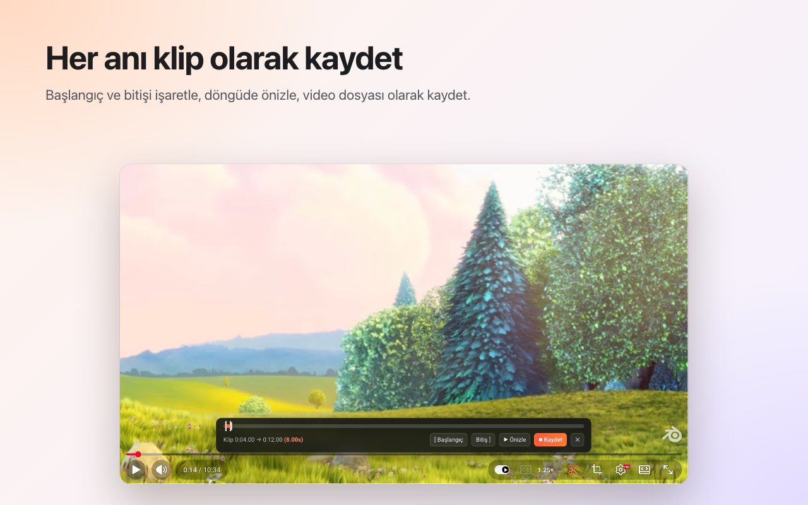
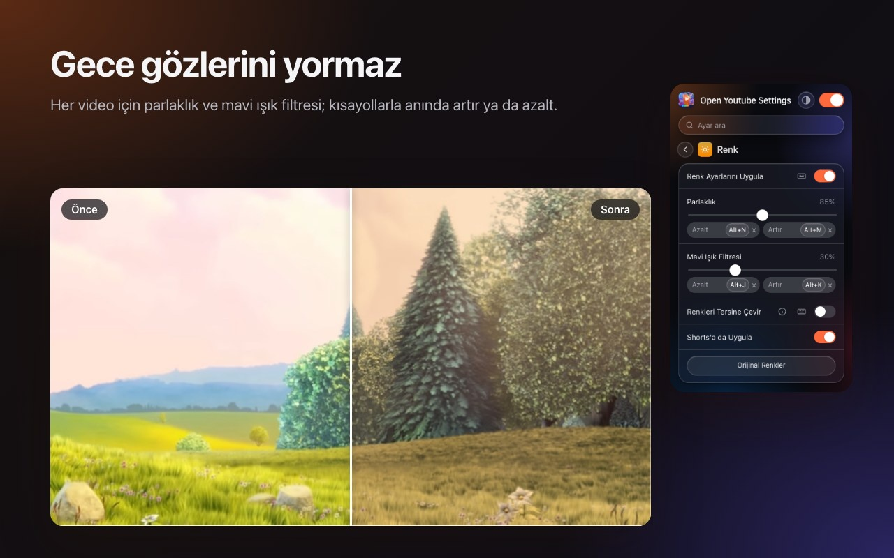
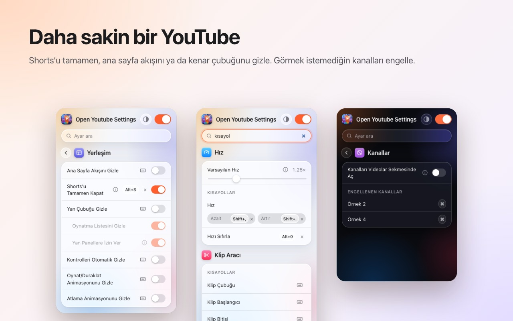

<p align="center">
  
</p>

<h1 align="center">Open Youtube Settings</h1>

<p align="center">
  YouTube için hız, renk, kırpma ve klip — doğrudan oynatıcıda.<br>
  <b>Chrome</b> ve <b>Firefox</b> için tarayıcı eklentisi. Ücretsiz, reklamsız, takip yok.
</p>

<p align="center">
  <a href="../../releases/latest"><b>Son sürümü indir</b></a> ·
  <a href="README.md">English</a>
</p>

<p align="center">
  
</p>

## Özellikler

### Kanalları tek tıkla engelle
Önerilen bir videonun üzerine gel ve 🚫 düğmesine bas. O kanalın tüm videoları artık ana sayfada, aramada ve video sonunda örtülür. Engeli istediğin zaman eklenti penceresinden kaldırabilirsin.



### Oynatıcıda oynatma hızı
Geçerli hız YouTube'un kendi kontrol çubuğunda durur. Tıklayınca 0.5× ile 2× arası hazır hızlar ve ince adımlar açılır; istersen kendi klavye kısayollarını kullan. Her video için varsayılan bir hız belirle ya da son hızı videolar arasında koru.



### İstediğin alanı kırp
Kırpma düğmesine bas ve ekran görüntüsü alır gibi videonun üzerinde bir alan seç. Video oynamaya devam eder; oynatıcıya **sığar** ya da oynatıcıyı **doldurur**. Videonun tamamını görmek için düğmeye yeniden bas. Kırpma video bitince kalkar.



### Klip kaydet
Klip çubuğunu aç, başlangıç ve bitişi işaretle, döngüde önizle ve video dosyası olarak kaydet. Klip, kendi oynatman sırasında gerçek zamanlı kaydedilir.



### Renk ve mavi ışık
Her video için parlaklık, mavi ışık filtresi ve renkleri tersine çevirme; kısayollarla artırıp azaltabilirsin. Filtrelerin Shorts'ta da çalışıp çalışmayacağını sen seçersin.



### Daha sakin bir YouTube
- **Shorts'u tamamen kapat:** raflar, arama sonuçları, menü girişi ve kanal sekmesi kaybolur; bir Shorts bağlantısı normal video olarak açılır.
- Ana sayfa akışını, kenar çubuğunu ya da oynatma listesi panelini gizle.
- Kontrol çubuğunu, oynat/duraklat ve atlama animasyonlarını gizle.
- **Kanal engelle:** önerilen bir videonun üzerine gel ve 🚫 düğmesine bas. O kanalın videoları artık örtülür.
- Reklamların sesini otomatik kapat; reklam biter bitmez ses geri gelir.
- Kanal bağlantılarını doğrudan Videolar sekmesinde aç.



### Ayrıca
- **Tek düğmeyle** her şeyi kapat; tekrar açana kadar YouTube olduğu gibi çalışır.
- Tüm ayarlarda **arama**.
- Neredeyse her ayar için **klavye kısayolu**.
- Açık, koyu ya da otomatik görünüm.
- 20 dil: English, Türkçe, Deutsch, Español, Français, Italiano, Português (Brasil), Nederlands, Polski, Русский, Українська, العربية, हिन्दी, Bahasa Indonesia, Tiếng Việt, ไทย, 한국어, 日本語, 简体中文, 繁體中文.

## Kurulum

**Mağazalardan:** Chrome Web Mağazası ve Firefox Eklentileri bağlantıları, mağaza onayından sonra buraya eklenecek.

**Sürüm dosyasından (elle):** tarayıcına uygun zip dosyasını [Releases](../../releases/latest) sayfasından indir.

- **Chrome / Edge / Brave:** zip'i aç, `chrome://extensions` sayfasına git, *Geliştirici modu*nu aç, *Paketlenmemiş öğe yükle*'yi seç ve açtığın klasörü göster.
- **Firefox:** `about:debugging#/runtime/this-firefox` sayfasını aç, *Geçici Eklenti Yükle…*'yi seç ve zip dosyasını göster. Geçici eklentiler Firefox yeniden başlayınca kaldırılır; kalıcı kurulum için Firefox Eklentileri'ndeki sürümü kullan.

## Gizlilik

Eklenti hiçbir veri toplamaz ve hiçbir yere bir şey göndermez. Ayarların tarayıcının kendi eklenti depolamasında kalır. Yalnızca `storage` iznini ve `youtube.com` erişimini ister.

## Geliştirme

```bash
npm ci
npm run test:install   # Playwright Chromium ve Firefox, bir kez
npm test               # çevrimdışı YouTube taklidine karşı statik, Chromium ve Firefox testleri
npm run package        # dist/chrome-youtube-settings.zip ve dist/firefox-youtube-settings.zip üretir
```

`npm run test:live` gerçek youtube.com üzerinde birkaç hızlı test çalıştırır.

### Sürüm çıkarma
1. `manifest.json` (ve `package.json`) içindeki `version` değerini yükselt.
2. Aynı numarayla bir etiket gönder, örneğin `git tag v0.9 && git push origin v0.9`. GitHub Actions testleri çalıştırır ve iki zip ile bir sürüm yayımlar.
3. *Actions → Publish to stores → Run workflow* o sürümü Chrome Web Mağazası'na ve Firefox Eklentileri'ne yükler.

---

<sub>Ekran görüntülerinde <a href="https://peach.blender.org/">Big Buck Bunny</a> © 2008 Blender Foundation kullanılmıştır, <a href="https://creativecommons.org/licenses/by/3.0/">CC BY 3.0</a> lisanslıdır. YouTube, Google LLC'nin ticari markasıdır; bu proje Google ile bağlantılı değildir ve Google tarafından onaylanmamıştır.</sub>
