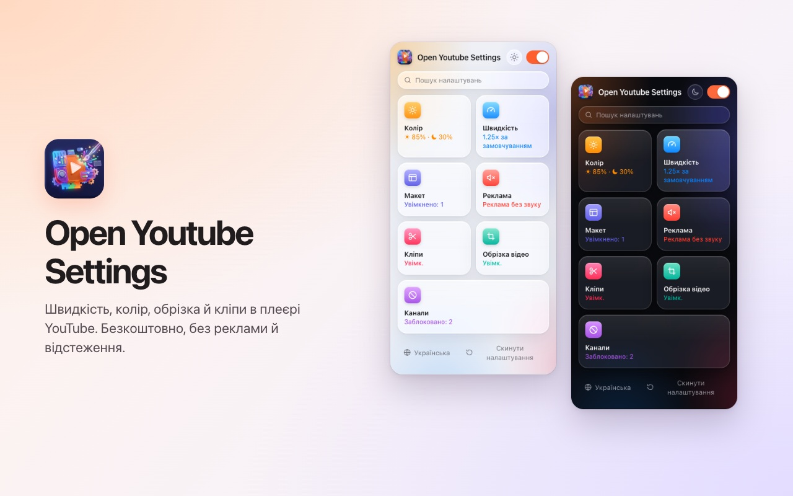
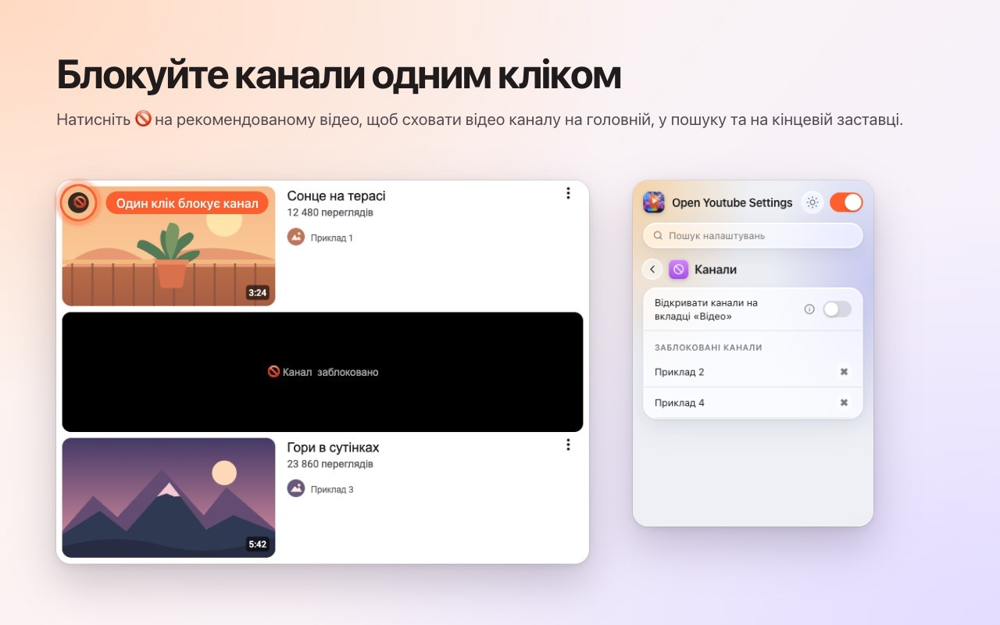
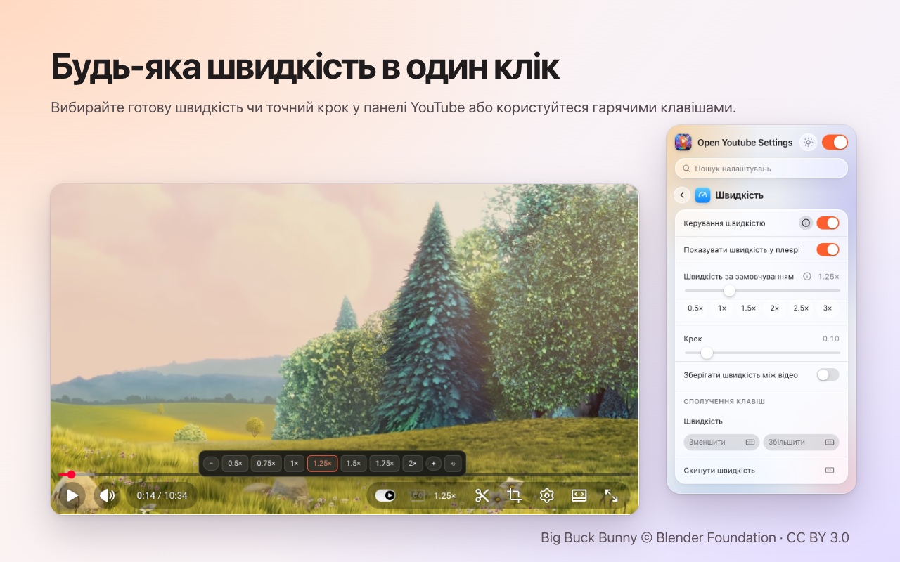
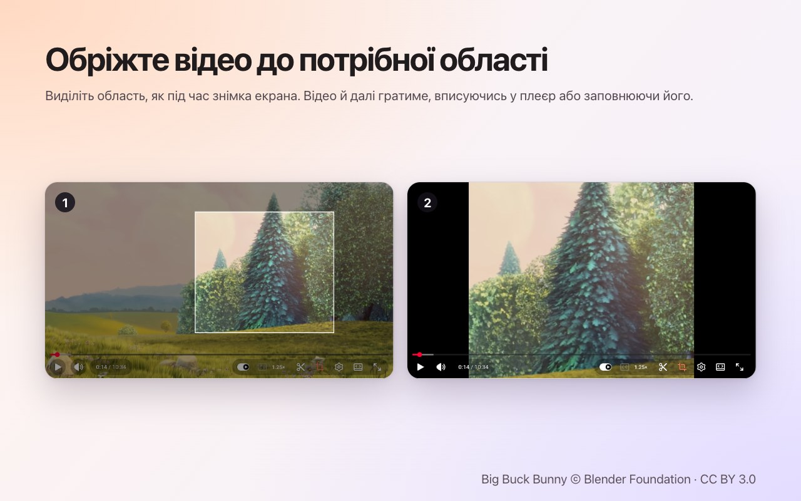
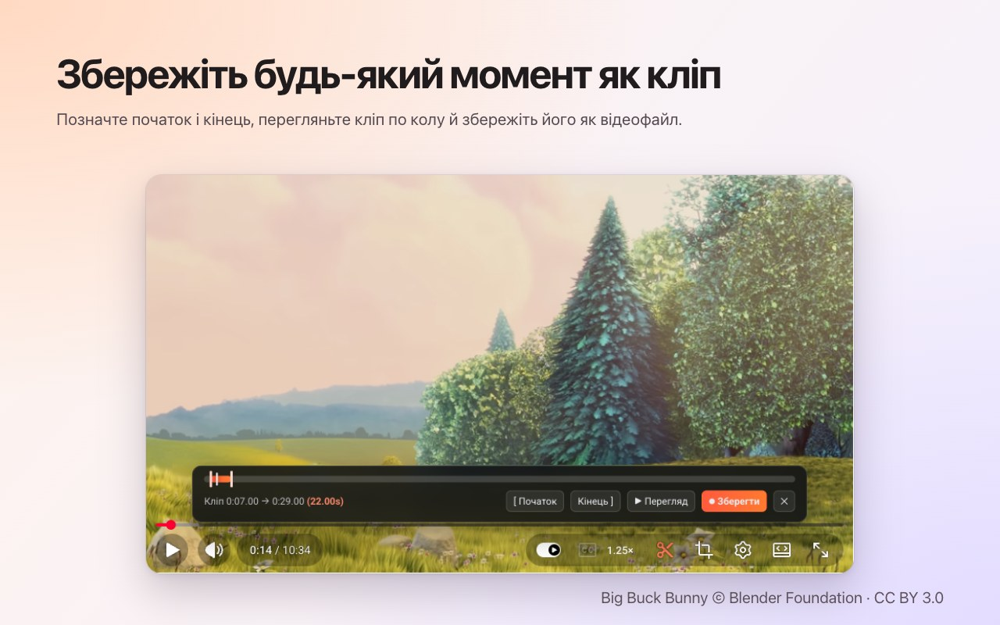

<p align="center">
  
</p>

<h1 align="center">Open Youtube Settings</h1>

<p align="center">
  Блокуйте канали YouTube одним кліком — а також швидкість, кадрування, кліпи й колір просто в плеєрі.<br>
  Безкоштовне розширення для <b>Chrome</b> і <b>Firefox</b>.
</p>

<p align="center">
  ✅ <b>Відкритий код</b> &nbsp;·&nbsp; ✅ <b>Чистий інтерфейс</b> &nbsp;·&nbsp; ✅ <b>Не збирає дані</b>
</p>

<p align="center">
  <a href="https://chromewebstore.google.com/detail/open-youtube-settings/commphgoijegmlhbkkbgbfbnemihdjod"><b>Chrome Web Store</b></a> ·
  <a href="../../releases/latest">Остання версія</a> ·
  <a href="https://www.youtube.com/watch?v=0iPOj1_EBRU">Демо-відео</a>
</p>

<p align="center"><sub><a href="README.md">English</a> · <a href="README.tr.md">Türkçe</a> · <a href="README.de.md">Deutsch</a> · <a href="README.es.md">Español</a> · <a href="README.fr.md">Français</a> · <a href="README.it.md">Italiano</a> · <a href="README.pt-BR.md">Português (Brasil)</a> · <a href="README.nl.md">Nederlands</a> · <a href="README.pl.md">Polski</a> · <a href="README.ru.md">Русский</a> · <b>Українська</b> · <a href="README.ar.md">العربية</a> · <a href="README.hi.md">हिन्दी</a> · <a href="README.id.md">Bahasa Indonesia</a> · <a href="README.vi.md">Tiếng Việt</a> · <a href="README.th.md">ไทย</a> · <a href="README.ko.md">한국어</a> · <a href="README.ja.md">日本語</a> · <a href="README.zh-CN.md">简体中文</a> · <a href="README.zh-TW.md">繁體中文</a></sub></p>

<p align="center">
  
</p>

## Чому Open Youtube Settings

- **Відкритий код:** увесь код лежить тут, на GitHub, під ліцензією MIT — кожен може перевірити, що саме робить розширення.
- **Чистий інтерфейс:** одне невелике вікно й кнопки просто в плеєрі YouTube. Без спливних вікон, реклами й платної версії.
- **Не збирає дані:** без облікового запису, без аналітики, без сервера. Ваші налаштування ніколи не залишають браузер.

## Можливості

### Блокування каналів одним кліком
Наведіть курсор на рекомендоване відео й натисніть 🚫. Відтепер усі відео цього каналу закриваються — на головній, у пошуку й на кінцевій заставці. Зняти блокування можна будь-коли у вікні розширення.



### Швидкість відтворення в плеєрі
Поточна швидкість показана на панелі керування YouTube. Натисніть, щоб вибрати значення від 0.5× до 2× і дрібні кроки, або використовуйте власні сполучення клавіш. Задайте швидкість за замовчуванням для кожного відео або зберігайте останню між відео.



### Кадрування будь-якої області
Натисніть кнопку кадрування й виділіть область на відео, як під час знімка екрана. Відео продовжує грати, **вписуючись** у плеєр або **заповнюючи** його. Натисніть кнопку ще раз, щоб побачити відео повністю. Кадрування закінчується разом із відео.



### Збереження кліпів
Відкрийте панель кліпу, позначте початок і кінець, перегляньте петлю й збережіть її як відеофайл. Кліп записується в реальному часі з вашого власного відтворення.



### Колір і синє світло
Яскравість, фільтр синього світла й інверсія кольорів для кожного відео, зі сполученнями клавіш для збільшення та зменшення. Виберіть, чи застосовувати фільтри й до Shorts.


### Спокійніший YouTube
- **Повністю вимкніть Shorts:** зникають полиці, результати пошуку, пункт меню й вкладка каналу; посилання на Shorts відкривається як звичайне відео.
- Приховайте стрічку головної сторінки, бічну панель або панель плейлиста.
- Приховайте панель керування й анімації відтворення/паузи та перемотування.
- Автоматично вимикайте звук реклами; він повертається, щойно реклама закінчується.
- Відкривайте посилання на канали одразу на вкладці «Відео».


### А також
- **Один перемикач** вимикає все; YouTube працює без змін, доки ви не ввімкнете його знову.
- **Пошук** у всіх налаштуваннях.
- **Сполучення клавіш** майже для кожного налаштування.
- Світла, темна або автоматична тема.
- 20 мов: English, Türkçe, Deutsch, Español, Français, Italiano, Português (Brasil), Nederlands, Polski, Русский, Українська, العربية, हिन्दी, Bahasa Indonesia, Tiếng Việt, ไทย, 한국어, 日本語, 简体中文, 繁體中文.

## Встановлення

**Chrome / Edge / Brave:** встановіть із [Chrome Web Store](https://chromewebstore.google.com/detail/open-youtube-settings/commphgoijegmlhbkkbgbfbnemihdjod).

**Firefox:** сторінка у Firefox Add-ons незабаром з'явиться. До того часу встановіть розширення з випуску, як описано нижче.

**З випуску (вручну):** завантажте zip-файл для свого браузера на сторінці [Releases](../../releases/latest).

- **Chrome / Edge / Brave:** розпакуйте його, відкрийте `chrome://extensions`, увімкніть *Режим розробника*, виберіть *Завантажити розпаковане розширення* й укажіть папку.
- **Firefox:** відкрийте `about:debugging#/runtime/this-firefox`, виберіть *Завантажити тимчасовий додаток…* і вкажіть zip-файл. Тимчасові додатки видаляються після перезапуску Firefox.

## Конфіденційність

Розширення не збирає дані й нічого нікуди не надсилає. Ваші налаштування залишаються у сховищі розширень самого браузера. Воно запитує лише дозвіл `storage` і доступ до `youtube.com`.

## Розробка

```bash
npm ci
npm run test:install   # Playwright Chromium and Firefox, once
npm test               # static, Chromium and Firefox tests against an offline YouTube fixture
npm run package        # builds both store zips in dist/
```

`npm run test:live` запускає кілька швидких тестів на справжньому youtube.com.

### Випуск версії
1. Збільште `version` у `manifest.json` (і `package.json`).
2. Надішліть відповідний тег, наприклад `git tag v0.13 && git push origin v0.13`. GitHub Actions запускає тести й публікує випуск з обома zip-файлами.
3. *Actions → Publish to stores → Run workflow* завантажує цей випуск у Chrome Web Store і Firefox Add-ons.

## Ліцензія

[MIT](LICENSE). Повідомлення про помилки та ідеї вітаються в [Issues](../../issues).

---

<sub>На знімках екрана використано <a href="https://peach.blender.org/">Big Buck Bunny</a> © 2008 Blender Foundation за ліцензією <a href="https://creativecommons.org/licenses/by/3.0/">CC BY 3.0</a>. YouTube — торговельна марка Google LLC; цей проєкт не пов'язаний із Google і не схвалений Google.</sub>
