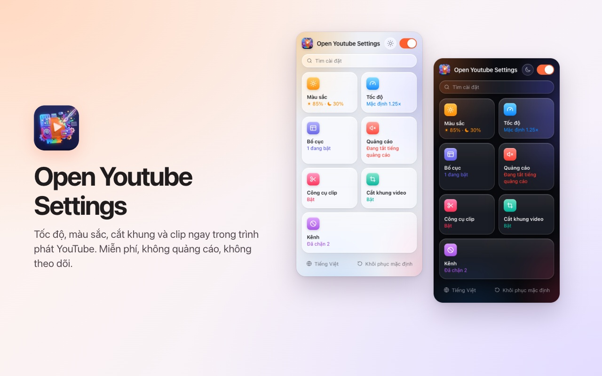
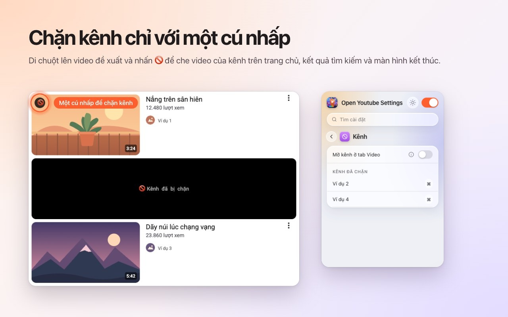
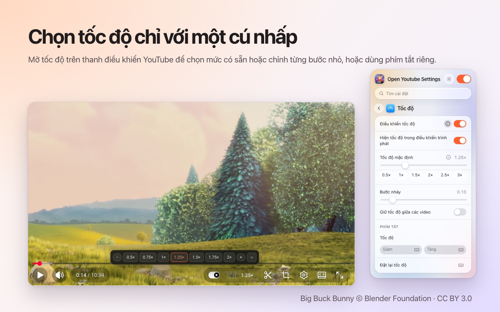
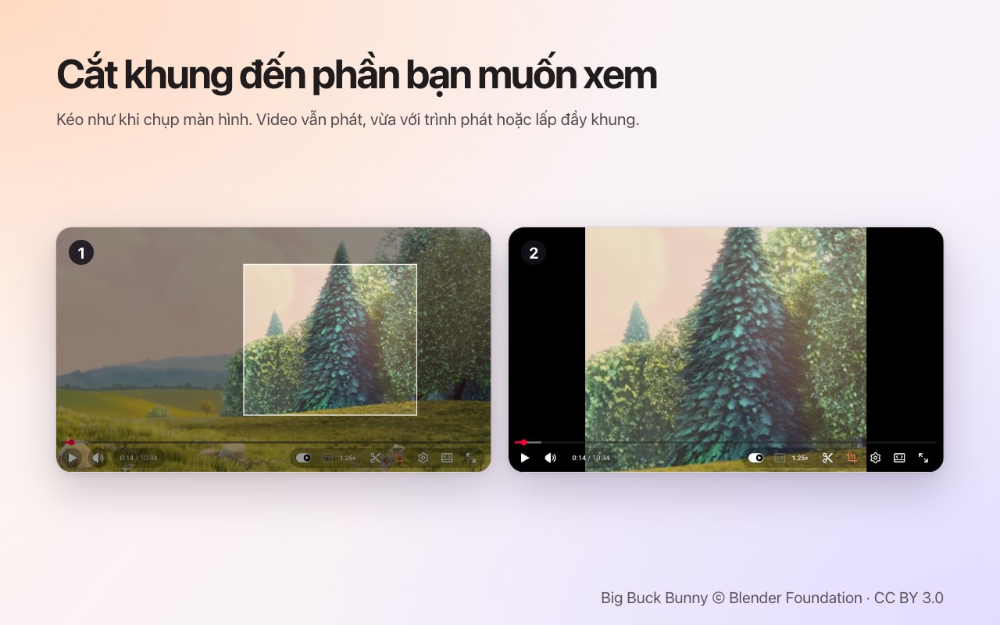
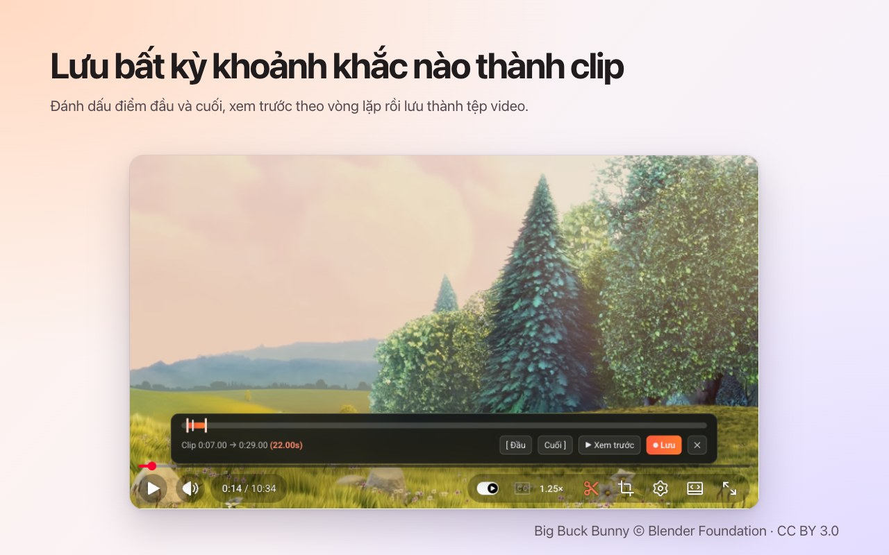

<p align="center">
  
</p>

<h1 align="center">Open Youtube Settings</h1>

<p align="center">
  Chặn kênh YouTube chỉ với một cú nhấp — cùng tốc độ, cắt khung, clip và màu sắc, ngay trong trình phát.<br>
  Tiện ích miễn phí cho <b>Chrome</b> và <b>Firefox</b>.
</p>

<p align="center">
  ✅ <b>Mã nguồn mở</b> &nbsp;·&nbsp; ✅ <b>Giao diện gọn gàng</b> &nbsp;·&nbsp; ✅ <b>Không thu thập dữ liệu</b>
</p>

<p align="center">
  <a href="https://chromewebstore.google.com/detail/open-youtube-settings/commphgoijegmlhbkkbgbfbnemihdjod"><b>Chrome Web Store</b></a> ·
  <a href="../../releases/latest">Bản phát hành mới nhất</a> ·
  <a href="https://www.youtube.com/watch?v=0iPOj1_EBRU">Video giới thiệu</a>
</p>

<p align="center"><sub><a href="README.md">English</a> · <a href="README.tr.md">Türkçe</a> · <a href="README.de.md">Deutsch</a> · <a href="README.es.md">Español</a> · <a href="README.fr.md">Français</a> · <a href="README.it.md">Italiano</a> · <a href="README.pt-BR.md">Português (Brasil)</a> · <a href="README.nl.md">Nederlands</a> · <a href="README.pl.md">Polski</a> · <a href="README.ru.md">Русский</a> · <a href="README.uk.md">Українська</a> · <a href="README.ar.md">العربية</a> · <a href="README.hi.md">हिन्दी</a> · <a href="README.id.md">Bahasa Indonesia</a> · <b>Tiếng Việt</b> · <a href="README.th.md">ไทย</a> · <a href="README.ko.md">한국어</a> · <a href="README.ja.md">日本語</a> · <a href="README.zh-CN.md">简体中文</a> · <a href="README.zh-TW.md">繁體中文</a></sub></p>

<p align="center">
  
</p>

## Vì sao chọn Open Youtube Settings

- **Mã nguồn mở:** toàn bộ mã nguồn nằm ngay trên GitHub theo giấy phép MIT, nên ai cũng có thể kiểm tra chính xác tiện ích làm gì.
- **Giao diện gọn gàng:** một cửa sổ nhỏ và các nút điều khiển ngay trong trình phát của YouTube. Không cửa sổ bật lên, không quảng cáo, không bản trả phí.
- **Không thu thập dữ liệu:** không tài khoản, không phân tích, không máy chủ. Cài đặt của bạn không bao giờ rời khỏi trình duyệt.

## Tính năng

### Chặn kênh chỉ với một cú nhấp
Di chuột lên một video được đề xuất và nhấn 🚫. Từ đó, mọi video của kênh này đều bị che — trên trang chủ, trong tìm kiếm và ở màn hình kết thúc. Bỏ chặn kênh bất cứ lúc nào trong cửa sổ tiện ích.



### Tốc độ phát ngay trong trình phát
Tốc độ hiện tại nằm trên thanh điều khiển của YouTube. Nhấp vào để chọn mức từ 0.5× đến 2× và các bước nhỏ, hoặc dùng phím tắt của riêng bạn. Đặt tốc độ mặc định cho mọi video hoặc giữ tốc độ gần nhất giữa các video.



### Cắt khung bất kỳ vùng nào
Nhấn nút cắt khung và kéo trên video, như khi chụp màn hình. Video vẫn tiếp tục phát, **vừa khít** trình phát hoặc **lấp đầy** trình phát. Nhấn nút lần nữa để xem toàn bộ video. Việc cắt khung kết thúc cùng video.



### Lưu clip
Mở thanh clip, đánh dấu điểm đầu và điểm cuối, xem trước vòng lặp rồi lưu thành tệp video. Clip được ghi theo thời gian thực từ chính lần phát của bạn.



### Màu sắc và ánh sáng xanh
Độ sáng, bộ lọc ánh sáng xanh và đảo màu cho mọi video, kèm phím tắt để tăng hoặc giảm. Chọn xem bộ lọc có áp dụng cho Shorts hay không.


### Một YouTube yên tĩnh hơn
- **Tắt hoàn toàn Shorts:** các kệ, kết quả tìm kiếm, mục menu và thẻ kênh đều biến mất; liên kết Shorts mở như video thường.
- Ẩn nguồn cấp trang chủ, thanh bên hoặc bảng danh sách phát.
- Ẩn thanh điều khiển cùng hiệu ứng phát/tạm dừng và tua.
- Tự động tắt tiếng quảng cáo; âm thanh trở lại ngay khi quảng cáo kết thúc.
- Mở liên kết kênh thẳng vào thẻ Video.


### Và còn nữa
- **Một công tắc** tắt mọi thứ; YouTube chạy nguyên vẹn cho đến khi bạn bật lại.
- **Tìm kiếm** trong mọi cài đặt.
- **Phím tắt** cho hầu hết mọi cài đặt.
- Giao diện sáng, tối hoặc tự động.
- 20 ngôn ngữ: English, Türkçe, Deutsch, Español, Français, Italiano, Português (Brasil), Nederlands, Polski, Русский, Українська, العربية, हिन्दी, Bahasa Indonesia, Tiếng Việt, ไทย, 한국어, 日本語, 简体中文, 繁體中文.

## Cài đặt

**Chrome / Edge / Brave:** cài từ [Chrome Web Store](https://chromewebstore.google.com/detail/open-youtube-settings/commphgoijegmlhbkkbgbfbnemihdjod).

**Firefox:** trang trên Firefox Add-ons sắp ra mắt. Trong lúc chờ, hãy cài từ một bản phát hành như hướng dẫn bên dưới.

**Từ bản phát hành (thủ công):** tải tệp zip cho trình duyệt của bạn tại [Releases](../../releases/latest).

- **Chrome / Edge / Brave:** giải nén, mở `chrome://extensions`, bật *Chế độ dành cho nhà phát triển*, chọn *Tải tiện ích đã giải nén* rồi chọn thư mục.
- **Firefox:** mở `about:debugging#/runtime/this-firefox`, chọn *Tải tiện ích tạm thời…* rồi chọn tệp zip. Tiện ích tạm thời sẽ bị gỡ khi Firefox khởi động lại.

## Quyền riêng tư

Tiện ích không thu thập dữ liệu và không gửi gì đi đâu cả. Cài đặt của bạn nằm trong bộ nhớ tiện ích của chính trình duyệt. Tiện ích chỉ xin quyền `storage` và quyền truy cập `youtube.com`.

## Phát triển

```bash
npm ci
npm run test:install   # Playwright Chromium and Firefox, once
npm test               # static, Chromium and Firefox tests against an offline YouTube fixture
npm run package        # builds dist/chrome-youtube-settings.zip and dist/firefox-youtube-settings.zip
```

`npm run test:live` chạy vài bài kiểm tra nhanh trên youtube.com thật.

### Phát hành phiên bản
1. Tăng `version` trong `manifest.json` (và `package.json`).
2. Đẩy một thẻ tương ứng, ví dụ `git tag v0.9 && git push origin v0.9`. GitHub Actions chạy kiểm tra và xuất bản bản phát hành kèm cả hai tệp zip.
3. *Actions → Publish to stores → Run workflow* tải bản phát hành đó lên Chrome Web Store và Firefox Add-ons.

## Giấy phép

[MIT](LICENSE). Rất hoan nghênh báo lỗi và ý tưởng tại [Issues](../../issues).

---

<sub>Ảnh chụp màn hình dùng <a href="https://peach.blender.org/">Big Buck Bunny</a> © 2008 Blender Foundation, theo giấy phép <a href="https://creativecommons.org/licenses/by/3.0/">CC BY 3.0</a>. YouTube là nhãn hiệu của Google LLC; dự án này không liên kết với Google và không được Google xác nhận.</sub>
