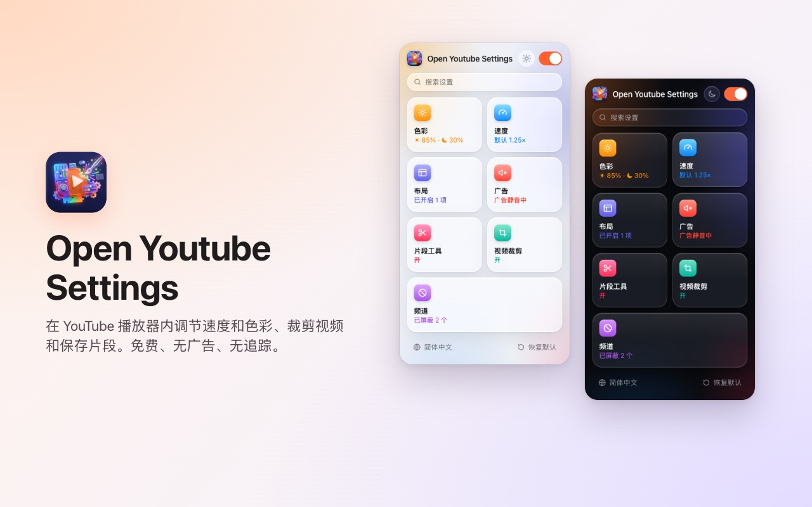
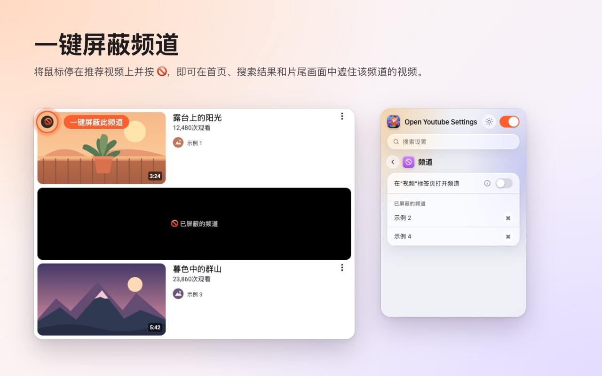
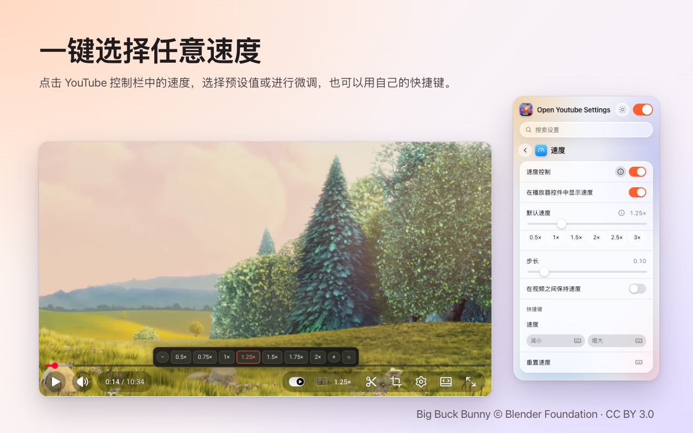
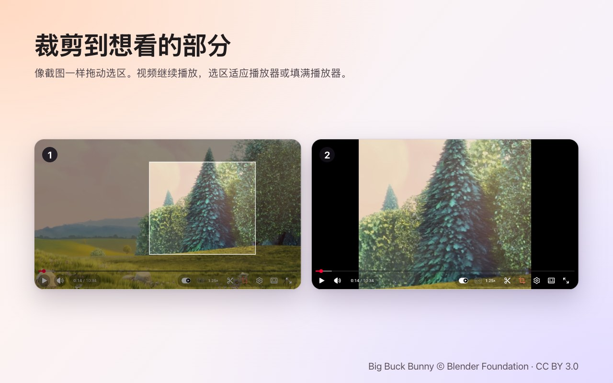
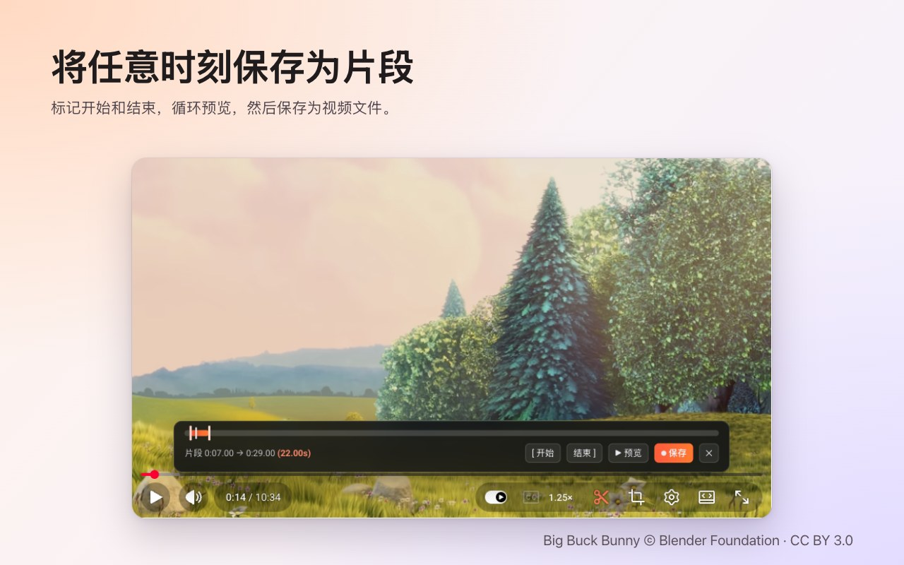

<p align="center">
  
</p>

<h1 align="center">Open Youtube Settings</h1>

<p align="center">
  一键屏蔽 YouTube 频道,还能在播放器里直接调节速度、裁剪画面、截取片段和调整颜色。<br>
  适用于 <b>Chrome</b> 和 <b>Firefox</b> 的免费扩展程序。
</p>

<p align="center">
  ✅ <b>开源</b> &nbsp;·&nbsp; ✅ <b>界面简洁</b> &nbsp;·&nbsp; ✅ <b>不收集数据</b>
</p>

<p align="center">
  <a href="https://chromewebstore.google.com/detail/open-youtube-settings/commphgoijegmlhbkkbgbfbnemihdjod"><b>Chrome 应用商店</b></a> ·
  <a href="../../releases/latest">最新版本</a> ·
  <a href="https://www.youtube.com/watch?v=0iPOj1_EBRU">演示视频</a>
</p>

<p align="center"><sub><a href="README.md">English</a> · <a href="README.tr.md">Türkçe</a> · <a href="README.de.md">Deutsch</a> · <a href="README.es.md">Español</a> · <a href="README.fr.md">Français</a> · <a href="README.it.md">Italiano</a> · <a href="README.pt-BR.md">Português (Brasil)</a> · <a href="README.nl.md">Nederlands</a> · <a href="README.pl.md">Polski</a> · <a href="README.ru.md">Русский</a> · <a href="README.uk.md">Українська</a> · <a href="README.ar.md">العربية</a> · <a href="README.hi.md">हिन्दी</a> · <a href="README.id.md">Bahasa Indonesia</a> · <a href="README.vi.md">Tiếng Việt</a> · <a href="README.th.md">ไทย</a> · <a href="README.ko.md">한국어</a> · <a href="README.ja.md">日本語</a> · <b>简体中文</b> · <a href="README.zh-TW.md">繁體中文</a></sub></p>

<p align="center">
  
</p>

## 为什么选择 Open Youtube Settings

- **开源:** 全部代码都在 GitHub 上,采用 MIT 许可证,任何人都可以确切地检查扩展程序在做什么。
- **界面简洁:** 一个小窗口,加上 YouTube 播放器里的控件。没有弹窗、没有广告、没有付费版。
- **不收集数据:** 没有账号、没有统计、没有服务器。你的设置永远不会离开浏览器。

## 功能

### 一键屏蔽频道
把鼠标移到推荐视频上并点击 🚫。此后该频道的所有视频都会被遮住——首页、搜索结果和片尾画面都一样。随时可以在扩展程序窗口里解除屏蔽。



### 在播放器中调节播放速度
当前速度显示在 YouTube 自己的控制栏里。点击即可选择 0.5× 到 2× 的预设和精细步进,也可以使用自定义快捷键。可以为所有视频设定默认速度,或在视频之间沿用上一次的速度。



### 裁剪任意区域
点击裁剪按钮,像截图一样在视频上拖出一个区域。视频继续播放,可**适应**播放器或**填满**播放器。再次点击按钮即可查看完整视频。视频结束时裁剪随之结束。



### 保存片段
打开片段栏,标记开始和结束,循环预览后保存为视频文件。片段会从你自己的播放画面中实时录制。



### 颜色与蓝光
为每个视频调节亮度、蓝光过滤和颜色反转,并可用快捷键升高或降低。可选择滤镜是否也作用于 Shorts。


### 更清静的 YouTube
- **彻底关闭 Shorts:** 推荐栏、搜索结果、菜单项和频道标签页都会消失;Shorts 链接会以普通视频打开。
- 隐藏首页推荐、侧边栏或播放列表面板。
- 隐藏控制栏以及播放/暂停和快进动画。
- 自动将广告静音;广告一结束声音立即恢复。
- 直接在“视频”标签页打开频道链接。


### 此外
- **一个开关**即可关闭全部功能;在你重新打开之前,YouTube 保持原样。
- 在所有设置中**搜索**。
- 几乎每项设置都有**键盘快捷键**。
- 浅色、深色或自动外观。
- 20 种语言: English, Türkçe, Deutsch, Español, Français, Italiano, Português (Brasil), Nederlands, Polski, Русский, Українська, العربية, हिन्दी, Bahasa Indonesia, Tiếng Việt, ไทย, 한국어, 日本語, 简体中文, 繁體中文.

## 安装

**Chrome / Edge / Brave:** 从 [Chrome 应用商店](https://chromewebstore.google.com/detail/open-youtube-settings/commphgoijegmlhbkkbgbfbnemihdjod) 安装。

**Firefox:** Firefox Add-ons 页面即将上线。在此之前,请按下面的方法从发布版本安装。

**从发布版本安装(手动):** 在 [Releases](../../releases/latest) 下载适合你浏览器的 zip 文件。

- **Chrome / Edge / Brave:** 解压后打开 `chrome://extensions`,开启*开发者模式*,选择*加载已解压的扩展程序*并选中文件夹。
- **Firefox:** 打开 `about:debugging#/runtime/this-firefox`,选择*临时载入附加组件…*并选中 zip 文件。临时附加组件会在 Firefox 重启后移除。

## 隐私

扩展程序不收集任何数据,也不向任何地方发送内容。你的设置保存在浏览器自身的扩展存储中。它只请求 `storage` 权限和对 `youtube.com` 的访问。

## 开发

```bash
npm ci
npm run test:install   # Playwright Chromium and Firefox, once
npm test               # static, Chromium and Firefox tests against an offline YouTube fixture
npm run package        # builds dist/chrome-youtube-settings.zip and dist/firefox-youtube-settings.zip
```

`npm run test:live` 会在真实的 youtube.com 上运行几项快速测试。

### 发布新版本
1. 提高 `manifest.json`(以及 `package.json`)中的 `version`。
2. 推送对应的标签,例如 `git tag v0.9 && git push origin v0.9`。GitHub Actions 会运行测试并发布包含两个 zip 的版本。
3. *Actions → Publish to stores → Run workflow* 会把该版本上传到 Chrome 应用商店和 Firefox Add-ons。

## 许可证

[MIT](LICENSE)。欢迎在 [Issues](../../issues) 中报告问题或提出建议。

---

<sub>截图使用了 <a href="https://peach.blender.org/">Big Buck Bunny</a> © 2008 Blender Foundation,采用 <a href="https://creativecommons.org/licenses/by/3.0/">CC BY 3.0</a> 许可。YouTube 是 Google LLC 的商标;本项目与 Google 无关联,也未获 Google 认可。</sub>
