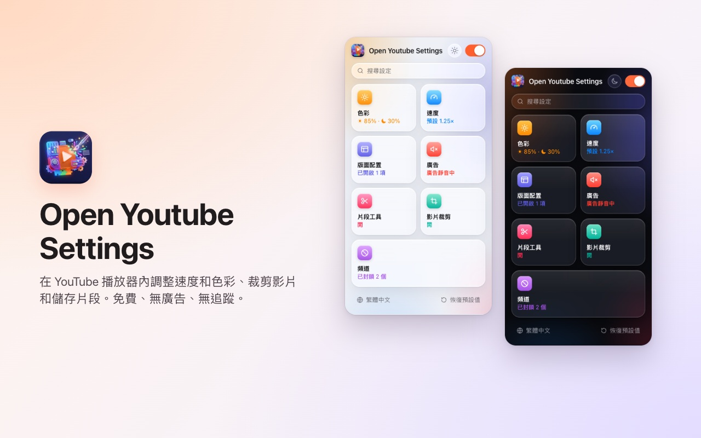
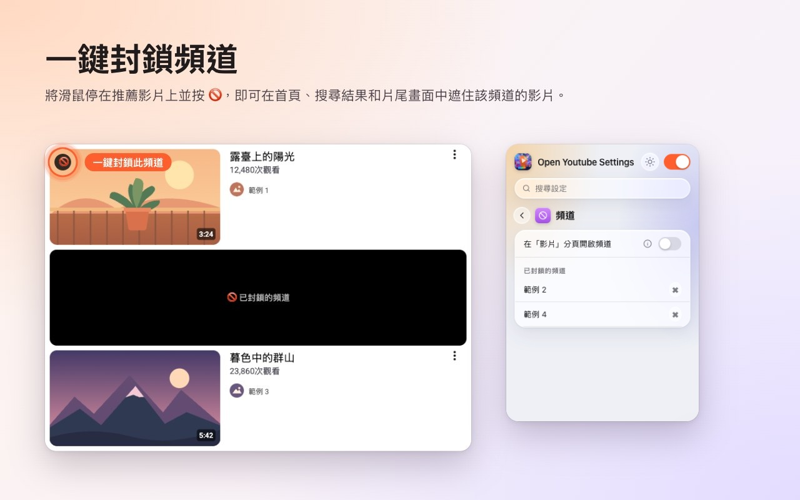
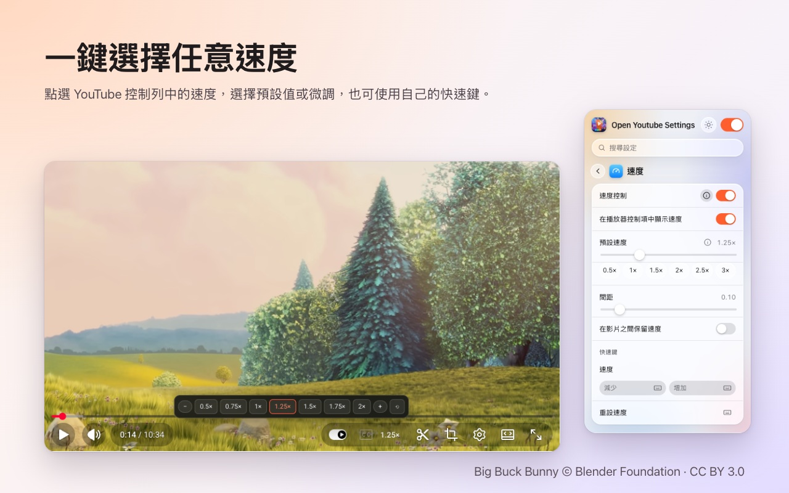
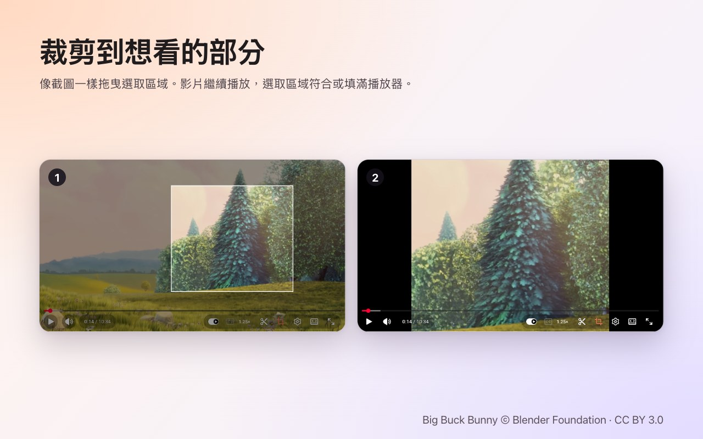
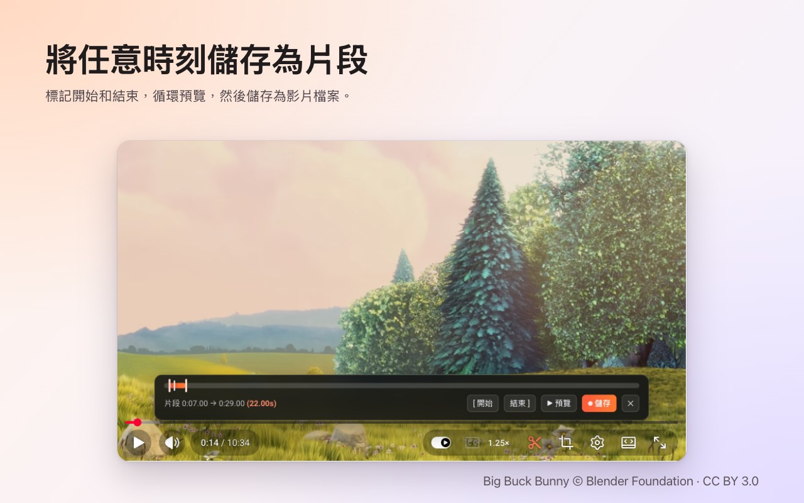

<p align="center">
  
</p>

<h1 align="center">Open Youtube Settings</h1>

<p align="center">
  一鍵封鎖 YouTube 頻道,還能在播放器裡直接調整速度、裁切畫面、擷取片段和調整色彩。<br>
  適用於 <b>Chrome</b> 和 <b>Firefox</b> 的免費擴充功能。
</p>

<p align="center">
  ✅ <b>開放原始碼</b> &nbsp;·&nbsp; ✅ <b>介面簡潔</b> &nbsp;·&nbsp; ✅ <b>不收集資料</b>
</p>

<p align="center">
  <a href="https://chromewebstore.google.com/detail/open-youtube-settings/commphgoijegmlhbkkbgbfbnemihdjod"><b>Chrome 線上應用程式商店</b></a> ·
  <a href="../../releases/latest">最新版本</a> ·
  <a href="https://www.youtube.com/watch?v=0iPOj1_EBRU">示範影片</a>
</p>

<p align="center"><sub><a href="README.md">English</a> · <a href="README.tr.md">Türkçe</a> · <a href="README.de.md">Deutsch</a> · <a href="README.es.md">Español</a> · <a href="README.fr.md">Français</a> · <a href="README.it.md">Italiano</a> · <a href="README.pt-BR.md">Português (Brasil)</a> · <a href="README.nl.md">Nederlands</a> · <a href="README.pl.md">Polski</a> · <a href="README.ru.md">Русский</a> · <a href="README.uk.md">Українська</a> · <a href="README.ar.md">العربية</a> · <a href="README.hi.md">हिन्दी</a> · <a href="README.id.md">Bahasa Indonesia</a> · <a href="README.vi.md">Tiếng Việt</a> · <a href="README.th.md">ไทย</a> · <a href="README.ko.md">한국어</a> · <a href="README.ja.md">日本語</a> · <a href="README.zh-CN.md">简体中文</a> · <b>繁體中文</b></sub></p>

<p align="center">
  
</p>

## 為什麼選擇 Open Youtube Settings

- **開放原始碼:** 所有程式碼都在 GitHub 上,採用 MIT 授權,任何人都能確實檢查擴充功能在做什麼。
- **介面簡潔:** 一個小視窗,加上 YouTube 播放器裡的控制項。沒有彈出視窗、沒有廣告、沒有付費版。
- **不收集資料:** 沒有帳號、沒有分析、沒有伺服器。你的設定永遠不會離開瀏覽器。

## 功能

### 一鍵封鎖頻道
把滑鼠移到推薦影片上並按下 🚫。之後該頻道的所有影片都會被遮住——首頁、搜尋結果和片尾畫面都一樣。隨時可以在擴充功能視窗中解除封鎖。



### 在播放器中調整播放速度
目前速度顯示在 YouTube 自己的控制列上。點一下即可選擇 0.5× 到 2× 的預設和細微間距,也能使用自訂快速鍵。可以為所有影片設定預設速度,或在影片之間沿用上一次的速度。



### 裁切任意區域
按下裁切按鈕,像截圖一樣在影片上拖出一個區域。影片會繼續播放,可**符合**播放器或**填滿**播放器。再按一次按鈕即可看到完整影片。影片結束時裁切也隨之結束。



### 儲存片段
開啟片段列,標記開始和結束,循環預覽後儲存成影片檔。片段會從你自己的播放畫面即時錄製。



### 色彩與藍光
為每部影片調整亮度、藍光濾鏡和色彩反轉,並可用快速鍵調高或調低。可選擇濾鏡是否也套用到 Shorts。


### 更清靜的 YouTube
- **完全關閉 Shorts:** 推薦欄、搜尋結果、選單項目和頻道分頁都會消失;Shorts 連結會以一般影片開啟。
- 隱藏首頁動態、側邊欄或播放清單面板。
- 隱藏控制列以及播放/暫停和快轉動畫。
- 自動將廣告靜音;廣告一結束聲音立即恢復。
- 直接在「影片」分頁開啟頻道連結。


### 此外
- **一個開關**即可關閉全部功能;在你重新開啟之前,YouTube 維持原樣。
- 在所有設定中**搜尋**。
- 幾乎每項設定都有**鍵盤快速鍵**。
- 淺色、深色或自動外觀。
- 20 種語言: English, Türkçe, Deutsch, Español, Français, Italiano, Português (Brasil), Nederlands, Polski, Русский, Українська, العربية, हिन्दी, Bahasa Indonesia, Tiếng Việt, ไทย, 한국어, 日本語, 简体中文, 繁體中文.

## 安裝

**Chrome / Edge / Brave:** 從 [Chrome 線上應用程式商店](https://chromewebstore.google.com/detail/open-youtube-settings/commphgoijegmlhbkkbgbfbnemihdjod) 安裝。

**Firefox:** Firefox Add-ons 頁面即將上線。在那之前,請依照下方方式從發行版本安裝。

**從發行版本安裝(手動):** 在 [Releases](../../releases/latest) 下載適合你瀏覽器的 zip 檔。

- **Chrome / Edge / Brave:** 解壓縮後開啟 `chrome://extensions`,開啟*開發人員模式*,選擇*載入未封裝項目*並選取資料夾。
- **Firefox:** 開啟 `about:debugging#/runtime/this-firefox`,選擇*載入暫用附加元件…*並選取 zip 檔。暫用附加元件會在 Firefox 重新啟動後移除。

## 隱私權

擴充功能不收集任何資料,也不會傳送任何內容到任何地方。你的設定保存在瀏覽器本身的擴充功能儲存空間中。它只要求 `storage` 權限和存取 `youtube.com`。

## 開發

```bash
npm ci
npm run test:install   # Playwright Chromium and Firefox, once
npm test               # static, Chromium and Firefox tests against an offline YouTube fixture
npm run package        # builds both store zips in dist/
```

`npm run test:live` 會在真正的 youtube.com 上執行幾項快速測試。

### 發行新版本
1. 調高 `manifest.json`(以及 `package.json`)中的 `version`。
2. 推送對應的標籤,例如 `git tag v0.13 && git push origin v0.13`。GitHub Actions 會執行測試並發行包含兩個 zip 的版本。
3. *Actions → Publish to stores → Run workflow* 會將該版本上傳到 Chrome 線上應用程式商店和 Firefox Add-ons。

## 授權

[MIT](LICENSE)。歡迎在 [Issues](../../issues) 回報問題或提出建議。

---

<sub>截圖使用了 <a href="https://peach.blender.org/">Big Buck Bunny</a> © 2008 Blender Foundation,採用 <a href="https://creativecommons.org/licenses/by/3.0/">CC BY 3.0</a> 授權。YouTube 是 Google LLC 的商標;本專案與 Google 無關,也未獲 Google 認可。</sub>
